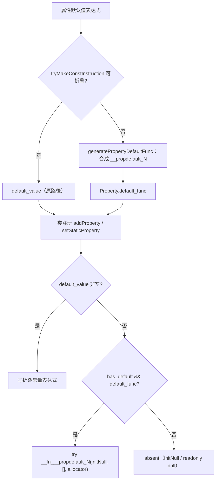
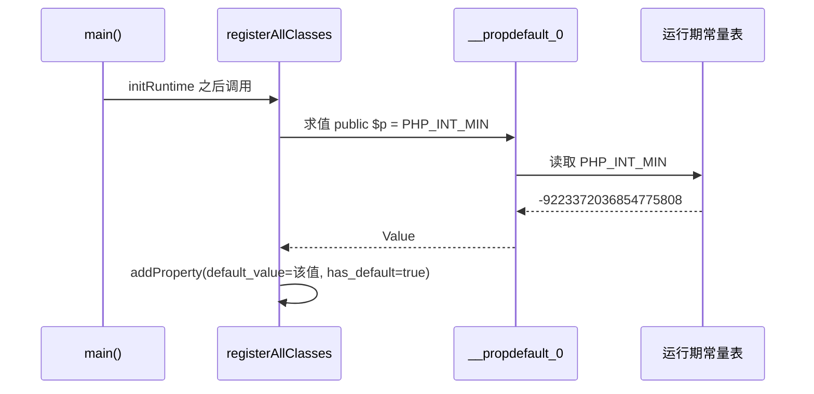

# AOT-CODEGEN-012 R-245：F-73b 属性默认值的构造期求值（PD2 转全绿）

- 日期：2026-10-24（R-245；F-73b 闭环，F-154 新立）
- 代次锚：`nlk 30a4c7363e679e9c02444effa4def235`／`irg 965dbb9f9005bf046ef1d72ef66c7eaa`／`ir e02923dfc85a4c2564dbcf10d35cc8c0`／`tpl f03b46d4…`／`parser 70e80f18…`／`opt 745e4bd4…`（源已提交 `ed878b2`）
- 状态：源已随 `ed878b2` 提交；本文档未跟踪（后补）

## 1. 高层摘要（TL;DR）

属性默认值如果是**全局常量**（`PHP_INT_MIN`、`-PHP_INT_MIN` 等），`tryMakeConstInstruction` 无法编译期折叠（按宪法不从编译器再复制一份常量表），发射器三叉落入 `else ⇒ initNull()`：属性被静默初始化成 NULL，而反射仍声称“有默认值”。本批按工单 §71 既定方案实现**构造期求值**：为不可折叠的默认值合成零参函数，类注册期调用它取值，并让 4 处默认值发射共用同一 helper。

- C291（10 臂）**10/10**；PD2 **19/19、silent_null=0**；P 门红集合与基线一致；主回归 **68/68**。

## 2. 影响范围

| 维度 | 影响 |
|---|---|
| 语义面 | 常量属性默认值（实例/静态/trait/匿名类）与反射 `getDefaultValue()` 对齐 PHP |
| 发射面 | 每个不可折叠默认值新增一个 `__propdefault_<N>` 零参函数；类注册期同步求值 |
| 兼容面 | 字面量/null/数组/类常量/一元二元折叠默认值行为逐字保留（含 trait `array_new=-1` 标记） |
| 未覆盖 | 非法默认值（函数调用等）仍由 parser 拒绝；求值期未定义常量的 fatal 未单列臂 |

## 3. 核心变更

| # | 位置 | 变更 |
|---|---|---|
| 1 | [ir.zig:220](file:///Users/wangjianjun/products/parser/src/aot/ir.zig#L220) | `TypeDef.Property.default_func: ?[]const u8`（与 `default_value` 互斥） |
| 2 | [ir_generator.zig:1578](file:///Users/wangjianjun/products/parser/src/aot/ir_generator.zig#L1578) | `generatePropertyDefaultFunc`：生成 `__propdefault_<N>` 零参函数；清空 `$this`/局部/entry allocas/try-finally 上下文 |
| 3 | `ir_generator.zig` 4 处属性收集 | 折叠失败且声明了默认值 ⇒ 合成函数并写入 `.default_func` |
| 4 | [native_linker.zig:33363](file:///Users/wangjianjun/products/parser/src/aot/native_linker.zig#L33363) | `writePropertyDefaultExpr`：统一折叠值/合成函数/缺省三态；`array_new_marker` 保留 trait 旧口径 |
| 5 | `native_linker.zig` 4 处默认值发射 | 普通属性、普通静态、trait 属性、trait 静态全部改走 helper |
| 6 | `fuzzy_scripts_720/tmp/c291_prop_const_default_gate_tmp.sh` | 新永久侧门 10 臂 |

## 4. 可视化概览（Code & Logic Map）

## 5. 详细变更分析

| 层 | 文件/位置 | 说明 |
|---|---|---|
| IR | `ir.zig` | 仅新增字段，默认 null ⇒ 旧程序零影响 |
| IR 生成 | `ir_generator.zig` | 合成函数在类成员处理期生成；匿名类默认值也安全（清 try/finally） |
| 发射器 | `native_linker.zig` | 一处 helper 覆盖 4 个站点；`absent` 与 marker 语义按站点参数化 |
| 门 | C291 | 实例/静态/反射/trait/匿名/readonly/字面量守卫/类常量/常量表达式/严格判等 |

**关键约束**
- 单实参调用合成函数必须用统一签名：`@"<ident>"(runtime.Value.initNull(), &[_]runtime.Value{}, runtime.runtime_allocator)`。
- 合成函数名经 `fnIdentName` 统一加前缀，用户函数已走 `__fn_` 命名空间（F-147），不冲突。
- **不得**在编译器里复制 PHP 常量表；常量值必须来自运行期唯一表（本方案满足）。
- trait `array_new=-1` 是既有标记口径，统一 helper 时必须保留，否则可能改变 trait 数组属性语义。
- `initRuntime` 必须先于 `registerAllClasses`（现状满足，`native_linker:2340/2488`）。

## 6. 影响与风险评估

| 项 | 结论 |
|---|---|
| 是否破坏式变更 | 无 API 变化；修正静默 NULL 错值 |
| 门 | C291 **10/10**；PD2 **19/19（silent_null=0）**；P **82/6**（红集合 `i1 i2 f12 f34 d6 d9` 与基线一致） |
| 邻居 | C276 12/12、C277 12/12 |
| 主回归 | **PASS=68 FAIL=0**、`SELF_CHECK_OK rows=68 uniq=68`（`c296_regression_R245_tmp.log`） |
| `zig build test` | 21/21 steps、326/326、rc=0（`/tmp/zigtest_R245.log`） |
| 风险 | 低；旧折叠路径逐字保留，新增路径仅覆盖此前“静默 NULL”的形态 |
| 性能 | 每个不可折叠默认值仅在**类注册期**求值一次，运行期属性读取零额外成本 |

**复测路径**：C291（自证 10 CF → 10/10）→ PD2 → P → C276/C277 → 主回归 → `zig build test`。

## 7. 遗留问题 / 潜在问题

1. **F-154（新立，P2）**：转换运算符作用于静态属性时（`(string)Z::$a`），AOT 报 `Undefined constant "Z"`；先赋值再转换可绕过。属共享 parser 优先级问题，跨模式影响面待测，需老铁裁。
2. 求值期未定义常量的 fatal 路径未单列臂（PHP 在类声明期即 Error）。
3. `default_func` 目前只由属性默认值使用；F-118b（形参不可折叠默认值）可复用同一合成函数模式，但调用点注入方式不同，需独立设计。

## 8. 后续开发 / 优化建议

| 优先级 | 建议 | 影响面 | 落地成本 |
|---|---|---|---|
| P1 | F-118b：形参 `new`/不可折叠默认值（复用合成函数模式） | Reflection/参数默认值 | 中高 |
| P2 | F-154：转换运算符＋静态属性优先级（待裁跨模式口径） | 共享 parser | 中 |
| P2 | F-62f-opt 可选参哨兵 | 全可选参族 | 中 |
| P3 | F-145-b legacy MT 序列 | `srand(MT_RAND_PHP)` | 高（缺 PHP 源） |
