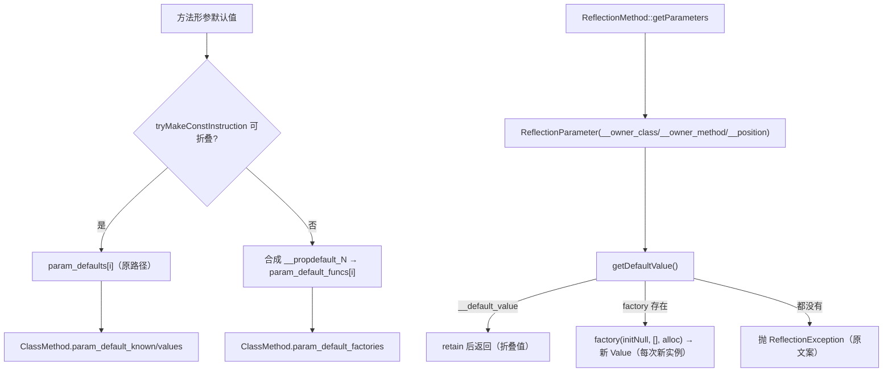
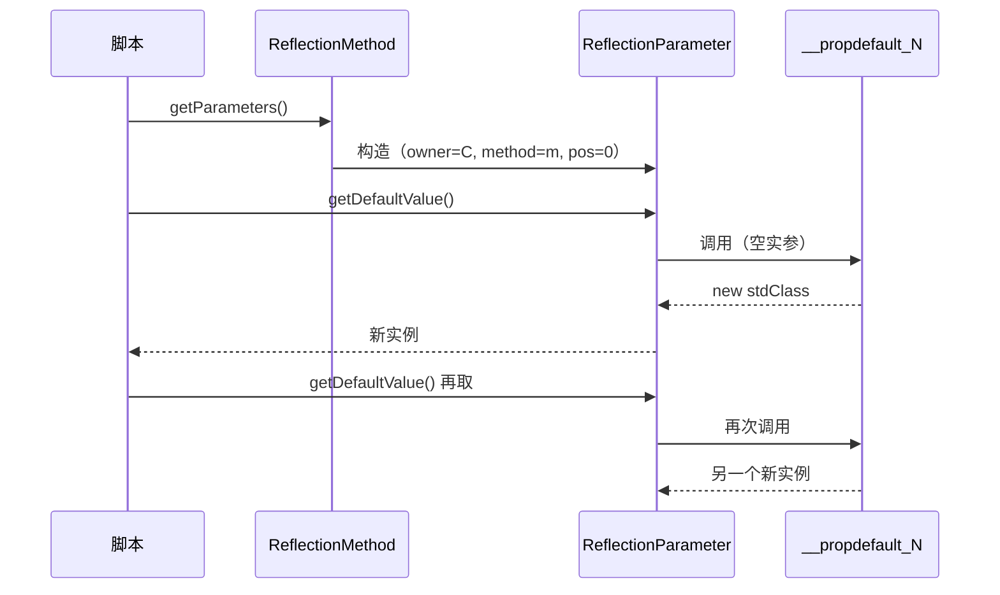

# AOT-CODEGEN-012 R-246：F-118b 方法形参的 `new` 初始化器默认值（反射逐次求值）

- 日期：2026-10-24（R-246；F-118b 闭环，F-155/F-156 新立）
- 代次锚：`nlk cb516ffd9c46887003c003d4528d7981`／`tpl cde4e7ed647fd6fc01d78a7b339bcf26`／`irg 2008cfe49b35ae31592cd44d63fe151b`／`ir bcf6823a6855fb6255856347008d76c2`／`parser 70e80f18…`／`opt 745e4bd4…`（未提交）
- 状态：全部**未提交**

## 1. 高层摘要（TL;DR）

形参默认值若为 `new` 初始化器（PHP 8.1+），调用期早已由函数序言的 `generateExpression` 求值，但**反射**侧 `ReflectionMethod::getParameters()[i]->getDefaultValue()` 仍抛 `Internal error`。本批复用 R-245 的合成零参函数：方法元数据携带每个不可折叠默认值的工厂，反射每次取值时重新调用 —— 与 PHP “每个 `new` 初始化器一份新实例”的语义一致。

- C292（6 臂）**6/6**；P 门 `d9` 转绿（88 臂 `83/5`，零新增）；主回归 **68/68**。

## 2. 影响范围

| 维度 | 影响 |
|---|---|
| 语义面 | 方法（实例/静态/构造器）形参的 `new`/数组含 `new` 默认值在反射中可取值，且每次取值新实例 |
| 发射面 | 新增 `param_default_funcs`（IR）与 `.param_default_factories`（元数据）；仅对不可折叠默认值生成 |
| 调用期 | 不变（仍在函数序言求值，每调用新实例） |
| 未覆盖 | 函数级反射（F-155）、接口方法反射（F-156） |

## 3. 核心变更

| # | 位置 | 变更 |
|---|---|---|
| 1 | [ir.zig:241](file:///Users/wangjianjun/products/parser/src/aot/ir.zig#L241) | `TypeDef.Method.param_default_funcs`（与 `param_defaults` 同序） |
| 2 | [ir_generator.zig:2519](file:///Users/wangjianjun/products/parser/src/aot/ir_generator.zig#L2519) | `getMethodMeta` 增 `class_name`；折叠失败 ⇒ 合成 `__propdefault_<N>` |
| 3 | `native_linker.zig:3390` | 发射 `.param_default_factories = &.{ … }`（全 null 时省略） |
| 4 | [runtime_lib_template.zig:15349](file:///Users/wangjianjun/products/parser/src/aot/runtime_lib_template.zig#L15349) | `ClassMethod.param_default_factories: []const ?MethodFn` |
| 5 | `runtime_lib_template.zig` getParameters | 参数对象记录 `__owner_class`/`__owner_method` |
| 6 | [runtime_lib_template.zig:19435](file:///Users/wangjianjun/products/parser/src/aot/runtime_lib_template.zig#L19435) | `getDefaultValue`：无折叠值时按 owner+pos 调工厂，**每次重新求值** |
| 7 | `fuzzy_scripts_720/tmp/c292_param_new_default_gate_tmp.sh` | 新永久侧门 6 臂 |

## 4. 可视化概览（Code & Logic Map）

## 5. 详细变更分析

| 层 | 文件/位置 | 说明 |
|---|---|---|
| IR | `ir.zig` | 新字段默认空切片，旧程序零影响 |
| IR 生成 | `ir_generator.zig` | `getMethodMeta` 需要 `class_name` 供 `self::` 解析；4 个调用点（类/枚举/trait/匿名）同步 |
| 发射器 | `native_linker.zig` | 仅当存在非空工厂时写字段；函数指针指向生成的 `__fn___propdefault_N` |
| 模板 | `runtime_lib_template.zig` | 元数据字段 + 参数 owner + 按需工厂调用 |
| 门 | C292 | 实例/静态/构造器 + 身份比较 + 调用期 + 无默认值 + 折叠守卫 |

**关键约束**
- 工厂**不得**在类注册期预求值：`new` 默认值必须按“每次 getDefaultValue/每次调用”创建新实例（PHP 实测 `$a === $b` 为 false）。
- `getDefaultValue` 的折叠值分支仍 `retain` 后返回；工厂分支返回新 Value，两者所有权一致。
- trait 组合方法目前走简化注册（无 param_default_* 元数据）⇒ 已登记 F-155，不在本门判据内。

## 6. 影响与风险评估

| 项 | 结论 |
|---|---|
| 是否破坏式变更 | 无 API 变化；调用期默认值路径未改 |
| 门 | C292 **6/6**（自证 6 CF）；P **83/5**（`d9` 转绿，红集合 `i1 i2 f12 f34 d6` 与基线相比零新增） |
| `zig build test` | 21/21 steps、326/326、rc=0（`/tmp/zigtest_R246.log`） |
| 主回归 | **PASS=68 FAIL=0**、`SELF_CHECK_OK rows=68 uniq=68`（`c297_regression_R246_tmp.log`） |
| 风险 | 低；工厂仅影响反射取值，运行期调用默认值保持原实现 |
| 性能 | 反射取值时每次一次空参函数调用（与 PHP 每次创建对象同阶）；常规调用零成本 |

**复测路径**：C292（自证 6 CF → 6/6）→ P（83/5，比对红集合）→ 主回归 → `zig build test`。

## 7. 遗留问题 / 潜在问题

1. **F-155（新立，P2）**：函数级反射默认值元数据缺失——`ReflectionFunction::getParameters()` 对可折叠默认值也不装填 `__default_value`；`new ReflectionParameter('f',0)` 构造路径完全不解析函数元数据；trait 组合方法走简化注册，无 param_default_* 元数据。
2. **F-156（新立，P2）**：接口方法 `ReflectionMethod('I','m')` 报 `Method I::m() does not exist`。
3. 工厂抛出的异常（如 `new` 的类不存在）经反射传播；未单列臂。
4. `isDefaultValueConstant()` 未实现（不在本批范围）。

## 8. 后续开发 / 优化建议

| 优先级 | 建议 | 影响面 | 落地成本 |
|---|---|---|---|
| P2 | F-155：函数级/直接构造/trait 方法的参数元数据统一 | Reflection 参数族 | 中 |
| P2 | F-156：接口方法注册与反射 | Reflection 类族 | 中 |
| P2 | F-154：转换运算符＋静态属性优先级（待裁跨模式） | 共享 parser | 中 |
| P3 | F-62f-opt 可选参哨兵 | 全可选参族 | 中 |
