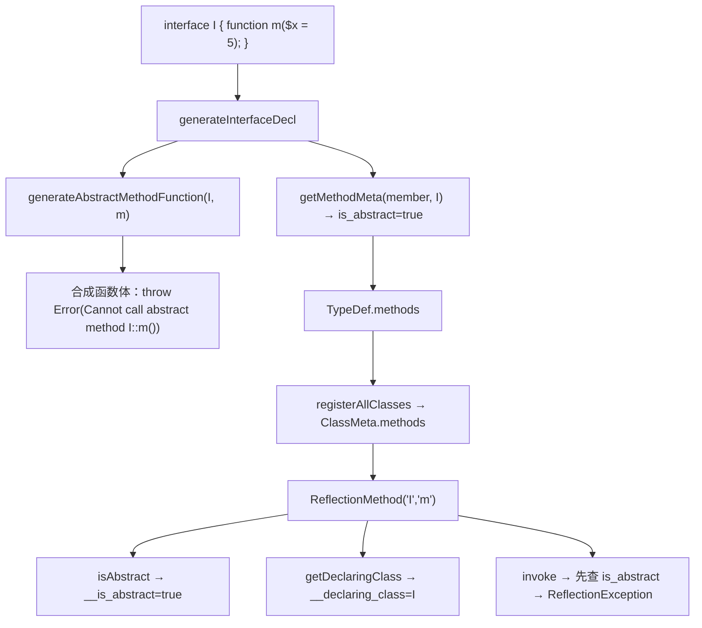
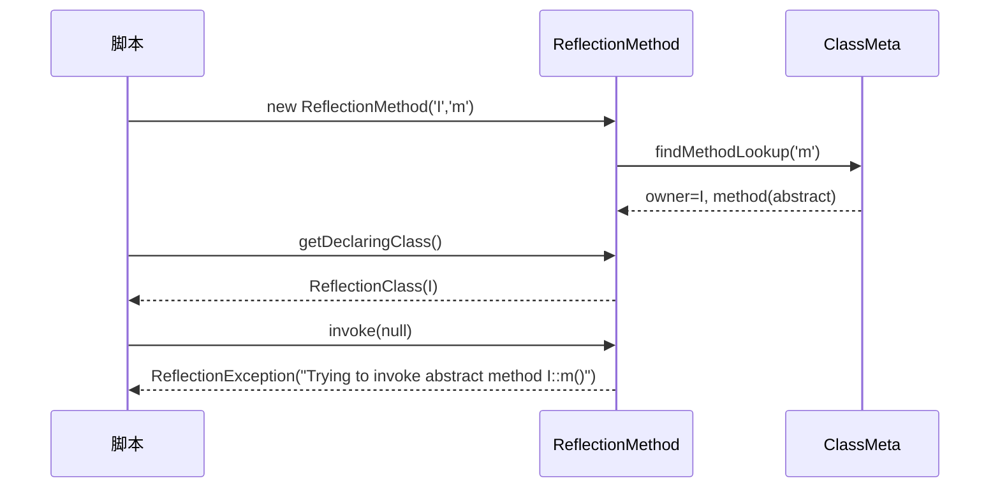

# AOT-CODEGEN-012 R-247：F-156 接口/抽象方法反射

- 日期：2026-10-24（R-247；F-156 闭环，F-156-b 新立）
- 代次锚：`irg a8bd2b75979b4442ee89676362cafc8b`／`tpl 9fee311c257eea3c5b673fa74eaee451`／`nlk cb516ffd…`／`ir bcf6823a…`／`parser 70e80f18…`／`opt 745e4bd4…`（未提交）
- 状态：全部**未提交**

## 1. 高层摘要（TL;DR）

接口声明在 IR 里把 `.methods` 固定为空 ⇒ `ReflectionMethod('I','m')` 必然报 `Method I::m() does not exist`。本批收集接口方法元数据（参数/默认值/静态性/abstract），并为每个方法合成“调用即抛 `Error: Cannot call abstract method X::m()`”的函数体；反射侧补齐方法级 `isAbstract`、`isStatic`、`getDeclaringClass`（继承接口时声明类仍为父接口）与 `invoke` 的抽象拦截。

- C293（7 臂）**7/7**；P 门 **83/5**（红集合零转移）；主回归 **68/68**。

## 2. 影响范围

| 维度 | 影响 |
|---|---|
| 语义面 | 接口/抽象方法可被反射；isAbstract 改为方法级；声明类沿 owner 解析；invoke 抽象抛 ReflectionException |
| 发射面 | 每个接口方法新增一个合成函数 `<Iface>::<m>`（仅抛错，无业务逻辑） |
| 查找面 | `ClassMeta.findMethodLookup` 在父类链之后新增 interfaces 链 |
| 未覆盖 | 直接静态调用 `I::m()` 的异常不可被 try/catch 捕获（F-156-b） |

## 3. 核心变更

| # | 位置 | 变更 |
|---|---|---|
| 1 | [ir_generator.zig:1627](file:///Users/wangjianjun/products/parser/src/aot/ir_generator.zig#L1627) | `generateAbstractMethodFunction`：合成抛 `Error: Cannot call abstract method X::m()` 的函数 |
| 2 | [ir_generator.zig:2145](file:///Users/wangjianjun/products/parser/src/aot/ir_generator.zig#L2145) | 接口成员收集：方法入 `TypeDef.methods` 并强制 `is_abstract=true` |
| 3 | `runtime_lib_template.zig` `findMethodLookup` | 父类链后新增 interfaces 链递归 |
| 4 | [runtime_lib_template.zig:18870](file:///Users/wangjianjun/products/parser/src/aot/runtime_lib_template.zig#L18870) | `ReflectionMethod::__construct` 记录 `__is_abstract`/`__declaring_class` |
| 5 | `runtime_lib_template.zig` `isAbstract` | 优先方法级 `__is_abstract`（修正抽象类具体方法误判） |
| 6 | `runtime_lib_template.zig` `getDeclaringClass` | 优先 `__declaring_class` |
| 7 | [runtime_lib_template.zig:19054](file:///Users/wangjianjun/products/parser/src/aot/runtime_lib_template.zig#L19054) | `invoke` 抽象拦截：`ReflectionException|Trying to invoke abstract method X::m()` |
| 8 | `fuzzy_scripts_720/tmp/c293_interface_method_gate_tmp.sh` | 新永久侧门 7 臂 |

## 4. 可视化概览（Code & Logic Map）

## 5. 详细变更分析

| 层 | 文件/位置 | 说明 |
|---|---|---|
| IR 生成 | `ir_generator.zig` | 接口方法元数据＋合成抛错函数；上下文清空同 R-245/R-246 |
| 模板 | `runtime_lib_template.zig` | 查找链、构造元数据、isAbstract/declaring/invoke 四处 |
| 门 | C293 | 接口/继承/实现类/静态/抽象类/常量守卫 |

**关键约束**
- 接口方法没有函数体，但 `ClassMethod.func` 非可选 ⇒ 必须提供**真实可调用**的抛错函数；禁止空实现或返回 null（会静默错值）。
- `isAbstract` 必须读**方法级**标记；类级 `is_abstract` 会把抽象类的具体方法误报为 true。
- 声明类取 `lookup.owner.name`；接口继承时不能取查询起点接口名。
- `findMethodLookup` 的接口链遍历必须放在父类链之后、CI 扫描之前，保持既有优先级。

## 6. 影响与风险评估

| 项 | 结论 |
|---|---|
| 是否破坏式变更 | 修正既有错误（接口方法反射缺失）；合法程序行为向 PHP 对齐 |
| 门 | C293 **7/7**（自证 7 CF）；P **83/5**（红集合 `i1 i2 f12 f34 d6` 零转移） |
| `zig build test` | 21/21 steps、326/326、rc=0（`/tmp/zigtest_R247.log`） |
| 主回归 | **PASS=68 FAIL=0**、`SELF_CHECK_OK rows=68 uniq=68`（`c298_regression_R247_tmp.log`） |
| 风险 | 低；新增查找仅在精确/父类均 miss 后发生；接口方法函数从不被正常调用路径命中 |
| 性能 | 反射查找多的一个 interfaces 循环（仅 miss 路径）；运行时零成本 |

**复测路径**：C293（自证 7 CF → 7/7）→ P（83/5 比对）→ 主回归 → `zig build test`。

## 7. 遗留问题 / 潜在问题

1. **F-156-b（新立，P2）**：直接静态调用接口方法 `I::m()` 在 PHP 是可捕获 `Error`，AOT 同文案但未捕获 fatal（rc=255）——合成函数 `.throw` 在直接静态分发路径未按调用点 handler 路由。
2. 类实现接口但漏实现方法（PHP 编译期拒绝）的 AOT 行为未单列。
3. 接口方法 attributes/返回类型元数据沿用 `getMethodMeta`，未加专门臂。

## 8. 后续开发 / 优化建议

| 优先级 | 建议 | 影响面 | 落地成本 |
|---|---|---|---|
| P2 | F-155：函数级/直接构造/trait 方法的参数元数据统一 | Reflection 参数族 | 中 |
| P2 | F-156-b：直接静态调用抽象方法的异常路由 | throw 路由族 | 中 |
| P2 | F-154：转换运算符＋静态属性优先级（待裁跨模式） | 共享 parser | 中 |
| P3 | F-62f-opt 可选参哨兵 | 全可选参族 | 中 |
