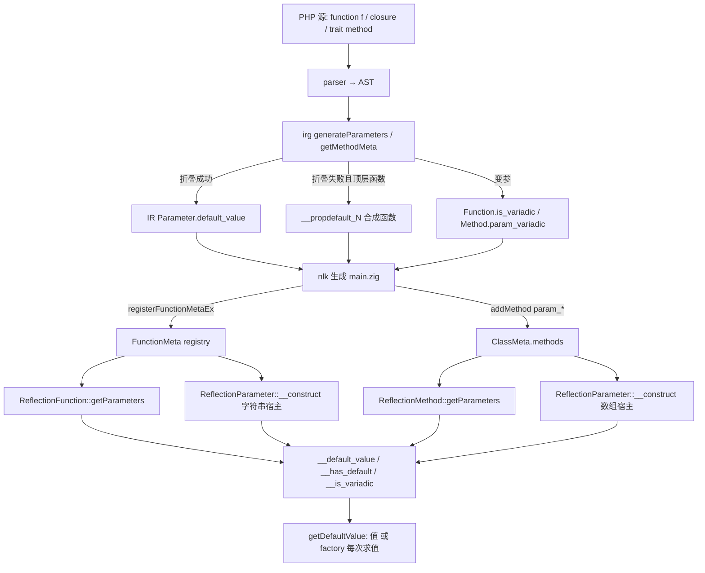
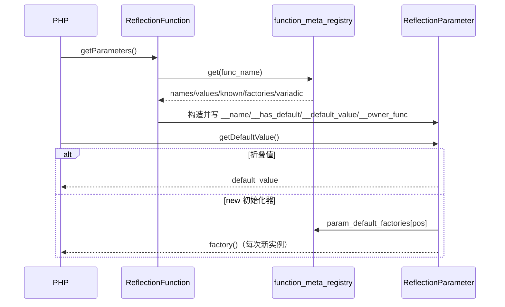

# AOT-CODEGEN-012 R-249：函数级反射形参元数据（F-155）

- 日期：2026-10-24
- 代次锚：`nlk b701caa977e68e016570c9fb10e02ef1`／`tpl 13e737b33fd313c898c876edf9e38acc`／`irg 3e935200b14117cecce8cf788c038d42`／`ir e3d7c4877b42b4c7f823f72fdf0eedca`（均未提交）
- 工单：`docs/known-issues/AOT-CODEGEN-012-class-name-case-insensitive-lookup.md` §156

## 1. 高层摘要（TL;DR）

`ReflectionFunction` 与 `new ReflectionParameter(...)` 从此前"只有参数计数/名字"补齐到 PHP 8.5.8 的形参契约：默认值（可折叠值＋`new` 初始化器工厂）、`isOptional`/`isDefaultValueAvailable`/`isVariadic`、按名定位、四类反射异常文案，并覆盖闭包与 trait 组合方法。新门 C295 9 臂全绿，邻居门零转移。

## 2. 影响范围

| 层 | 影响 |
|---|---|
| IR | `Parameter.default_func`、`Method.param_variadic`（新增字段） |
| IR 生成 | 顶层函数形参合成默认值工厂；方法元数据收集变参位 |
| 运行期模板 | `FunctionMeta`/`PHPClosure`/`ClassMethod` 扩元数据；`ReflectionFunction`/`ReflectionMethod`/`ReflectionParameter`/`getDefaultValue` 六处读取与工厂支 |
| 发射器 | 函数/闭包注册新增 `registerFunctionMetaEx`；方法注册新增 `.param_variadic`；trait 组合方法改用 Full 注册 |
| 语义面 | 反射 API（AOT-only） |

## 3. 核心变更

| # | 变更 | 说明 |
|---|---|---|
| 1 | `FunctionMeta` 扩 4 字段 | 值/可知位/工厂/变参下标；旧入口委托空表 |
| 2 | `generateParameters` 合成工厂 | 仅顶层函数、非闭包、折叠失败时 |
| 3 | 闭包带默认值 | `PHPClosure` 三个切片区＋创建点从 registry 带入 |
| 4 | `__has_default` 判据 | `i >= required_params` 且非变参；**不得**改用 known 位 |
| 5 | 直接构造三宿主 | 函数名、`[类名,方法]`、`[对象,方法]`；含四类异常文案 |
| 6 | trait 组合元数据 | 按 provider trait 的 `TypeDef.Method` 走 Full；可见性/静态性用 adaptation |
| 7 | 方法变参 | `Method.param_variadic` → `ClassMethod.param_variadic` → 反射 |
| 8 | 附带内存修复 | 方法 `getParameters` 两处 owner 字符串 `defer release`；默认值属性去掉多余 retain |

## 4. 可视化概览（Code & Logic Map）

## 5. 详细变更分析

| 文件 | 变更点 |
|---|---|
| `src/aot/ir.zig` | `Parameter.default_func`；`Method.param_variadic` |
| `src/aot/ir_generator.zig` | `generateParameters` 顶层函数工厂合成（闭包排除）；`getMethodMeta` 收集变参位 |
| `src/aot/runtime_lib_template.zig` | `FunctionMeta`/`registerFunctionMetaEx`；`PHPClosure` 元数据；三处反射读取；直接构造三宿主；方法变参；getDefaultValue `__owner_func` 支；refcount 清理 |
| `src/aot/native_linker.zig` | 函数/闭包 Ex 注册；方法 `.param_variadic`；`emitMethodRegistrationFull` override 参数；trait 查找 `findTraitMethodMeta` |
| `fuzzy_scripts_720/tmp/c295_function_param_meta_gate_tmp.sh` | 新门 9 臂（f1–f7、g1–g2） |

## 6. 影响与风险评估

- **破坏式变更**：否。新增元数据字段均有默认值；旧 `registerFunctionMeta` 保持可用。
- **风险点**：`isDefaultValueAvailable` 与 known 位的语义混淆（开发中实测到一次：`new` 默认值被误报 false，已改回 `required_params`＋变参判据）。
- **trait 组合注册**：仅非抽象方法改走 Full；抽象 trait 方法保持简化路径，避免引用不存在的函数。
- **复测路径**：`bash fuzzy_scripts_720/tmp/c295_function_param_meta_gate_tmp.sh`；邻居 `c292/c293/c294/c073/c012`。
- **读数**：C295 9/9（自证 9 CF）／C292 6/6／C293 7/7／C294 7/7／PD2 19/19／P 83/5 零转移／`zig build test` 326/326／主回归 **PASS=68 FAIL=0**。

## 7. 遗留问题

- **F-155-b**：闭包 `new` 初始化器默认值仍不可取（未合成工厂）——实测 `ReflectionException|Internal error`。
- **F-157**：`ReflectionMethod('Child','inherited')->getParameters()` 为空（构造只查自身 `ClassMeta.methods`）——实测 `count=0`。
- 内置函数反射参数名/默认值仍缺（F-12 面）。

## 8. 后续建议

| 优先级 | 建议 | 影响面 | 落地成本 |
|---|---|---|---|
| P2 | 闭包工厂合成（去掉 irg 的闭包排除，闭包注册带 factories） | 闭包反射完整性 | 低 |
| P2 | ReflectionMethod 构造走 `findMethodLookup`，统一继承方法元数据 | 继承反射面 | 低 |
| P3 | 内置函数参数表纳入 registry（按 builtin_map 元数据） | 内置反射面 | 中 |
