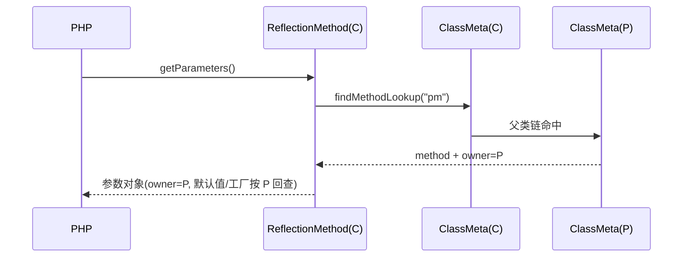

# AOT-CODEGEN-012 R-250：继承方法反射参数元数据（F-157）

- 日期：2026-10-24
- 代次锚：`tpl 3a98c34e8caa615b3b2393f4a9c07ada`；`nlk b701caa9…`／`irg 3e935200…`／`ir e3d7c487…` 未变（均未提交）
- 工单：`docs/known-issues/AOT-CODEGEN-012-class-name-case-insensitive-lookup.md` §157

## 1. 高层摘要（TL;DR）

`ReflectionMethod('子类', '继承方法')->getParameters()` 从恒空补齐为父类声明元数据：名字/optional/avail/默认值/`new` 工厂全部生效。改动仅模板一个查表点＋owner 归属。C296 7 臂全绿，反射门 P 零转移。

## 2. 影响范围

| 层 | 影响 |
|---|---|
| 运行期模板 | `ReflectionMethod::getParameters` 主路径查表与 owner 记录 |
| 反射 API | 继承方法、多级继承、父类 trait 方法、继承构造器、抽象父类方法 |
| IR / 发射器 | 无改动 |

## 3. 核心变更

| # | 变更 | 说明 |
|---|---|---|
| 1 | `methods.get` → `findMethodLookup` | 父类链/接口链统一解析 |
| 2 | owner 取 `lookup.owner.name` / `m.name` | 工厂在声明类元数据里；用查询起点会回查失败 |
| 3 | 默认值/变参沿用 `m.param_*` | 与 R-246/R-249 同一套数组 |

## 4. 可视化概览（Code & Logic Map）

```mermaid
flowchart LR
  A[ReflectionMethod('C','pm') 构造: 存 __class_name=C] --> B[getParameters]
  B --> C{findClass(C)}
  C -->|findMethodLookup| D[lookup: method=m, owner=P]
  D --> E[__name/__position/__has_default/__is_variadic]
  D -->|owner=P, m.name| F[__owner_class/__owner_method]
  F --> G[getDefaultValue: P 的 param_default_values/factories]
  D -->|foldable| H[__default_value]
```



## 5. 详细变更分析

| 文件 | 变更点 |
|---|---|
| `src/aot/runtime_lib_template.zig` | `ReflectionMethod::getParameters`：`findMethodLookup`＋owner 归属修正 |
| `fuzzy_scripts_720/tmp/c296_inherited_method_meta_gate_tmp.sh` | 新门 7 臂（h1–h6、g1） |

## 6. 影响与风险评估

- **破坏式变更**：否；仅影响此前返回空数组的继承方法。
- **正向副作用**：实现类未覆写接口方法时，`ReflectionMethod` 现按接口声明给出参数（PHP 同口径）。
- **风险点**：owner 改成声明类后，`getDefaultValue` 的工厂回查必须按声明类走——本批同时改，否则继承的 `new` 默认值会抛 `Internal error`。
- **复测路径**：`bash fuzzy_scripts_720/tmp/c296_inherited_method_meta_gate_tmp.sh`；邻居 `c292`、`c012`。
- **读数**：C296 7/7（自证 7 CF，41 s）／C292 6/6／P 88 臂 83/5 零转移／`zig build test` 326/326／主回归 **PASS=68 FAIL=0**。

## 7. 遗留问题

- F-155-b：闭包 `new` 初始化器默认值仍不可取（未合成工厂）。
- 方法不存在时 `ReflectionMethod` 构造函数仍不抛异常（既有形态，未在本批）。

## 8. 后续建议

| 优先级 | 建议 | 影响面 | 落地成本 |
|---|---|---|---|
| P2 | 闭包工厂合成（F-155-b） | 闭包反射完整性 | 低 |
| P3 | `ReflectionMethod` 构造期校验方法存在并抛 PHP 文案 | 反射错误面 | 低 |
| P3 | `getDeclaringClass` 在继承方法上复用 `lookup.owner` | 反射归属面 | 低 |
