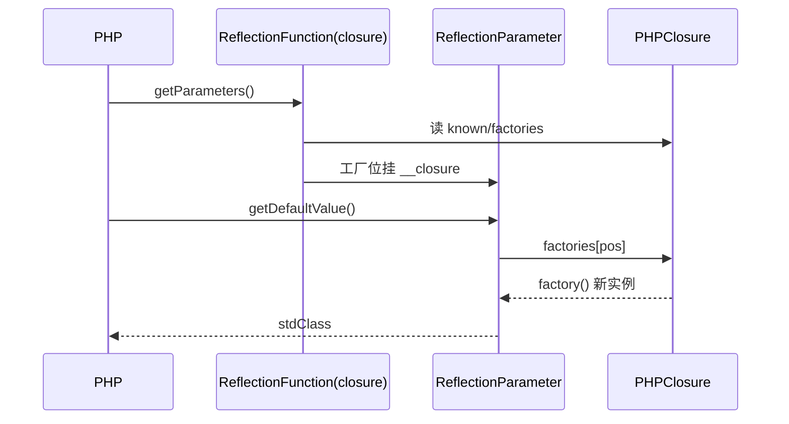

# AOT-CODEGEN-012 R-251：闭包形参 `new` 初始化器默认值（F-155-b）

- 日期：2026-10-24
- 代次锚：`tpl eca42d370be484838a714ebbd99dec4d`／`nlk 05947e99145562f618dc5e3c5d42b563`／`irg cd8e0b7305b509365cc7d095bbdd34ff`／`ir e3d7c487…`（均未提交）
- 工单：`docs/known-issues/AOT-CODEGEN-012-class-name-case-insensitive-lookup.md` §158

## 1. 高层摘要（TL;DR）

闭包形参的不可折叠默认值（`new` 初始化器）此前只能通过函数级元数据取到可折叠值，`getDefaultValue()` 直接抛 `Internal error`。本轮为闭包合成工厂并贯通 registry → PHPClosure → ReflectionParameter → getDefaultValue 四层，`bindTo`/`bind` 派生闭包与类内 `self::CONST` 一并覆盖。顺带登记发射器缺陷 **F-158**（if 体内嵌套三元在 echo 实参位丢值）。

## 2. 影响范围

| 层 | 影响 |
|---|---|
| IR 生成 | 闭包形参折叠失败时合成 `__propdefault_N`（类内保留类上下文） |
| 发射器 | 闭包 `registerFunctionMetaEx` 的工厂数组不再恒空 |
| 运行期模板 | `PHPClosure` 增加工厂切片；创建/派生点带入；反射两个读取点 |
| 语义面 | 闭包反射 API（AOT-only） |

## 3. 核心变更

| # | 变更 | 说明 |
|---|---|---|
| 1 | irg 取消闭包排除 | `generateParameters` 对所有非方法函数合成工厂 |
| 2 | 闭包工厂注册 | `p.default_func` → `&@"__fn___propdefault_N"` |
| 3 | `PHPClosure.param_default_factories` | registry 切片别名；`php_create_closure`/bind 两处带入 |
| 4 | 形参反持闭包 | 仅当该位置有工厂时 `setProperty("__closure", …)` |
| 5 | getDefaultValue 闭包支 | 按 position 调工厂，每次新实例 |
| 6 | 类上下文 | 类内闭包默认值可用 `self::CONST` |

## 4. 可视化概览（Code & Logic Map）

```mermaid
flowchart TD
  A[闭包 $o = new stdClass] --> B[irg generateParameters]
  B -->|折叠失败| C[__propdefault_N 合成函数]
  C --> D[nlk 闭包 registerFunctionMetaEx factories]
  D --> E[FunctionMeta registry]
  E --> F[php_create_closure 带入 PHPClosure.param_default_factories]
  F --> G[bindTo/bind 派生复制]
  F --> H[ReflectionFunction::getParameters]
  H -->|工厂位| I[param.__closure 反持]
  I --> J[ReflectionParameter::getDefaultValue → factory()]
```



## 5. 详细变更分析

| 文件 | 变更点 |
|---|---|
| `src/aot/ir_generator.zig` | `generateParameters` 闭包工厂合成＋类上下文 |
| `src/aot/native_linker.zig` | 闭包 Ex 注册的 factories 数组 |
| `src/aot/runtime_lib_template.zig` | `PHPClosure` 字段、创建/派生带入、getParameters 反持、getDefaultValue 闭包支 |
| `fuzzy_scripts_720/tmp/c297_closure_param_new_gate_tmp.sh` | 新门 5 臂（c1–c5） |

## 6. 影响与风险评估

- **破坏式变更**：否。无工厂的闭包行为不变。
- **引用环风险**：形参对象只在“该位置有工厂”时反持闭包；普通形参不持有。
- **F-158（新登记，P1）**：if 体内嵌套三元在 echo 实参位丢值——与本轮无关，但会导致门脚本出现假红；C297 的 c1 改用 helper 函数（内部顺序 if）规避，并在门头注明。
- **复测路径**：`bash fuzzy_scripts_720/tmp/c297_closure_param_new_gate_tmp.sh`；邻居 `c295`、`c296`、`c292`、`c012`。
- **读数**：C297 5/5（自证 5 CF，27 s）／C295 9/9／C296 7/7／C292 6/6／C012 83/5 零转移（`repo_build_residue=0`）／`zig build test` 326/326／主回归 **PASS=68 FAIL=0**。

## 7. 遗留问题

- **F-158**：嵌套三元在 if 体的表达式位丢值（含吞后续 echo 实参）；需单独审计发射器 merge/phi。
- 内置函数反射参数名/默认值仍缺（F-12 面）。

## 8. 后续建议

| 优先级 | 建议 | 影响面 | 落地成本 |
|---|---|---|---|
| P1 | F-158：if 体内嵌套三元 merge phi 落点审计（与 F-117 同族） | 所有表达式位嵌套三元 | 中 |
| P3 | 内置函数参数表入 registry | 内置反射面 | 中 |
| P3 | 方法不存在时 ReflectionMethod 构造抛 PHP 文案 | 反射错误面 | 低 |
