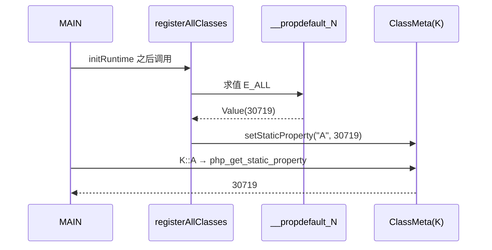

# AOT-CODEGEN-012 R-252：类常量不可折叠初始化器（F-95-c-b）

- 日期：2026-10-24
- 代次锚：`nlk 4f9c54a065b58e949b59bcdcdb6373d1`／`irg 4015f0f5ee68facdfef20449f47d8589`／`ir fb2bb442ca27b98cf1df7e109a240e1f`／`tpl eca42d37…`（均未提交）
- 工单：`docs/known-issues/AOT-CODEGEN-012-class-name-case-insensitive-lookup.md` §159

## 1. 高层摘要（TL;DR）

`const A = E_ALL;` 这类依赖**运行期常量/表达式**的类常量此前根本不会被收集 ⇒ 读取 `K::A` 报 `Access to undeclared static property`（rc=255）。本轮复用属性默认值的合成工厂：收集期折叠失败即生成零参求值函数，类/接口/枚举/trait 注册期调用；同时修掉第二个根因——占位值进入编译期 `constant_cache` 会把读取折叠成 `null`。

## 2. 影响范围

| 层 | 影响 |
|---|---|
| IR | `TypeDef.Constant.default_func`（新增） |
| IR 生成 | 4 个常量收集点；`constant_cache` 构建跳过运行期常量 |
| 发射器 | 类/trait 常量注册点改用工厂调用 |
| 语义面 | 类常量初始化器（AOT-only） |

## 3. 核心变更

| # | 变更 | 说明 |
|---|---|---|
| 1 | `Constant.default_func` | `value` 仅占位；非空即必须运行期求值 |
| 2 | 收集点合成工厂 | 类/接口/枚举/trait 四处；类上下文供 `self::` 解析 |
| 3 | `constant_cache` 跳过 | 占位 `.null` 不得进编译期表（否则读取恒 null） |
| 4 | 注册点工厂调用 | `const cv = try @"__propdefault_N"(...)` 后写静态属性 |
| 5 | trait 常量同口径 | 组合进类时由类注册点求值 |

## 4. 可视化概览（Code & Logic Map）

```mermaid
flowchart TD
  A[const A = E_ALL] --> B[irg evalConstantExprToTypeDef]
  B -->|失败| C[generatePropertyDefaultFunc → __propdefault_N]
  C --> D[TypeDef.Constant{value=.null, default_func}]
  B -->|成功| E[Constant{value} 且入 constant_cache]
  D -->|跳过 cache| F[nlk 注册点: cv = try factory()]
  F --> G[php_set_static_property(K, A, cv)]
  H[读取 K::A] -->|cache 未命中| I[static_property_get]
  I --> G
```



## 5. 详细变更分析

| 文件 | 变更点 |
|---|---|
| `src/aot/ir.zig` | `TypeDef.Constant.default_func` |
| `src/aot/ir_generator.zig` | 4 处收集点工厂合成；`constant_cache` 跳过 `default_func` |
| `src/aot/native_linker.zig` | 类/trait 常量注册点工厂调用 |
| `fuzzy_scripts_720/tmp/c298_class_const_runtime_gate_tmp.sh` | 新门 7 臂（c1–c6、g1） |

## 6. 影响与风险评估

- **破坏式变更**：否；可折叠常量路径与缓存行为不变。
- **关键陷阱（本轮实测）**：修好收集后仍全空——占位 `.null` 被缓存进 `constant_cache`，读取折叠成 null。任何“占位值 + 运行期回填”的设计都必须同时封闭编译期缓存。
- **复测路径**：`bash fuzzy_scripts_720/tmp/c298_class_const_runtime_gate_tmp.sh`；邻居 `c073`、`c291`、`c012`。
- **读数**：C298 7/7（自证 7 CF，36 s）／C073 19/19／C291 10/10／C012 83/5 零转移（清理调试目录后 residue=0）／`zig build test` 326/326／主回归 **PASS=68 FAIL=0**。

## 7. 遗留问题

- **F-159**：直接读取 trait 常量 `T::A` 应 fatal（PHP `Cannot access trait constant T::A directly`），AOT 返回组合值。
- **F-160**：`constant('K::A')` 不解析类常量（foldable 也 fatal），PHP 返回常量值。
- 前向引用常量（`const A = self::B; const B = ...;`）按注册顺序求值，可能读到未注册值（未建臂）。

## 8. 后续建议

| 优先级 | 建议 | 影响面 | 落地成本 |
|---|---|---|---|
| P2 | F-160：`constant()` 解析 `C::NAME`（复用 static_properties/可见性） | 常量反射面 | 低 |
| P2 | F-159：trait 常量直接读取的 fatal 文案 | 常量可见性 | 低 |
| P3 | 常量初始化器拓扑排序（前向引用） | 类常量完整性 | 中 |
