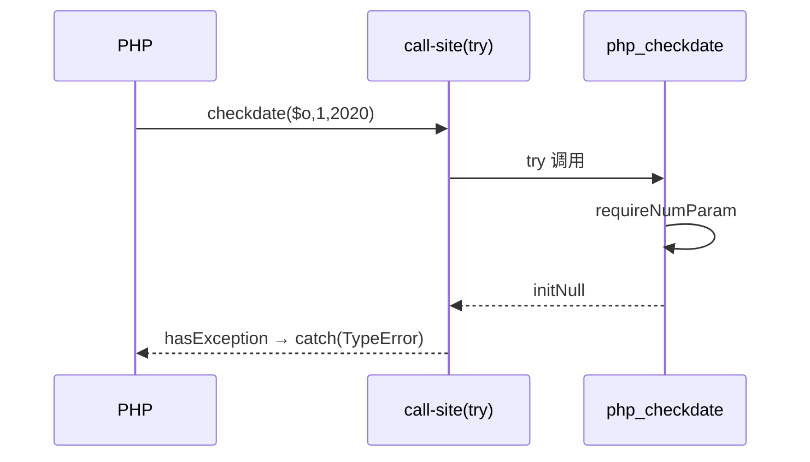

# AOT-CODEGEN-012 R-253：checkdate 形参契约与 `.may_raise` 配套（F-128）

- 日期：2026-10-24
- 代次锚：`nlk aef85ac8520e0a806d3132a533a1d921`／`tpl 3698a257bda04310229a94dac4263ee6`；`irg 4015f0f5…`／`ir fb2bb442…` 未变（均未提交）
- 工单：`docs/known-issues/AOT-CODEGEN-012-class-name-case-insensitive-lookup.md` §160

## 1. 高层摘要（TL;DR）

`checkdate()` 的 3 枚 `int` 形参此前不做类型校验（静默 `toInt()`），且注册表 `.may_raise=false` 使 helper 异常无法在调用点路由。本轮按 §104.5 普查结论（48 枚条目中恰此 1 枚会抛）做**两文件配套**修复：模板签名改 `!Value` + 三枚 `requireNumParam`，注册表翻 `may_raise=true`。BLT b170–b172 由红转绿，反向守卫不动。

## 2. 影响范围

| 层 | 影响 |
|---|---|
| 运行期模板 | `php_checkdate` 签名与三枚形参契约 |
| 发射器 | `checkdate` 注册表条目 `may_raise` 单枚翻转 |
| 语义面 | 内置函数形参 TypeError（AOT） |

## 3. 核心变更

| # | 变更 | 说明 |
|---|---|---|
| 1 | `php_checkdate` → `!Value` | 与 `may_raise=true` 配套（缺一即编译期错或异常不路由） |
| 2 | 三枚 `requireNumParam` | 复用 F-62f 统一 weak 口径；消息逐字合 PHP |
| 3 | `.may_raise = true` | 只翻 checkdate 一枚，依据两遍普查 |

## 4. 可视化概览（Code & Logic Map）

```mermaid
flowchart TD
  A[checkdate(o,1,2020)] --> B[nlk builtin_map: may_raise=true]
  B --> C[发射点 try @"php_checkdate"(...)]
  C --> D[php_checkdate: requireNumParam #1]
  D -->|拒绝| E[throwThrowable TypeError + initNull]
  E --> F[调用点 hasException → PHP catch]
  D -->|通过| G[#2/#3 同理]
  G --> H[值域判定 → bool]
```



## 5. 详细变更分析

| 文件 | 变更点 |
|---|---|
| `src/aot/runtime_lib_template.zig` | `php_checkdate` 签名与三枚 `requireNumParam` |
| `src/aot/native_linker.zig` | `checkdate` 条目 `.may_raise = true` |
| BLT（既有门 c047） | 子集 b168–b178 覆盖本批与守卫，无需新门 |

## 6. 影响与风险评估

- **破坏式变更**：否；`checkdate` 的合法值与值域结果不变。
- **配套约束**：签名与旗必须同批；只改一处会产生“编译期错”或“异常不路由”两种病态。
- **复测路径**：`ONLY="b168 b169 b170 b171 b172 b173 b174 b175 b176 b177 b178" bash fuzzy_scripts_720/tmp/c047_builtin_numeric_object_gate_tmp.sh`。
- **读数**：BLT 子集 11/11 SAME（`aot_caught=8`、`zig_escape=0`）；探针逐字节 SAME；`zig build test` 326/326；主回归 **PASS=68 FAIL=0**。

## 7. 遗留问题

- F-62f 余量（31 函数／45 行）仍开；每接一枚 `.may_raise=false` 条目都需重跑 `c207`+`c208` 普查。
- 显式 `null` 与省略不可区分（F-62f-opt）。

## 8. 后续建议

| 优先级 | 建议 | 影响面 | 落地成本 |
|---|---|---|---|
| P2 | 按 `c207/c208` 结论继续接线 F-62f 余量（逐枚真值定档） | 内置形参契约 | 中 |
| P3 | `.may_raise` 与签名的一致性做成编译期静态检查 | 发射器防回归 | 低 |
| P3 | F-62f-opt：可达的“省略 vs 显式 null”哨兵 | 可选参语义 | 中 |
