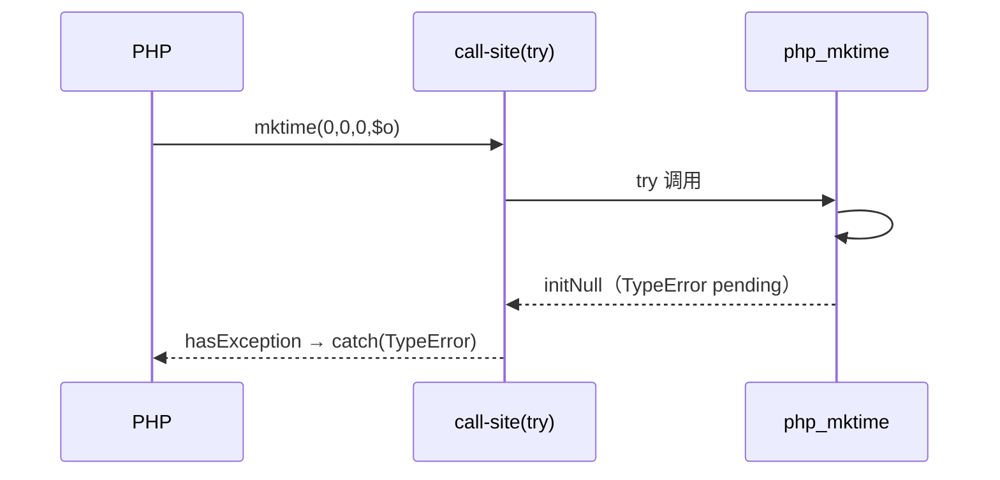

# AOT-CODEGEN-012 R-254：时间族 `?int` 形参契约（F-62f 余量）

- 日期：2026-10-24
- 代次锚：`nlk 555e8ee0b6c99c1b15da16c55b27b25e`／`tpl b983633e661a0c2b118933a3967d5ec3`；`irg 4015f0f5…`／`ir fb2bb442…` 未变（均未提交）
- 工单：`docs/known-issues/AOT-CODEGEN-012-class-name-case-insensitive-lookup.md` §161

## 1. 高层摘要（TL;DR）

`mktime` 的 6 个形参与 `getdate`/`idate` 的时间戳形参在 AOT 只做 `toInt()`，对象被静默折算。本轮按 F-62f 既有 helper 接线 `.int_param`（#1）与 `.nullable_int_param`（其余），并同步 `may_raise=true`；对象/数组槽改为可捕获 TypeError，null 与 weak 形语义原样保留。

## 2. 影响范围

| 层 | 影响 |
|---|---|
| 运行期模板 | `php_mktime` 签名＋6 槽、`php_getdate` #1、`php_idate` #2 |
| 发射器 | `mktime`/`getdate`/`idate` 三条 `may_raise=true` |
| 语义面 | 内置时间函数形参（AOT） |

## 3. 核心变更

| # | 变更 | 说明 |
|---|---|---|
| 1 | `php_mktime` → `!Value` | #1 `.int_param`；#2–#6 `.nullable_int_param` |
| 2 | getdate/idate 校验 | `.nullable_int_param`；null ⇒ 当前时间不变 |
| 3 | 三枚 `may_raise=true` | r152 配套（旗与签名同批） |
| 4 | null 路径不动 | 取当前分量/当前时间语义保持 |

## 4. 可视化概览（Code & Logic Map）

```mermaid
flowchart TD
  A[mktime(o,0,0,1,1,2020)] --> B[nlk may_raise=true]
  B --> C[try @"php_mktime"(...)]
  C --> D[#1 requireOptionalNumParam .int]
  D -->|对象/数组| E[TypeError pending → 调用点 catch]
  D -->|null| F[原语义：hour=0 / 其余取当前分量]
  D -->|合法| G[值域归一化 → int]
```



## 5. 详细变更分析

| 文件 | 变更点 |
|---|---|
| `src/aot/runtime_lib_template.zig` | `php_mktime`/`php_getdate`/`php_idate` 形参校验 |
| `src/aot/native_linker.zig` | 三条注册表 `.may_raise = true` |
| `fuzzy_scripts_720/tmp/c299_time_param_contract_gate_tmp.sh` | 新门 5 臂 |

## 6. 影响与风险评估

- **破坏式变更**：否；null/弱模式与固定时间戳值不变。
- **配套约束**：`!Value` 与 `may_raise=true` 同批（r152）。
- **复测路径**：`bash fuzzy_scripts_720/tmp/c299_time_param_contract_gate_tmp.sh`；邻居 BLT `b183`、`c264`、`c265`。
- **读数**：C299 5/5（自证 5 CF，27 s）／BLT b183 1/1／C264 19/0/1／C265 7/7／`zig build test` 326/326／主回归 **PASS=68 FAIL=0**。

## 7. 遗留问题

- `mktime #1` 显式 null 的 Passing-null Deprecated 未发（F-62f-opt：省略与显式 null 不可区分）。
- F-62f 余量仍含 `array|string`／`array`／`string|int|null` 等族，需逐枚真值定档。

## 8. 后续建议

| 优先级 | 建议 | 影响面 | 落地成本 |
|---|---|---|---|
| P2 | F-62f 下一批：`substr_replace`/`range` 的联合类型槽 | 内置形参契约 | 中 |
| P2 | F-62f-opt：省略 vs 显式 null 哨兵 | 可选参语义 | 中 |
| P3 | `may_raise` 与签名的编译期静态检查 | 发射器防回归 | 低 |
