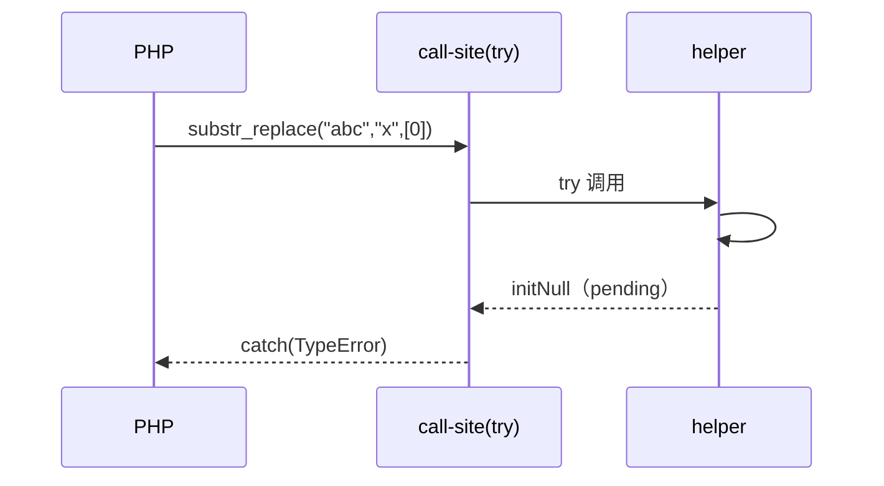

# AOT-CODEGEN-012 R-255：range / substr_replace 联合类型形参（F-62f 余量）

- 日期：2026-10-24
- 代次锚：`nlk 3ef02637cfda03d32234e57c751a8f9c`／`tpl dab046c1b94badd9d0cf129d7eccf2c6`；`irg 4015f0f5…`／`ir fb2bb442…` 未变（均未提交）
- 工单：`docs/known-issues/AOT-CODEGEN-012-class-name-case-insensitive-lookup.md` §162

## 1. 高层摘要（TL;DR）

`range` 的 `string|int|float` / `int|float` 槽与 `substr_replace` 的 `array|string` / `array|int(|null)` 槽此前无类型校验，对象被静默折算。本轮新增三个联合槽 helper，按 PHP 文案拒绝对象，并补上「单字符串 + 数组 offset/length」的专用 TypeError；null/weak 与合法值语义不变。

## 2. 影响范围

| 层 | 影响 |
|---|---|
| 运行期模板 | `php_range` 三槽、`php_substr_replace` 四槽 + 两条专用文案 |
| 发射器 | `range`/`substr_replace` 两条 `may_raise=true` |
| 语义面 | 内置联合类型形参（AOT） |

## 3. 核心变更

| # | 变更 | 说明 |
|---|---|---|
| 1 | `requireArrayOrStringParam` | `array|string` 联合槽 |
| 2 | `requireRangeBoundParam` | `string|int|float` 联合槽 |
| 3 | `requireArrayOrIntParam` | `array|int` / `array|int|null` 联合槽 |
| 4 | 单字符串 + 数组 offset/length | PHP 专用 TypeError 文案 |
| 5 | 两条 `may_raise=true` | r152 配套 |

## 4. 可视化概览（Code & Logic Map）

```mermaid
flowchart TD
  A[range(o,3) / substr_replace('abc','x',o)] --> B[nlk may_raise=true]
  B --> C[try 调用]
  C --> D[联合槽 helper]
  D -->|对象| E[rejectParamType → TypeError pending]
  E --> F[调用点 hasException → catch]
  D -->|合法/weak/null| G[原实现路径]
```



## 5. 详细变更分析

| 文件 | 变更点 |
|---|---|
| `src/aot/runtime_lib_template.zig` | 三个 helper；`php_range`/`php_substr_replace` 校验 |
| `src/aot/native_linker.zig` | 两条注册表 `.may_raise = true` |
| `fuzzy_scripts_720/tmp/c300_union_param_contract_gate_tmp.sh` | 新门 4 臂 |

## 6. 影响与风险评估

- **破坏式变更**：否；合法值/null/weak 口径保持不变。
- **未知面**：数组形 `substr_replace`（F-162）与浮点步长 `range`（F-163）未实现，本批只负责类型契约。
- **复测路径**：`bash fuzzy_scripts_720/tmp/c300_union_param_contract_gate_tmp.sh`；邻居 `c299`。
- **读数**：C300 4/4（自证 4 CF，26 s）／C299 5/5／`zig build test` 326/326。

## 7. 遗留问题

- **F-162**：`substr_replace` 数组形未实现（PHP 返回逐元素结果）。
- **F-163**：`range` 浮点步长被当 1。
- 显式 null 的 Passing-null Deprecated（F-62f-opt）。

## 8. 后续建议

| 优先级 | 建议 | 影响面 | 落地成本 |
|---|---|---|---|
| P2 | F-163：`range` 浮点步长（含精度与包含端点） | 数值迭代 | 低-中 |
| P2 | F-162：`substr_replace` 数组形语义 | 字符串族 | 中 |
| P3 | F-62f 剩余族（password_* options/algo、preg_replace 联合槽） | 内置形参契约 | 中 |
