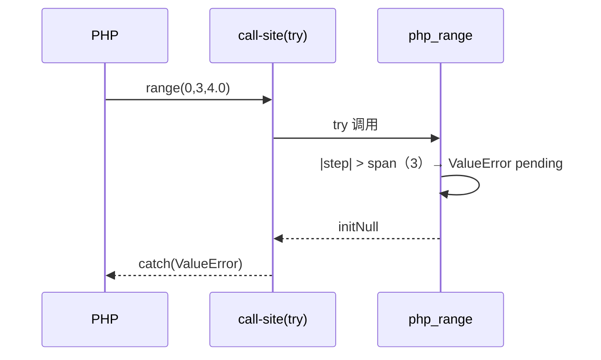

# AOT-CODEGEN-012 R-256：range 浮点步长与 ValueError 契约（F-163）

- 日期：2026-10-24
- 代次锚：`tpl da3654bee5bc0c27c9ebb52ce191400b`；`nlk 3ef02637…`／`irg 4015f0f5…`／`ir fb2bb442…` 未变（均未提交）
- 工单：`docs/known-issues/AOT-CODEGEN-012-class-name-case-insensitive-lookup.md` §163

## 1. 高层摘要（TL;DR）

`range` 的浮点步长此前被当作 1（只认 `isInt`），非法步长（0、升序负步长、超过跨度）也被静默夹取。本轮按 PHP 8.5.8 实测重建：三类 ValueError、整值步长走整数路径、浮点步长用 `start + i*step` **乘法式**取值（末位值与 PHP 一致）、降序正负步长等价。

## 2. 影响范围

| 层 | 影响 |
|---|---|
| 运行期模板 | `php_range` 数值分支 |
| 语义面 | range 元素类型/值/错误（AOT） |

## 3. 核心变更

| # | 变更 | 说明 |
|---|---|---|
| 1 | 步长归一 f64 | 校验顺序：0 → 升序负步长 → `|step|>span`（span>0） |
| 2 | 整数路径条件 | 整型边界 + 整值步长（含 bool→1） |
| 3 | 浮点路径 | 乘法式 `start ± i*step`，端点含入按浮点比较 |
| 4 | 等值边界 | `span==0` 跳过跨度检查，单元素 |
| 5 | 字符范围 | 保持在校验之前（原语义） |

## 4. 可视化概览（Code & Logic Map）

```mermaid
flowchart TD
  A[range(start,end,step)] --> B[联合槽校验 R-255]
  B --> C{字符单字符范围?}
  C -->|是| D[原字符分支]
  C -->|否| E[步长归一 f64]
  E --> F[step==0 → ValueError]
  E --> G[升序且 step<0 → ValueError]
  E --> H[|step|>span 且 span>0 → ValueError]
  H --> I{整型边界 且 整值步长?}
  I -->|是| J[整数循环]
  I -->|否| K[浮点乘法循环 start ± i*step]
```



## 5. 详细变更分析

| 文件 | 变更点 |
|---|---|
| `src/aot/runtime_lib_template.zig` | `php_range` 数值分支重建 |
| `fuzzy_scripts_720/tmp/c301_range_float_step_gate_tmp.sh` | 新门 5 臂 |

## 6. 影响与风险评估

- **破坏式变更**：对非法步长由「静默夹取」改为 PHP 同款 ValueError（方向正确）；合法整数 range 结果不变。
- **关键点**：浮点末位值必须用乘法而非累加（PHP 实测 `range(1,0,0.3)` 末值 `0.10000000000000009`）。
- **复测路径**：`bash fuzzy_scripts_720/tmp/c301_range_float_step_gate_tmp.sh`；邻居 `c300`。
- **读数**：C301 5/5（自证 5 CF，27 s）／C300 4/4／`zig build test` 326/326／主回归 **PASS=68 FAIL=0**。

## 7. 遗留问题

- **F-164**：数值字符串边界 `range("1","3")` 应返回字符串元素，AOT 返回 int。
- 字符范围 + 浮点步长（PHP Warning + `[0.0]`）未处理。
- null 步长省略/显式不可区分（F-62f-opt）。

## 8. 后续建议

| 优先级 | 建议 | 影响面 | 落地成本 |
|---|---|---|---|
| P2 | F-164：数值字符串边界的字符串元素路径 | range 值语义 | 低 |
| P2 | F-162：substr_replace 数组形 | 字符串族 | 中 |
| P3 | 字符范围浮点步长的 Warning/边界行为 | range 边角 | 低 |
