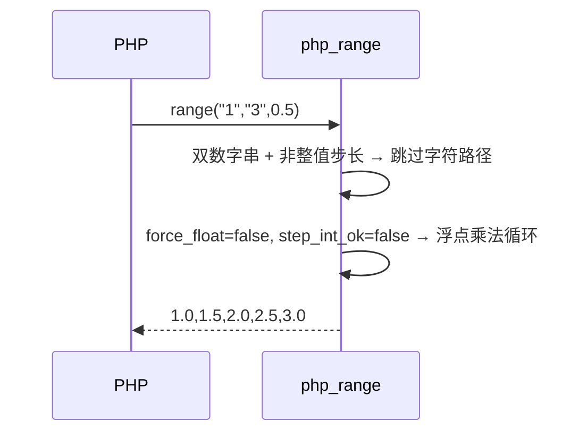

# AOT-CODEGEN-012 R-257：range 数值字符串边界与输出类型（F-164）

- 日期：2026-10-24
- 代次锚：`tpl 20d18a37cf8c941bc1dd10f13e597aab`；`nlk 3ef02637…`／`irg 4015f0f5…`／`ir fb2bb442…` 未变（均未提交）
- 工单：`docs/known-issues/AOT-CODEGEN-012-class-name-case-insensitive-lookup.md` §164

## 1. 高层摘要（TL;DR）

`range` 的字符串边界此前一律按 `toInt()` 走整数路径。本轮按 PHP 实测拆出三种边界：单字节数字串走字符路径（字符串元素）、多字节整数字符串/混合形走整数路径、浮点字符串走浮点路径；双数字串 + 浮点步长不再误落字符路径。

## 2. 影响范围

| 层 | 影响 |
|---|---|
| 运行期模板 | `php_range` 字符/数值路径选择与 `force_float` 判定 |
| 语义面 | range 字符串边界的元素类型与值（AOT） |

## 3. 核心变更

| # | 变更 | 说明 |
|---|---|---|
| 1 | `rangeStringBoundKind()` | `int_string` / `float_string` / `not_numeric`（整串数值判定） |
| 2 | 字符路径门控 | 双数字串 + 非整值步长 ⇒ 走数值浮点；整值步长仍字符路径 |
| 3 | `force_float` | 浮点边界或浮点字符串 ⇒ float 元素；否则 int |
| 4 | 步长预计算上移 | `step_f/step_integral` 在字符分支前算好 |

## 4. 可视化概览（Code & Logic Map）

```mermaid
flowchart TD
  A[range(start,end,step)] --> B[联合槽/步长校验]
  B --> C{双单字节串?}
  C -->|是| D{双数字串 且 非整值步长?}
  D -->|否| E[字符路径 → 字符串元素]
  D -->|是| F[数值路径]
  C -->|否| F
  F --> G{float 边界/浮点串?}
  G -->|是| H[浮点乘法循环]
  G -->|否| I[整数循环（含 "01" 与混合形）]
```



## 5. 详细变更分析

| 文件 | 变更点 |
|---|---|
| `src/aot/runtime_lib_template.zig` | `RangeBoundKind`/`rangeStringBoundKind`；字符门控；`force_float` |
| `fuzzy_scripts_720/tmp/c302_range_string_bound_gate_tmp.sh` | 新门 3 臂 |

## 6. 影响与风险评估

- **破坏式变更**：数值字符串边界的元素类型与 PHP 对齐；整数/字符/浮点步长面由 C301 守卫复证。
- **边角未处理**：多字节非数字串与空串（PHP Warning + 特殊强转）保持旧路径；字符范围 + 浮点步长仍为已知边角。
- **复测路径**：`bash fuzzy_scripts_720/tmp/c302_range_string_bound_gate_tmp.sh`；邻居 `c301`。
- **读数**：C302 3/3（自证 3 CF，14 s）／C301 5/5／`zig build test` 326/326／主回归 **PASS=68 FAIL=0**。

## 7. 遗留问题

- 多字节非数字串/空串的 Warning 与强转边角（无门臂）。
- 字符范围 + 浮点步长（R-256 边界）。

## 8. 后续建议

| 优先级 | 建议 | 影响面 | 落地成本 |
|---|---|---|---|
| P2 | F-162：`substr_replace` 数组形 | 字符串族 | 中 |
| P3 | range 非数字多字节串/空串的 Warning 边角 | range 边角 | 低 |
| P3 | F-62f 剩余族（password_* options/algo、preg_replace 联合槽） | 内置形参契约 | 中 |
