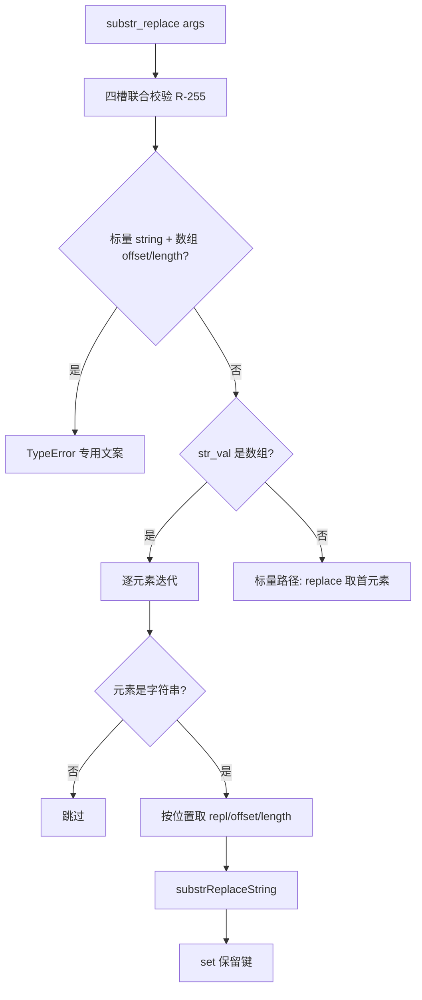
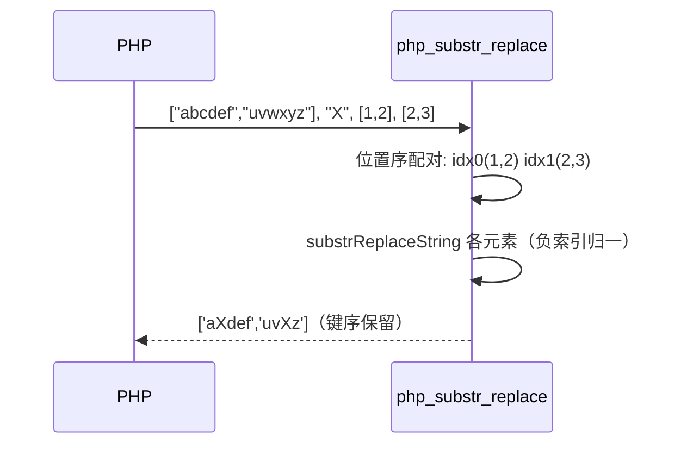

# AOT-CODEGEN-012 R-258：substr_replace 数组形语义（F-162）

- 日期：2026-10-24
- 代次锚：`tpl f9449afc47a53c3332b3c4d332c5a03e`；`nlk 3ef02637…`／`irg 4015f0f5…`／`ir fb2bb442…` 未变（均未提交）
- 工单：`docs/known-issues/AOT-CODEGEN-012-class-name-case-insensitive-lookup.md` §165

## 1. 高层摘要（TL;DR）

`substr_replace` 此前对数组形 `$string` 直接返回 NULL，且数组 `$replace/$offset/$length` 只有标量解释。本轮按 PHP 8.5.8 实测实现数组形：数组 `$string` 逐元素替换并**保留键**；`$replace/$offset/$length` 按**位置序**与元素配对，缺位分别回落 `""` / 0 / 剩余全段；标量 `$string` + 数组 `$replace` 取**首元素**。

## 2. 影响范围

| 层 | 影响 |
|---|---|
| 运行期模板 | `php_substr_replace` 数组分支 + 四个位置配对 helper |
| 语义面 | `substr_replace` 数组形返回值/键序（AOT） |
| 内存面 | 数组分支键/值 `set` 的 retain-release 配对（键深拷贝、值 defer release） |

## 3. 核心变更

| # | 变更 | 说明 |
|---|---|---|
| 1 | 数组 `$string` 分支 | 迭代元素并按位置取 `replacement/offset/length`；字符串元素替换，其余跳过 |
| 2 | 键保留 | 字符串键 `PHPString.init` 深拷贝（`PHPArray.set` 对键 retain ⇒ defer release） |
| 3 | `arrayNthValue()` | 按插入位置取第 idx 个元素值（PHP 实测不看键） |
| 4 | `substrReplace{Replacement,Offset,Length}()` | 数组按位置取；缺位 ⇒ `""` / 0 / null（null ⇒ 剩余全段） |
| 5 | `substrReplaceString()` | 原标量替换核心抽取（负索引/负长度归一），标量与数组两支共用 |

## 4. 可视化概览（Code & Logic Map）

## 5. 详细变更分析

| 文件 | 变更点 |
|---|---|
| `src/aot/runtime_lib_template.zig` | `php_substr_replace` 数组分支（`:4114`–`:4136`）；helper `arrayNthValue`/`substrReplaceReplacement`/`substrReplaceOffset`/`substrReplaceLength`/`substrReplaceString`（`:4144`–`:4209`） |
| `fuzzy_scripts_720/tmp/c303_substr_replace_array_gate_tmp.sh` | 新门 4 臂（t1 数组 string、t2 数组 replace、t3 缺省位、g1 标量守卫＋TypeError） |
| `docs/known-issues/AOT-CODEGEN-012-…md` | §162 登记处标注关闭；新增 §165 落地记录 |

## 6. 影响与风险评估

- **破坏式变更**：数组 `$string` 由此前 NULL 变为逐元素数组；标量路径语义不变（R-255 的 g1 臂复证）。
- **内存安全**：`PHPArray.set` 对键/值都 retain（`src/aot/runtime_lib_template.zig:2263`），数组分支的键深拷贝与值均 `defer release`，无悬挂/双释放。
- **未覆盖面**：数组元素非字符串直接跳过（PHP 强转/告警面未逐形实测，登记边界）；`$offset/$length` 数组元素非整数沿用 `toInt()` 标量口径。
- **复测路径**：`bash fuzzy_scripts_720/tmp/c303_substr_replace_array_gate_tmp.sh`；探针 `/tmp/f162b.php`（十形）；邻居 C300。
- **读数**：C303 4/4（自证 4 CF，19 s）／探针 10/10／C300 4/4／`zig build test` 326/326／主回归 **PASS=68 FAIL=0**。

## 7. 遗留问题

- 数组元素非字符串的 PHP 强转/Warning 面（P3，无门臂）。
- 显式 null 的 Passing-null Deprecated（F-62f-opt，省略/显式不可区分）。
- F-158/F-117 嵌套三元 merge phi（P0，待裁决）。

## 8. 后续建议

| 优先级 | 建议 | 影响面 | 落地成本 |
|---|---|---|---|
| P1 | F-62f 余量：`preg_replace` #1/#2 `array\|string` 联合槽 | preg 族形参契约 | 低（入口两处校验＋may_raise） |
| P2 | F-62f 余量：`password_hash`/`password_needs_rehash` 的 `$algo`（`string\|int\|null`）与 `$options`（array） | 密码族 | 中（需扩形参与发射侧特例） |
| P2 | F-62f 余量：`hash_pbkdf2` 的 `$options`（array，第 7 参） | 哈希族 | 中（同上） |
| P3 | 数组元素非字符串的强转/告警面 | substr_replace 边角 | 低 |
