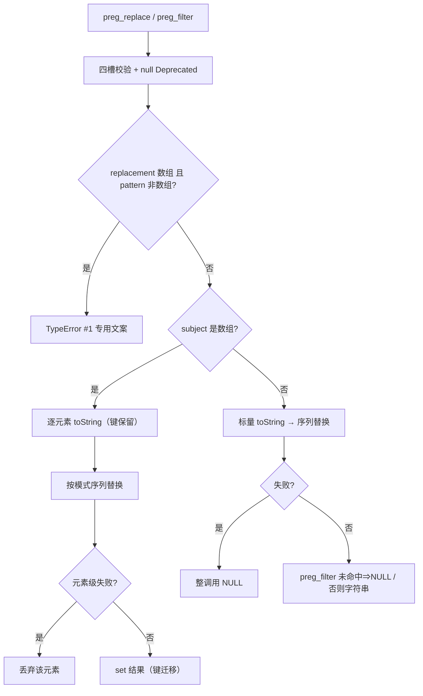
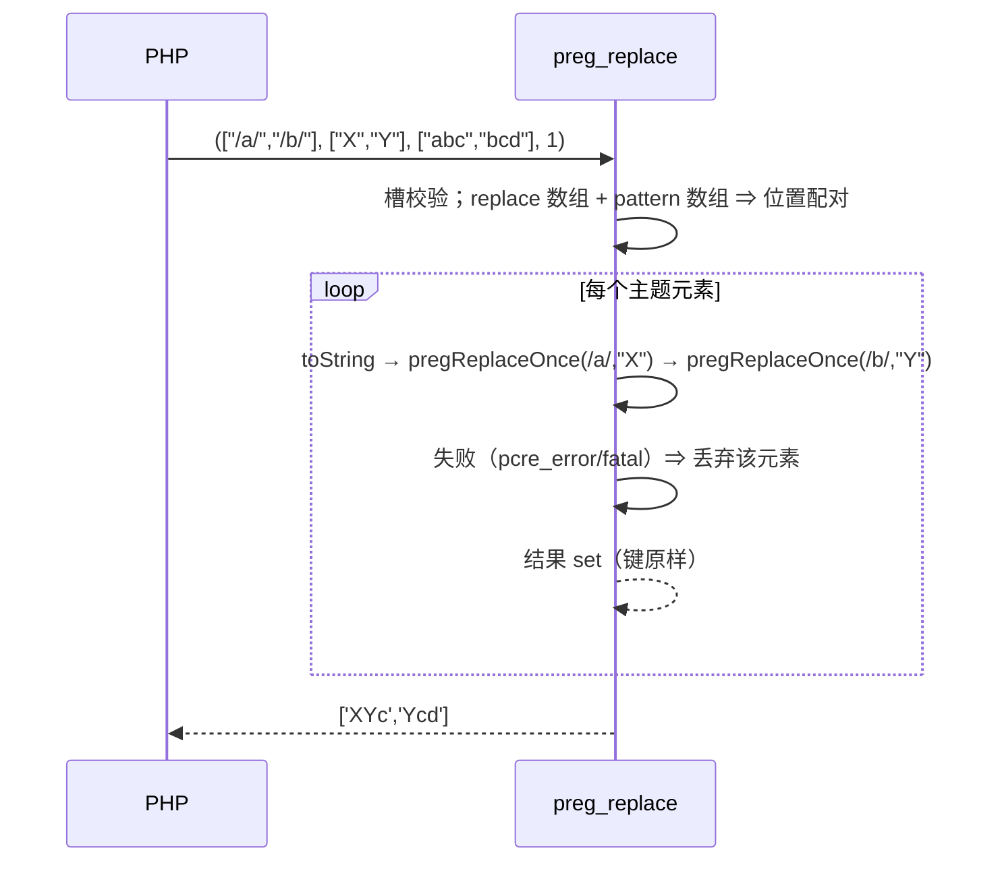

# AOT-CODEGEN-012 R-259：preg_replace／preg_filter 数组形与形参契约（F-165；F-166 同轮）

- 日期：2026-10-24
- 代次锚：`nlk 7e7b5d8a21d28699c8cb3d94ff54776c`／`tpl 5e8b1663ab6ca22c38cde932aece9977`；`irg 4015f0f5…`／`ir fb2bb442…` 未变（均未提交）
- 工单：`docs/known-issues/AOT-CODEGEN-012-class-name-case-insensitive-lookup.md` §166

## 1. 高层摘要（TL;DR）

`preg_replace` 此前对任何数组实参直接返回 NULL，`preg_filter` 只支持「标量模式 + 标量替换 + 数组主题」且丢字符串键、无 `$limit`。本轮按 PHP 8.5.8 实测实现两函数的数组形（位置配对、标量替换广播、键保留、元素强转）、四槽 `array|string`／`int` 契约与 `preg_filter` 的 `$limit`；同轮修掉 substitute 输出缓冲 `2*subject+1` 的既有溢出缺陷（替换串更长时误报 NULL），并纠正「数组主题元素级失败」的分流（PHP 丢弃该元素，非整调用 NULL）。

## 2. 影响范围

| 层 | 影响 |
|---|---|
| 运行期模板 | `preg_replace`／`preg_filter` 重写为共享内核；`pregReplaceOnce`/`pregReplaceSequence` 三态错误分流；substitute 溢出重试 |
| 发射器表 | `preg_filter` 新增 `handler_params=4`＋缺省 `-1`（语料 0 处调用 ⇒ 发射面零暴露） |
| 语义面 | preg 族数组形、形参类型、limit、显式 null Deprecated、键序 |

## 3. 核心变更

| # | 变更 | 说明 |
|---|---|---|
| 1 | `requirePregArgParam` | `array|string` 槽：数组/标量/null/带 `__toString` 对象放行，其余 TypeError 原文 |
| 2 | `pregCollectArgStrings` | 槽展开为字符串列表（数组按插入序、键忽略、元素 `toString`） |
| 3 | `pregReplaceOnce` | 单模式×单主题；三态 `ok`／`pcre_error`／`fatal` |
| 4 | `pregReplaceSequence` | 替换按位置配对、缺位 `""`；标量替换广播；错误三态上抛 |
| 5 | `preg_replace` | 四槽校验＋混合形专用 TypeError＋数组/标量主题两路 |
| 6 | `preg_filter` | 同槽＋`$limit` 形参；数组主题只留命中元素且**保留键**（原实现字符串键被 `push` 丢弃） |
| 7 | F-166 | substitute 带 `OVERFLOW_LENGTH` 预跑，按回写实需 `realloc` 重跑 |
| 8 | 数组主题元素级失败 | 编译失败/PCRE 错误 ⇒ 丢弃该元素（PHP 实测），标量主题 ⇒ NULL |

## 4. 可视化概览（Code & Logic Map）

## 5. 详细变更分析

| 文件 | 变更点 |
|---|---|
| `src/aot/runtime_lib_template.zig` | `requirePregArgParam`/`valueHasToStringMethod`/`pregCollectArgStrings`/`pregFreeStringList`/`PregOnceResult`/`PregSeqResult`/`pregReplaceOnce`/`pregReplaceSequence`；重写 `preg_replace`、`preg_filter`；`PCRE2_ERROR_NOMEMORY` 常量＋溢出重试 |
| `src/aot/native_linker.zig` | `preg_filter` 注册项：`.handler_params = 4`、`.optional_defaults = &.{"runtime.Value.initInt(-1)"}` |
| `fuzzy_scripts_720/tmp/c304_preg_union_gate_tmp.sh` | 新门 9 臂（t1–t8＋g1） |

## 6. 影响与风险评估

- **破坏式变更**：`preg_replace` 数组形由 NULL 变为逐元素结果（与 PHP 对齐）；`preg_filter` 字符串键不再丢失；数组主题错误由整调用 NULL 变为丢弃元素。
- **内存安全**：所有临时字符串列表 `defer` 释放；`PregOutcome.data` 在调用方 `defer free`；数组键深拷贝后 `set`（`PHPArray.set` 双 retain ⇒ defer release 配对）。
- **发射面**：仅 `preg_filter` 3 参调用多补一个 `-1`；语料 `preg_filter` 0 处 ⇒ 影子按中性预期，但**未做影子腿**（无同代次基线二进制），本批以主回归＋邻门＋定向门取证。
- **复测路径**：`bash fuzzy_scripts_720/tmp/c304_preg_union_gate_tmp.sh`；邻居 `c093`（PERR）、`c072`（PMOD）、`c300`、`c281`。
- **读数**：C304 9/9（自证 9 CF，51 s）／探针 19/19／PMOD 15/15／PERR 31/1（仅 e4）／C281 7/1（a8 既存）／C300 4/4／`zig build test` 326/326／主回归 **PASS=68 FAIL=0**。

## 7. 遗留问题

- **F-167 新立（P2）**：limit<0 的 substitute 替换语法与 PHP 不一致（`$$` ⇒ `$`），与 limit>0 手写支不一致；旧实现即如此。
- 显式 null `$limit` 的 Deprecated 未发（F-62f-opt 同族）。
- `preg_replace_callback` 数组形另案。
- F-158/F-117 嵌套三元/循环 phi（P0，待裁决）仍开。

## 8. 后续建议

| 优先级 | 建议 | 影响面 | 落地成本 |
|---|---|---|---|
| P1 | F-167：统一 limit<0/limit>0 的替换串语法（建议统一走手写支或先转义 `$`） | preg 族替换语义 | 中 |
| P2 | F-62f 余量：`password_hash`/`password_needs_rehash` 的 `$algo`（`string\|int\|null`）与 `$options`（array）、`hash_pbkdf2` 的 `$options` | 密码/哈希族 | 中（需扩形参与发射侧特例） |
| P3 | `preg_replace_callback` 数组形 | preg 族 | 中 |
| P3 | 数组 pattern 元素非字符串的 Warning 文案边界 | preg 边角 | 低 |
