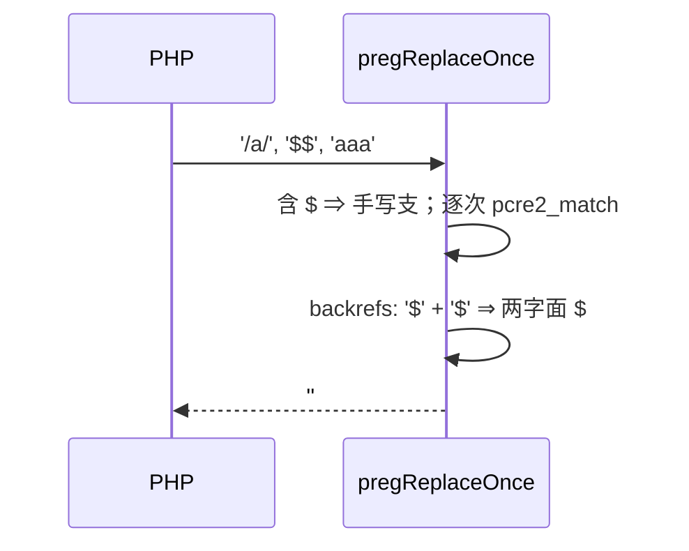

# AOT-CODEGEN-012 R-260：preg 替换串语法统一到 PHP（F-167）

- 日期：2026-10-24
- 代次锚：`tpl c916b98ea42479770f626dcc19540dc5`；`nlk 7e7b5d8a…`／`irg 4015f0f5…`／`ir fb2bb442…` 未变（均未提交）
- 工单：`docs/known-issues/AOT-CODEGEN-012-class-name-case-insensitive-lookup.md` §167

## 1. 高层摘要（TL;DR）

`preg_replace`/`preg_filter` 的 limit<0 支此前直接走 `pcre2_substitute`，其替换串语法与 PHP 不同：`$$` 被吃成 `$`、`\\` 不折叠、`\$`/`$10`/`$<1>`/`a$b` 等直接 `BADREPLACEMENT`（整调用 NULL）。本轮把「含 `$` 或 `\` 的替换串」改走手写拼接支，并按 PHP 实测重写反引用语法；纯字面替换仍走 substitute 快路。

## 2. 影响范围

| 层 | 影响 |
|---|---|
| 运行期模板 | `pregReplaceOnce` 路径分流；`pregReplaceProcessBackrefs` 按 PHP 语法重写；新增 `pregIsDigits`/`pregAppendGroupRef` |
| 语义面 | `preg_replace`/`preg_filter` 的替换串（组引用、转义、字面 `$`/`\`） |
| 性能面 | 仅含 `$`/`\` 的替换串改走手写支；纯字面替换保持 C 级 substitute |

## 3. 核心变更

| # | 变更 | 说明 |
|---|---|---|
| 1 | 路径分流 | `indexOfAny(repl, "$\\") != null` ⇒ 手写支；否则 limit<0 仍 substitute |
| 2 | 多位组 | `$NN`/`\NN`/`${NN}` 取最长数字串；越界/未参与 ⇒ 空串（不回退成「组1+数字」） |
| 3 | 转义 | `$$`⇒`$$`、`\$`⇒`$`、`\\`⇒`\`、`\x` 保留反斜杠、尾部单 `$`/`\` 保留 |
| 4 | 无限制语义 | meta 路径在 limit<0 时 `limit_usize = maxInt(usize)` |
| 5 | 组写入 | `pregAppendGroupRef` 同时守卫越界与 `PCRE2_UNSET` |

## 4. 可视化概览（Code & Logic Map）

```mermaid
flowchart TD
  A[pregReplaceOnce] --> B{replacement 含 $ 或 \\ ?}
  B -->|否| C[limit<0 ? pcre2_substitute 快路]
  B -->|是| D[手写匹配循环]
  D --> E[pregReplaceProcessBackrefs]
  E --> F{$ / \\ 分支}
  F --> G[$NN / ${NN} / \\NN → 组引用]
  F --> H[$$→$$, \\$→$, \\\\→\\, 其他 \\x 保留]
  F --> I[尾部单字符保留]
```



## 5. 详细变更分析

| 文件 | 变更点 |
|---|---|
| `src/aot/runtime_lib_template.zig` | `pregReplaceOnce` 分流与 limit 语义；`pregReplaceProcessBackrefs` 重写；`pregIsDigits`/`pregAppendGroupRef` |
| `fuzzy_scripts_720/tmp/c305_repl_grammar_gate_tmp.sh` | 新门 4 臂（t1 17 形矩阵、t2 多位组/尾部、t3 快路/数组/limit、g1 preg_filter） |

## 6. 影响与风险评估

- **破坏式变更**：含 meta 替换串的结果由「错误/NULL 或错值」变为 PHP 真值；纯字面替换路径不变。
- **性能**：meta 替换串从 C 级 substitute 变为逐匹配 `pcre2_match` + 手写拼接；literal 替换不受影响。语料主回归 68/68 通过。
- **内存**：手写支使用 `ArrayList(u8)` 与既有 `defer` 释放；无新增所有权转移。
- **复测路径**：`bash fuzzy_scripts_720/tmp/c305_repl_grammar_gate_tmp.sh`；探针 `/tmp/f167.php`；邻居 `c093`/`c072`/`c304`/`c281`。
- **读数**：C305 4/4（自证 4 CF，23 s）／探针 17/17／PERR 31/1（仅 e4）／PMOD 15/15／C304 9/9／C281 7/1（a8 既存）／`zig build test` 326/326／主回归 **PASS=68 FAIL=0**。

## 7. 遗留问题

- `${name}` 具名组不展开（PHP 本机对 `${n}` 亦为字面；`$<1>` 同）。
- 显式 null `$limit` 的 Deprecated 未发（F-62f-opt 同族）。
- F-158/F-117 嵌套三元/循环 phi（P0，待裁决）仍开。

## 8. 后续建议

| 优先级 | 建议 | 影响面 | 落地成本 |
|---|---|---|---|
| P2 | F-62f 余量：`password_hash`/`password_needs_rehash` 的 `$algo`/`$options`、`hash_pbkdf2` 的 `$options` | 密码/哈希族 | 中 |
| P3 | `preg_replace_callback` 数组形与替换语法对齐 | preg 族 | 中 |
| P3 | meta 替换串的手写支性能定价（与 substitute 快路对比实测） | preg 性能 | 低 |
