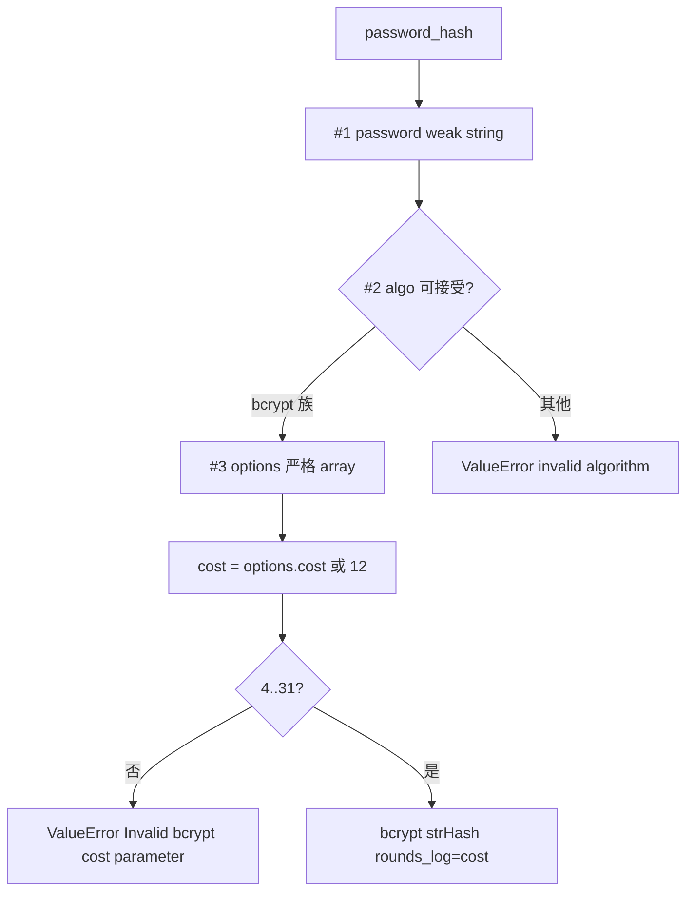
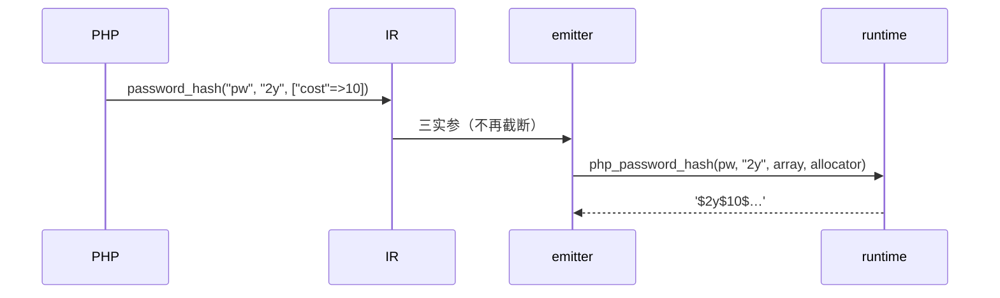

# AOT-CODEGEN-012 R-261：password 族与 hash_pbkdf2 的形参/options 契约（F-62f 余量）

- 日期：2026-10-24
- 代次锚：`nlk a0338c9a0199dd4b75ea8f37b6410b1e`／`tpl c97e05d73b7fabc9b21a0cfd72f1279c`／`irg 0b7106338d5ffe1342caee961734b8d8`；`ir fb2bb442…` 未变（均未提交）
- 工单：`docs/known-issues/AOT-CODEGEN-012-class-name-case-insensitive-lookup.md` §168

## 1. 高层摘要（TL;DR）

`password_hash` 的第三个实参（options）此前被 **IR 直接截断**，`options['cost']` 永远不生效；`password_needs_rehash` 的三参调用编不过（无发射特例）；`hash_pbkdf2` 的 `$options` 直接编不过。本轮补齐三函数的槽类型（`string` / `string|int|null` / 严格 `array`）、bcrypt cost、needs_rehash 成本比较与未知算法 ValueError，并把缺省 options 发射为**真正的空数组**（显式 null 仍按 PHP 报 TypeError）。

## 2. 影响范围

| 层 | 影响 |
|---|---|
| 运行期模板 | 三个函数签名与实现；新 helper（weak string / 算法族 / options 取值） |
| IR 生成 | 删除 `password_hash` 的 options 截断 |
| 发射器 | 注册表 `handler_params`/`optional_defaults`；三函数的赋值/表达式语句特例 |
| 语义面 | password 族 cost/algo/options；hash_pbkdf2 槽与未知算法 |

## 3. 核心变更

| # | 变更 | 说明 |
|---|---|---|
| 1 | `php_password_hash(password, algo, options, allocator)` | 三槽校验 → bcrypt 判定 → cost 4..31 校验 → `rounds_log=cost` |
| 2 | 算法族 | `null`/0/1/`'2y'` ⇒ bcrypt；`argon2i/argon2id` ⇒ 显式 ValueError（F-168）；其他 ⇒ PHP 同文案 ValueError |
| 3 | `php_password_needs_rehash(hash, algo, options, allocator)` | 无效 algo ⇒ false；argon ⇒ true；bcrypt 比较存储 cost 与 options cost（目标不校验值域） |
| 4 | `php_hash_pbkdf2(..., options, allocator)` | #1–#3 weak string、#7 严格 array；未知算法改 ValueError |
| 5 | IR | 移除 options 截断 |
| 6 | 发射 | 缺省 options＝空数组表达式；两处 emitter 链补 password_hash/password_needs_rehash/hash_pbkdf2 |

## 4. 可视化概览（Code & Logic Map）

## 5. 详细变更分析

| 文件 | 变更点 |
|---|---|
| `src/aot/runtime_lib_template.zig` | `requireStringParamWeak`/`requireStringOrIntOrNullParam`/`phpArrayGetStringOption`/`phpOptionToInt`/`passwordBcryptCost`/`passwordAlgoKind`；三函数重写 |
| `src/aot/ir_generator.zig` | 删除 password_hash options 截断 |
| `src/aot/native_linker.zig` | 三个注册项 `handler_params`/`optional_defaults`；两处 emitter 特例补齐 |
| `fuzzy_scripts_720/tmp/c306_password_contract_gate_tmp.sh` | 新门 4 臂 |

## 6. 影响与风险评估

- **破坏式变更**：cost 生效、`password_needs_rehash` 三参可编译、`hash_pbkdf2` 七参可编译；未知 hash 算法由 false 改为 ValueError（更接近 PHP，但对未实现算法是显式限制，见 F-169）。
- **安全**：argon2 请求不再静默回落到 bcrypt（改为显式 ValueError，F-168）。
- **内存**：password 三槽的临时字符串 `defer release`；options 空数组在生成码内构造。
- **复测路径**：`bash fuzzy_scripts_720/tmp/c306_password_contract_gate_tmp.sh`；探针 `/tmp/f168.php`；邻居 `c047`（BLT）、`c065`（arity）。
- **读数**：C306 4/4（自证 4 CF，29 s）／探针 25 行仅常量值 1 行差异（F-101 家族）／BLT 209 臂 208 SAME + 1 DIFF（`b5` 既存 bcadd 对象面）／C065 66 臂与旧基线：`hash_pbkdf2` CF→SAME（本轮），另 4 项 CF→SAME 属此前轮次（默认 TSV 陈旧）／`zig build test` 326/326／主回归 **PASS=68 FAIL=0**。

## 7. 遗留问题

- **F-168 新立（P2）**：AOT 未实现 argon2i/argon2id（Zig std 有 `crypto.argon2`，但 `password_verify` 亦需同步）；当前对 argon 请求报 invalid-algo ValueError。
- **F-169 新立（P2）**：`hash_pbkdf2` 仅实现 sha256/sha1/md5；PHP 合法算法（sha512/sha224/sha384/sha512-256 等）现显式 ValueError。
- **F-101 家族**：`PASSWORD_DEFAULT`/`PASSWORD_BCRYPT` 仍为 int 1（PHP 8.5 为字符串 `'2y'`）；常量表结构仅支持整数。
- F-158/F-117（P0）仍待裁决。

## 8. 后续建议

| 优先级 | 建议 | 影响面 | 落地成本 |
|---|---|---|---|
| P2 | F-168 argon2i/id 支持（hash+verify 同批，用 `std.crypto.pwhash.argon2` PHC 编码） | 密码族 | 中 |
| P2 | F-169 补 hash_pbkdf2 的 sha512/sha224/sha384/sha512-256 | 哈希族 | 低 |
| P3 | PASSWORD_* 常量改字符串（需常量表支持字符串值，F-101 家族） | 常量保真 | 中 |
