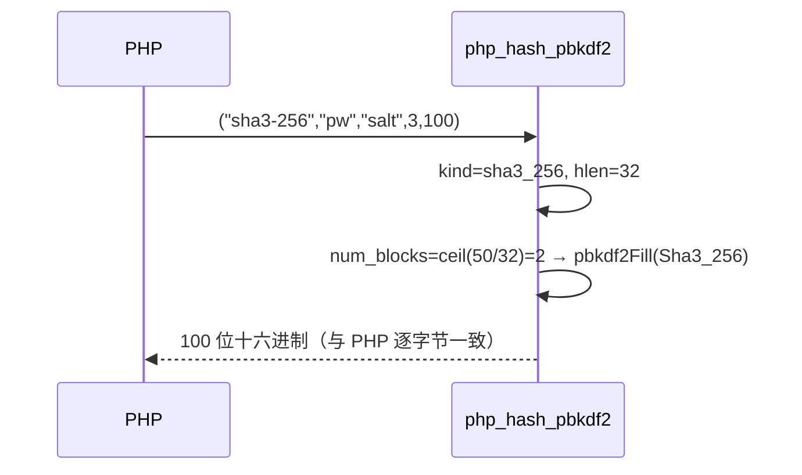

# AOT-CODEGEN-012 R-262：hash_pbkdf2 算法族补齐（F-169）

- 日期：2026-10-24
- 代次锚：`tpl 7f1b833d90be9fabaef40473083b2960`；`nlk a0338c9a…`／`irg 0b710633…`／`ir fb2bb442…` 未变（均未提交）
- 工单：`docs/known-issues/AOT-CODEGEN-012-class-name-case-insensitive-lookup.md` §169

## 1. 高层摘要（TL;DR）

`hash_pbkdf2` 此前只支持 sha256/sha1/md5，其他 PHP 合法算法（sha224/384/512、sha512/256、sha512/224、sha3-*）一律报「无效算法」。本轮把 PBKDF2 主循环泛化成 `pbkdf2Fill(comptime Hash, ...)`，按算法分派 std 同名哈希，12 族算法与 PHP 逐字节对齐（含整摘要、二进制、跨块长输出）。

## 2. 影响范围

| 层 | 影响 |
|---|---|
| 运行期模板 | `php_hash_pbkdf2` 的算法识别与派生主循环 |
| 语义面 | `hash_pbkdf2` 的算法接受面与输出值 |

## 3. 核心变更

| # | 变更 | 说明 |
|---|---|---|
| 1 | `Pbkdf2Algo` + `pbkdf2AlgoFromName` | 12 族（含 `sha512/256`↔`sha512-256` 双拼写） |
| 2 | `pbkdf2AlgoHlen` | 摘要长度表（20/28/32/48/64/16） |
| 3 | `pbkdf2Fill(comptime Hash, ...)` | HMAC 取 `std.crypto.auth.hmac.Hmac(Hash)`；块数由 `dk.len` 推出 |
| 4 | 分发 | `switch (kind)` → Sha1/Sha2 四型/Sha512_224/Sha512_256/Sha3 四型/Md5 |
| 5 | 删除手写循环 | 旧「三分支 + `[64]u8` 上界 + 重复 HMAC 代码」整体移除，DRY |

## 4. 可视化概览（Code & Logic Map）

```mermaid
flowchart TD
  A[hash_pbkdf2 algo] --> B[pbkdf2AlgoFromName]
  B -->|null| C[ValueError 无效算法]
  B -->|kind| D[hlen = pbkdf2AlgoHlen]
  D --> E[dk = alloc num_blocks*hlen]
  E --> F[switch kind → pbkdf2Fill Hash]
  F --> G[HMAC(password, salt||BE(i)) 迭代 XOR]
  G --> H[raw ? 原始字节 : 十六进制]
```



## 5. 详细变更分析

| 文件 | 变更点 |
|---|---|
| `src/aot/runtime_lib_template.zig` | `Pbkdf2Algo`/`pbkdf2AlgoFromName`/`pbkdf2AlgoHlen`/`pbkdf2Fill`；`php_hash_pbkdf2` 主循环改分发 |
| `fuzzy_scripts_720/tmp/c307_hash_algos_gate_tmp.sh` | 新门 4 臂 |

## 6. 影响与风险评估

- **破坏式变更**：原先报 ValueError 的合法算法现在产出正确值；sha1/md5/sha256 的输出不变（C306/BLT 复核）。
- **内存**：`dk` 与每块 `salt_block` 沿用 `defer`；泛型 `[Hlen]u8` 栈缓冲取代旧 `[64]u8`。
- **复测路径**：`bash fuzzy_scripts_720/tmp/c307_hash_algos_gate_tmp.sh`；探针 `/tmp/f169.php`；邻居 `c306`、`c047 ONLY=5 臂`、`c065`。
- **读数**：C307 4/4（自证 4 CF，23 s）／探针 29 行 28 SAME（余 ripemd160）／BLT 相关 5 臂 5/5／C306 4/4／C065 无转移／`zig build test` 326/326／主回归 **PASS=68 FAIL=0**。

## 7. 遗留问题

- **F-170 新立（P2）**：RIPEMD-160/128、Whirlpool、Tiger、GOST、HAVAL 未实现（`hash_pbkdf2` 报无效算法）；同族 `php_hash` 的 `ripemd128` 用 MD5 冒充（静默错值）需一并修。
- F-168（argon2）、F-101（常量值）、F-158/F-117（P0，待裁决）仍开。

## 8. 后续建议

| 优先级 | 建议 | 影响面 | 落地成本 |
|---|---|---|---|
| P2 | F-170：实现 RIPEMD-160/128（含修正 php_hash 假实现） | 哈希族 | 中 |
| P2 | F-168：argon2i/id 的 hash+verify | 密码族 | 中 |
| P3 | 收紧算法别名面（仅接受 PHP 列出的拼写） | 兼容性 | 低 |
