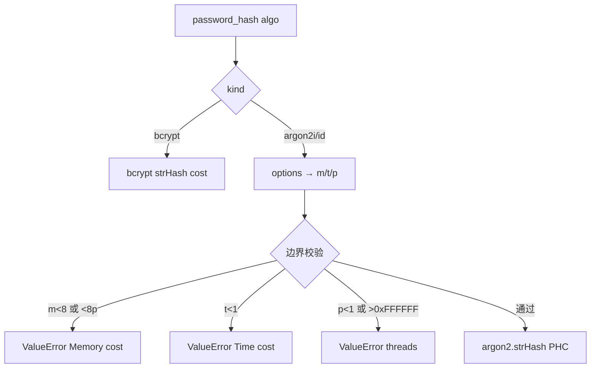
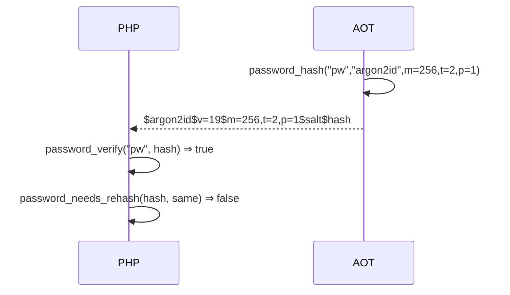

# AOT-CODEGEN-012 R-263：password argon2i/argon2id 支持（F-168）

- 日期：2026-10-24
- 代次锚：`tpl b0edfd94288565f6d43977082f24ed7f`；`nlk a0338c9a…`／`irg 0b710633…`／`ir fb2bb442…` 未变（均未提交）
- 工单：`docs/known-issues/AOT-CODEGEN-012-class-name-case-insensitive-lookup.md` §170

## 1. 高层摘要（TL;DR）

`password_hash` 此前只实现 bcrypt，argon2i/argon2id 请求被显式拒绝；`password_verify` 也只认 bcrypt；`password_needs_rehash` 对 argon 一律返回 true。本轮基于 Zig std 的 `std.crypto.pwhash.argon2` 接通三函数：PHC 编码与 PHP 完全互操作（AOT 产出的哈希可被 PHP 验证，反之亦然），options 的 `memory_cost/time_cost/threads` 生效并按 PHP 文案校验，needs_rehash 比较模式与参数。

## 2. 影响范围

| 层 | 影响 |
|---|---|
| 运行期模板 | `php_password_hash`/`php_password_verify`/`php_password_needs_rehash` 的 argon 分支；新参数 helper |
| 语义面 | password 族 argon2i/id 的哈希、校验、重算判定 |

## 3. 核心变更

| # | 变更 | 说明 |
|---|---|---|
| 1 | `passwordArgon2Params` | options → m/t/p（缺省 65536/4/1；数值串生效；bcrypt `cost` 忽略） |
| 2 | `passwordArgon2StoredParams` | 解析 `$argon2x$v=19$m=..,t=..,p=..$…` |
| 3 | hash argon 分支 | 参数边界（PHP 文案）→ `argon2.strHash(.encoding=.phc)` |
| 4 | verify | `$argon2i$`/`$argon2id$` ⇒ `argon2.strVerify` |
| 5 | needs_rehash | 模式 + m/t/p 比较（同参 false、改参/换模式 true） |
| 6 | 结构 | hash 串计算上移，供 argon 分支使用 |

## 4. 可视化概览（Code & Logic Map）

## 5. 详细变更分析

| 文件 | 变更点 |
|---|---|
| `src/aot/runtime_lib_template.zig` | `Argon2ParamsOpt`/`passwordArgon2Params`/`passwordArgon2StoredParams`；三函数 argon 分支 |
| `fuzzy_scripts_720/tmp/c308_argon2_gate_tmp.sh` | 新门 4 臂（含 x1 跨语言互操作） |

## 6. 影响与风险评估

- **破坏式变更**：argon 请求由 ValueError 变为真实实现；bcrypt 路径不动（C306 复核）。
- **安全**：哈希格式与 PHP 互操作已双向验证；argon 参数边界按 PHP 拒绝。
- **性能**：与 PHP 同参数同成本；门内用 m=256 保持速读。
- **复测路径**：`bash fuzzy_scripts_720/tmp/c308_argon2_gate_tmp.sh`；探针 `/tmp/f168b.php`；邻居 `c306`、`c047 ONLY=b192`。
- **读数**：C308 4/4（自证 4 CF，24 s）／探针全 SAME／互操作 true/true/false／C306 4/4／BLT b192 SAME／`zig build test` 326/326／主回归 **PASS=68 FAIL=0**。

## 7. 遗留问题

- **F-171 新立（P2）**：`PASSWORD_ARGON2I/ID` 常量未定义（常量表仅整数）；使用常量名调用 argon 的脚本仍 fatal，需常量表字符串化（F-101 家族）。
- F-170（RIPEMD 族）、F-158/F-117（P0）仍开。

## 8. 后续建议

| 优先级 | 建议 | 影响面 | 落地成本 |
|---|---|---|---|
| P2 | 常量表支持字符串值（PASSWORD_*、PHP_OS_FAMILY 等，F-101 家族） | 常量保真 | 中 |
| P2 | F-170：RIPEMD-160/128（含修正 php_hash 假 ripemd128） | 哈希族 | 中 |
| P3 | argon2 `version`/异常编码边界补充守卫 | 密码族 | 低 |
