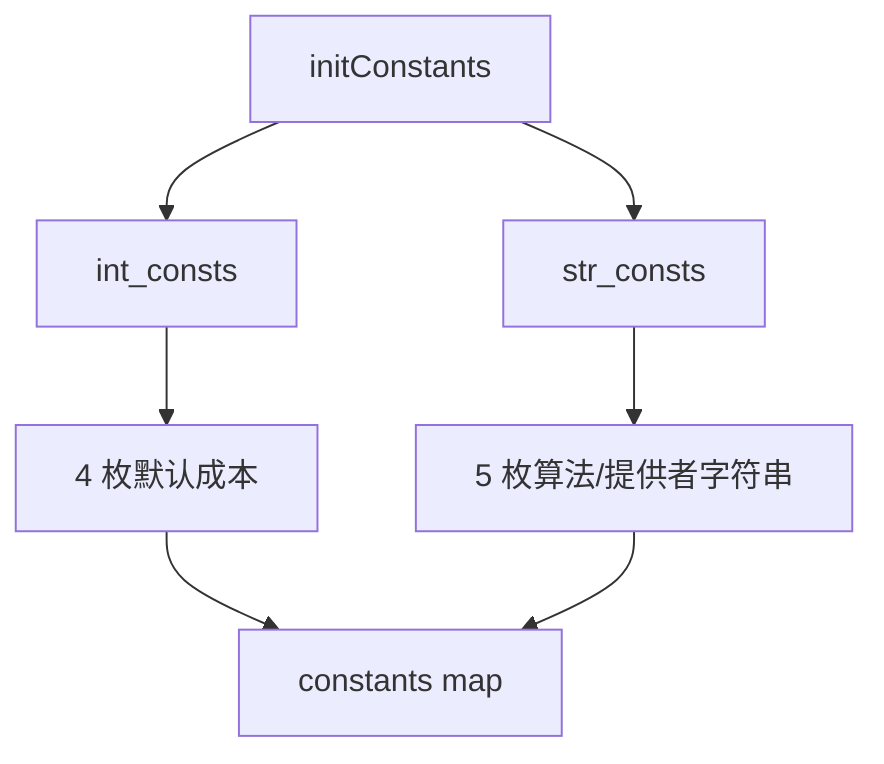
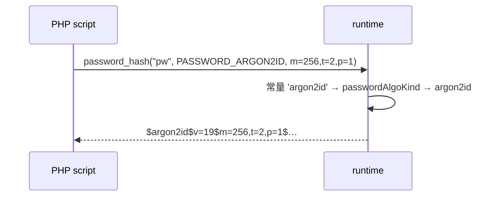

# AOT-CODEGEN-012 R-264：PASSWORD_* 常量族修正（F-171；F-101 家族）

- 日期：2026-10-24
- 代次锚：`tpl 84a4fa6f92f7cbe1bb57cedd7d7840f8`；`nlk a0338c9a…`／`irg 0b710633…`／`ir fb2bb442…` 未变（均未提交）
- 工单：`docs/known-issues/AOT-CODEGEN-012-class-name-case-insensitive-lookup.md` §171

## 1. 高层摘要（TL;DR）

`PASSWORD_BCRYPT`/`PASSWORD_DEFAULT` 此前是 **int 1**（PHP 8.5 为字符串 `'2y'`），`PASSWORD_ARGON2*` 7 枚未定义 ⇒ 使用常量名调 argon 的脚本未定义常量 fatal。本轮按 PHP 实测把 5 枚字符串常量放入既有 `StrConst` 表、4 枚整数默认成本放入 int 表；密码全链因 `passwordAlgoKind` 已接受字符串而无需改动。

## 2. 影响范围

| 层 | 影响 |
|---|---|
| 运行期模板 | 常量表（int/str 两张） |
| 语义面 | `PASSWORD_*` 9 枚常量的值、类型与 defined() |

## 3. 核心变更

| # | 变更 | 说明 |
|---|---|---|
| 1 | 删除 int 1 的两枚 | `PASSWORD_DEFAULT`/`PASSWORD_BCRYPT` 不再为整型 |
| 2 | str 表新增 5 枚 | `'2y'`×2、`'argon2i'`、`'argon2id'`、`PASSWORD_ARGON2_PROVIDER='standard'` |
| 3 | int 表新增 4 枚 | `PASSWORD_BCRYPT_DEFAULT_COST=12`、`ARGON2_DEFAULT_MEMORY_COST=65536`、`_TIME_COST=4`、`_THREADS=1` |

## 4. 可视化概览（Code & Logic Map）

## 5. 详细变更分析

| 文件 | 变更点 |
|---|---|
| `src/aot/runtime_lib_template.zig` | int 表密码段替换为 4 枚默认成本；str 表新增 5 枚算法常量 |
| `fuzzy_scripts_720/tmp/c309_password_consts_gate_tmp.sh` | 新门 3 臂 |

## 6. 影响与风险评估

- **破坏式变更**：`PASSWORD_BCRYPT === 1` 从此为 false（与 PHP 一致）；使用常量作算法实参的调用保持不变（C306/C308 复证）。
- **兼容性**：`passwordAlgoKind` 已接受 `'2y'/'argon2i'/'argon2id'`。
- **复测路径**：`bash fuzzy_scripts_720/tmp/c309_password_consts_gate_tmp.sh`；探针 `/tmp/f171.php`；邻居 `c306`、`c308`、`c047 ONLY=b192`。
- **读数**：C309 3/3（自证 3 CF，14 s）／探针全 SAME／C306 4/4／C308 4/4／BLT b192 SAME／`zig build test` 326/326／主回归 **PASS=68 FAIL=0**。

## 7. 遗留问题

- **F-101 剩余**：`PHP_VERSION`（8.4.8 vs 8.5.8）、`PHP_VERSION_ID`/`PHP_MAJOR/MINOR/RELEASE`、`PHP_BINDIR`（/usr/local/bin）与 `PHP_OS`/`PHP_OS_FAMILY`（"Darwin"）仍未对齐/硬编码，待裁。
- F-170（RIPEMD 族）、F-158/F-117（P0）仍开。

## 8. 后续建议

| 优先级 | 建议 | 影响面 | 落地成本 |
|---|---|---|---|
| P2 | F-101：版本自述与 `PHP_BINDIR`/`PHP_OS` 改造（字符串常量表已具备能力） | 常量保真 | 中 |
| P2 | F-170：RIPEMD-160/128（含修正 php_hash 假 ripemd128） | 哈希族 | 中 |
| P3 | 常量族普查：其余 `get_defined_constants('standard')` 缺项 | 常量保真 | 中 |
