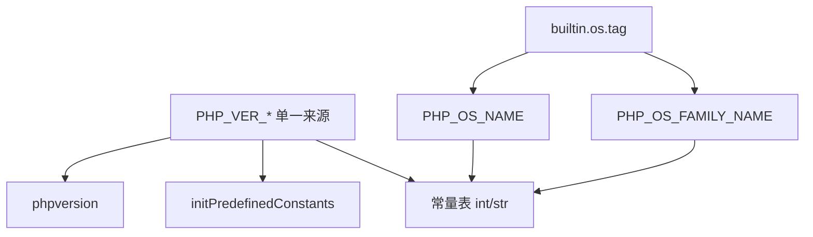
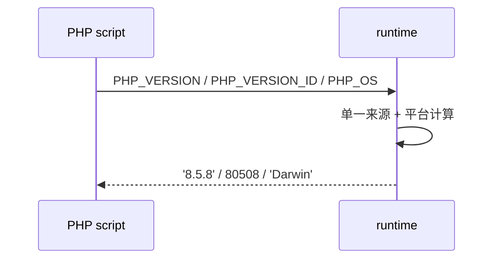

# AOT-CODEGEN-012 R-265：版本自述与 OS 常量对齐（F-101 主体）

- 日期：2026-10-24
- 代次锚：`tpl 96a30d6759f1bcc8d7b63dad857e9561`；`nlk a0338c9a…`／`irg 0b710633…`／`ir bb…` 未变（均未提交）
- 工单：`docs/known-issues/AOT-CODEGEN-012-class-name-case-insensitive-lookup.md` §172

## 1. 高层摘要（TL;DR）

模板自述 PHP 8.4.8/80408，且两处注册源互相矛盾（常量表 minor=3、运行期 minor=4），`PHP_EXTRA_VERSION` 未定义，`PHP_OS(_FAMILY)` 硬编码 `"Darwin"`。本轮建立**文件级单一来源**（版本号与 ID），两处注册点与 `phpversion()` 全部引用；新增 `PHP_EXTRA_VERSION`；OS 常量改为按 `builtin.os.tag` 计算。

## 2. 影响范围

| 层 | 影响 |
|---|---|
| 运行期模板 | 版本/OS 常量注册（两处）、`phpversion()` |
| 语义面 | `PHP_VERSION*`、`PHP_OS(_FAMILY)` 的值与 `defined()` |

## 3. 核心变更

| # | 变更 | 说明 |
|---|---|---|
| 1 | 单一来源常量 | `PHP_VER_MAJOR/MINOR/RELEASE/EXTRA/STRING/ID`（8/5/8/""/`"8.5.8"`/80508） |
| 2 | 两处注册点改引用 | `initPredefinedConstants` 与常量表；删除 8.4.8/80408/minor 3/4 等散落字面量 |
| 3 | `PHP_EXTRA_VERSION` | 新增（运行期 + 表） |
| 4 | `PHP_OS_NAME`/`PHP_OS_FAMILY_NAME` | `builtin.os.tag` 计算（macOS/Linux/Windows/BSD/illumos，未知回退） |
| 5 | `phpversion()` | 引用 `PHP_VER_STRING` |

## 4. 可视化概览（Code & Logic Map）

## 5. 详细变更分析

| 文件 | 变更点 |
|---|---|
| `src/aot/runtime_lib_template.zig` | 文件级版本/OS 常量；两处注册点与 `phpversion()` 改引用 |
| `fuzzy_scripts_720/tmp/c310_php_version_gate_tmp.sh` | 新门 3 臂 |

## 6. 影响与风险评估

- **破坏式变更**：`PHP_VERSION` 8.4.8→8.5.8、`PHP_VERSION_ID` 80408→80508、`PHP_MINOR_VERSION` 3/4→5；与 PHP 8.5.8 oracle 对齐。
- **性能**：仅初始化期字符串/整数注册，无热路径影响。
- **复测路径**：`bash fuzzy_scripts_720/tmp/c310_php_version_gate_tmp.sh`；探针 `/tmp/f101.php`；邻居 `c265`。
- **读数**：C310 3/3（自证 3 CF，14 s）／探针全 SAME／C265 7/7／`zig build test` 326/326／主回归 **PASS=68 FAIL=0**。

## 7. 遗留问题

- **F-101 尾**：`PHP_BINDIR`（`/usr/local/bin`）/`PHP_BINARY` 依赖 PHP 安装路径，AOT 无对应安装，待产品口径裁定。
- F-170（RIPEMD 族）、F-158/F-117（P0）仍开。

## 8. 后续建议

| 优先级 | 建议 | 影响面 | 落地成本 |
|---|---|---|---|
| P2 | F-101 尾：`PHP_BINDIR`/`PHP_BINARY` 口径（配置注入或明确返回空/构建期路径） | 常量保真 | 中 |
| P2 | F-170：RIPEMD-160/128（含修正 php_hash 假 ripemd128） | 哈希族 | 中 |
| P3 | 去掉两处重复注册（保留单一注册点） | 内部整洁 | 低 |
