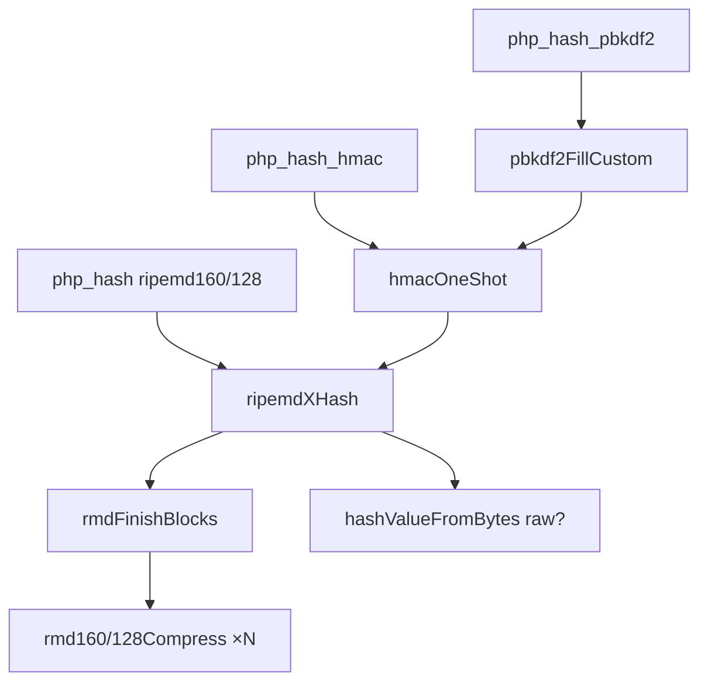
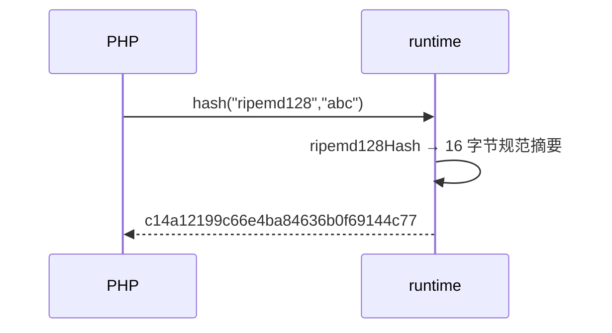

# AOT-CODEGEN-012 R-266：RIPEMD-160/128 实现（F-170）

- 日期：2026-10-24
- 代次锚：`tpl 87be9b4bf352f60ec808318b5dc0a41f`；`nlk a0338c9a…`／`irg 0b710633…`／`ir bb…` 未变（均未提交）
- 工单：`docs/known-issues/AOT-CODEGEN-012-class-name-case-insensitive-lookup.md` §173

## 1. 高层摘要（TL;DR）

`php_hash` 的 `ripemd128` 此前用 **MD5 冒充**（静默错值），`ripemd160` 缺失，`hash_hmac`/`hash_pbkdf2` 也不支持两者。本轮按 RIPEMD 规范实现 160/128 核心（共享 r/r′/s/s′ 表与双线压缩），并接入三入口：hash（含 raw）、hmac（含 >64 字节键）、pbkdf2（含整摘要/二进制）。

## 2. 影响范围

| 层 | 影响 |
|---|---|
| 运行期模板 | RIPEMD 核心 + hmac/pbkdf2 自定义实现 + `php_hash`/`php_hash_hmac`/`php_hash_pbkdf2` 分支 |
| 语义面 | `hash`/`hash_hmac`/`hash_pbkdf2` 的 ripemd160/128 |

## 3. 核心变更

| # | 变更 | 说明 |
|---|---|---|
| 1 | `rmd160Compress`/`rmd128Compress` | 80/64 轮双线压缩；`rmdReadBlock` 小端读字 |
| 2 | `rmdFinishBlocks` | 0x80 + 零填充 + 小端 64 位比特长度；支持 1–2 个尾块 |
| 3 | `ripemd160Hash`/`ripemd128Hash` | 一次性哈希（规范向量已验） |
| 4 | `hashValueFromBytes` | 统一 raw/hex 输出 |
| 5 | `hmacOneShot` | 一次性哈希版 HMAC（键 >64 先哈希、ipad/opad 64 字节） |
| 6 | `pbkdf2FillCustom` | 一次性哈希版 PBKDF2 主循环 |
| 7 | 三入口接线 | hash 修正假 ripemd128 + 新增 160；hmac/pbkdf2 新增两族 |

## 4. 可视化概览（Code & Logic Map）

## 5. 详细变更分析

| 文件 | 变更点 |
|---|---|
| `src/aot/runtime_lib_template.zig` | RIPEMD 表/压缩/一次性哈希、HMAC、PBKDF2 自定义填充；三函数分支 |
| `fuzzy_scripts_720/tmp/c311_ripemd_gate_tmp.sh` | 新门 4 臂 |

## 6. 影响与风险评估

- **破坏式变更**：`hash('ripemd128', …)` 由 MD5 值改为真实 RIPEMD-128（静默错值消失）；ripemd160 由 false 变真实值。
- **性能**：纯 Zig 实现，无额外分配（hmac/pbkdf2 仅临时拼接缓冲）；RIPEMD 不在语料热路径。
- **复测路径**：`bash fuzzy_scripts_720/tmp/c311_ripemd_gate_tmp.sh`；探针 `/tmp/f170.php`；邻居 `c307`。
- **读数**：C311 4/4（自证 4 CF，19 s）／探针全 SAME／C307 4/4／`zig build test` 326/326／主回归 **PASS=68 FAIL=0**。

## 7. 遗留问题

- **F-172 新立（P3）**：`php_hash` 既有 sha224/384/512/sha3-* 分支忽略 `raw_output`；`hash_hmac` 缺 `binary` 形参。
- **F-170 尾**：`ripemd256`/`ripemd320` 未实现（PHP 支持）。
- F-158/F-117（P0）仍开。

## 8. 后续建议

| 优先级 | 建议 | 影响面 | 落地成本 |
|---|---|---|---|
| P2 | F-172：`php_hash` 全分支 raw 口径 + `hash_hmac` binary 形参 | 哈希族 | 低 |
| P3 | RIPEMD-256/320（由 160 组合式派生） | 哈希族 | 低 |
| P0 | F-158/F-117 表达式位 phi（待裁） | 表达式正确性 | 高 |
