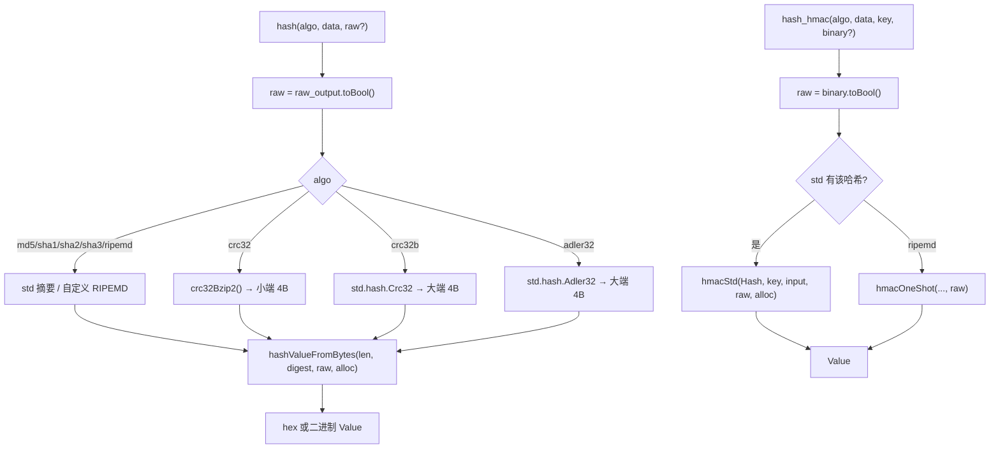
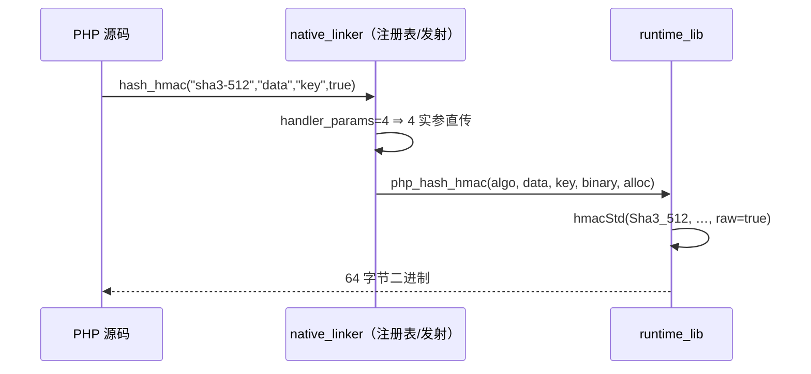

# AOT-CODEGEN-012 R-267：hash 全算法族 raw 口径 ＋ hash_hmac binary（F-172）

- 日期：2026-10-24
- 代次锚：`nlk d23236d9cd6661d253d6281d61cd8f83`；`tpl 14353f170cf2e2e7c9e3ae10b0636e51`；`irg 0b7106338d5ffe1342caee961734b8d8`／`ir fb2bb442ca27b98cf1df7e109a240e1f` 未变（均未提交）
- 工单：`docs/known-issues/AOT-CODEGEN-012-class-name-case-insensitive-lookup.md` §174

## 1. 高层摘要（TL;DR）

`php_hash` 的绝大多数分支此前**无视第 3 参 `raw_output`**（恒返回十六进制），`hash_hmac` 的**第 4 参 `binary` 在 AOT 签名里根本不存在**（3 实参调用错位）。本轮把两个入口统一到 PHP 的 raw 口径：`php_hash` 的 17 条分支（md5/sha1 委托既有实现，其余 15 条走单点 `hashValueFromBytes`）全部按 raw 返回，并补上 sha512/224、sha3-224/256/384/512；`hash_hmac` 增 `binary` 形参并覆盖 14 种算法；顺带定位并修复 `hash('crc32')` 被 `crc32b` 顶替（PHP 的 `crc32` 是 CRC-32/BZIP2 且按小端输出）。

## 2. 影响范围

| 层 | 影响 |
|---|---|
| 运行期模板 | `php_hash`／`php_hash_hmac` 的返回值字节面；新增 `crc32Bzip2*` 与 `hmacStd` |
| 发射器/注册表 | `hash_hmac` 条目 `handler_params=4` ＋ 缺省 `false`（3 实参调用补位） |
| 语义面 | `hash()`／`hash_hmac()` 的 raw(binary) 输出；`hash('crc32')` 值 |

## 3. 核心变更

| # | 变更 | 说明 |
|---|---|---|
| 1 | `php_hash` raw 单点 | `const raw = raw_output.toBool()`（`:32478`），15 条分支统一 `hashValueFromBytes(len, hash, raw, allocator)` |
| 2 | 算法补齐 | 新增 sha512/224、sha3-224/256/384/512（`:32504`–`:32523`） |
| 3 | `crc32` ≠ `crc32b` | `crc32` 走 `crc32Bzip2()`（非反射、poly 0x04C11DB7、init/xorout 全 1）并**小端**写出；`crc32b` 保持 `std.hash.Crc32`＋大端 |
| 4 | `hmacStd()` | 一个 comptime 泛型 helper 收口 std HMAC 族的 binary 口径（`:32550`） |
| 5 | `hash_hmac` 第 4 参 | 模板签名增 `binary`（`:32560`）；注册表 `handler_params=4`／`optional_defaults=initBool(false)`（nlk `:4844`） |
| 6 | 算法矩阵 | hmac 覆盖 sha256/sha1/md5/sha512/sha384/sha224/sha512-256/sha512-224/sha3-224/256/384/512 与 ripemd160/128 |

## 4. 可视化概览（Code & Logic Map）

## 5. 详细变更分析

| 文件 | 变更点 |
|---|---|
| `src/aot/runtime_lib_template.zig` | `crc32Bzip2Table()`／`CRC32_BZIP2_TABLE`／`crc32Bzip2()`（`:32447`/`:32462`/`:32466`，comptime 建表需 `@setEvalBranchQuota(4096)`）；`php_hash` raw 单点（`:32478`）、新算法分支（`:32504`–`:32523`）、`crc32`/`crc32b` 拆分（`:32524`/`:32530`）；`hmacStd()`（`:32550`）；`php_hash_hmac` 增 `binary` 与算法矩阵（`:32560`） |
| `src/aot/native_linker.zig` | `hash_hmac` 注册项补 `handler_params`/`optional_defaults`（`:4844`） |
| `fuzzy_scripts_720/tmp/c312_hash_raw_gate_tmp.sh` | 新门 5 臂（hash raw 矩阵／hmac raw 矩阵／超块长键／hmac 三口径／hash 缺省对照） |

## 6. 影响与风险评估

- **破坏式变更**：`hash($a, $d, true)` 与 `hash_hmac(..., true)` 的结果从「十六进制字符串」变为「二进制字符串」——这是向 PHP 靠拢，属修缺陷；`hash('crc32')` 的值改变（原错用 crc32b）。
- **潜在风险**：comptime 建表引入编译期配额依赖（已 `@setEvalBranchQuota(4096)`，否则子编译会失败）。
- **未改**：`php_crc32()`（PHP 的 `crc32()` 函数，返回 int）口径独立，仍用反射 CRC-32；`hash_algos()` 列表仍是旧的 10 项（F-172-b 的前置）。
- **复测路径**：`bash fuzzy_scripts_720/tmp/c312_hash_raw_gate_tmp.sh`；邻居 `c307`（算法族）、`c311`（RIPEMD）。
- **读数**：C312 **5/5 SAME**（27 s，自证 5 CF）；C307 4/4、C311 4/4；`zig build test` 21/21、**326/326**；主回归 **PASS=68 FAIL=0**（`SELF_CHECK_OK rows=68 uniq=68`）。

## 7. 遗留问题/潜在问题

- **F-172-b（新立，P3）**：未知算法与非加密算法在 `hash()`／`hash_hmac()`／`hash_pbkdf2()` 三入口 PHP 均抛 ValueError，AOT 返回 `false`。修法必须先有「PHP 侧合法算法全集」（`hash_algos()` 现值仅 10 项），否则会误抛 PHP 支持的算法。
- **F-170 尾（仍开）**：`ripemd256`/`ripemd320`；PHP 还支持 whirlpool/tiger/gost/haval/md2/md4/fnv*/joaat/xxh*/murmur3 等。
- **观察（未定性）**：首轮 C312 的 t1/t5 报 `executable generation failed: FileNotFound` 且无 Zig 诊断；同一 `main.zig` 手工 `zig build-exe` 暴露真实原因（comptime 分支配额超限）。配额修正后同输入正常；事后故意还原配额复测报的是 `CompilationFailed`＋完整诊断 ⇒ `FileNotFound` 未能复现，仅记录。

## 8. 后续建议

| 优先级 | 建议 | 影响面 | 落地成本 |
|---|---|---|---|
| P2 | F-172-b：先补 `hash_algos()` 全集（含 PHP 支持但未实现的算法名），再按三入口接 ValueError（`.may_raise`＋catch 复证） | hash 族错误契约 | 中 |
| P3 | F-170 尾：ripemd256/320、whirlpool/tiger 等算法实现 | hash 算法矩阵 | 高 |
| P3 | `hash_init`/`hash_update`/`hash_final` 增量接口与 `hash_equals`（若缺） | hash 族 API | 中 |
