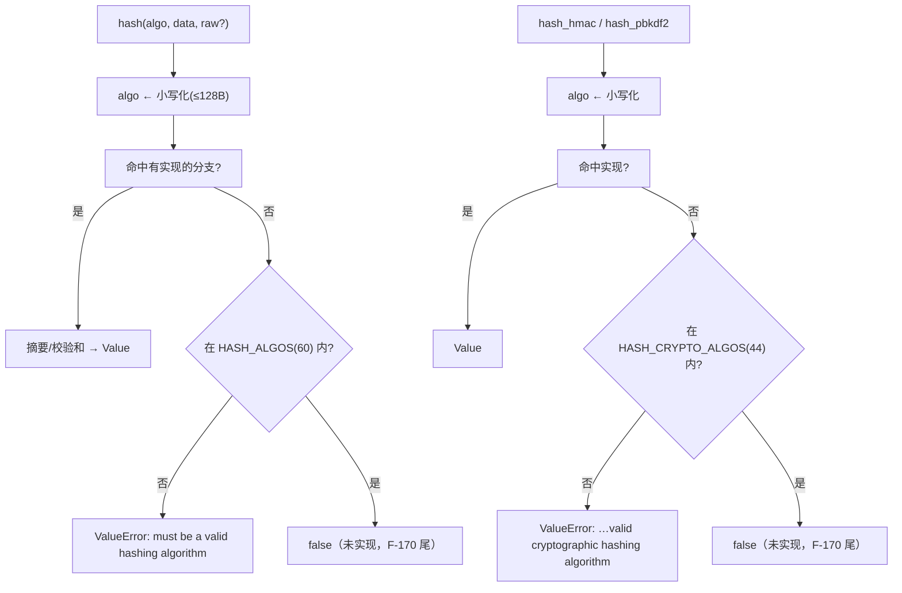
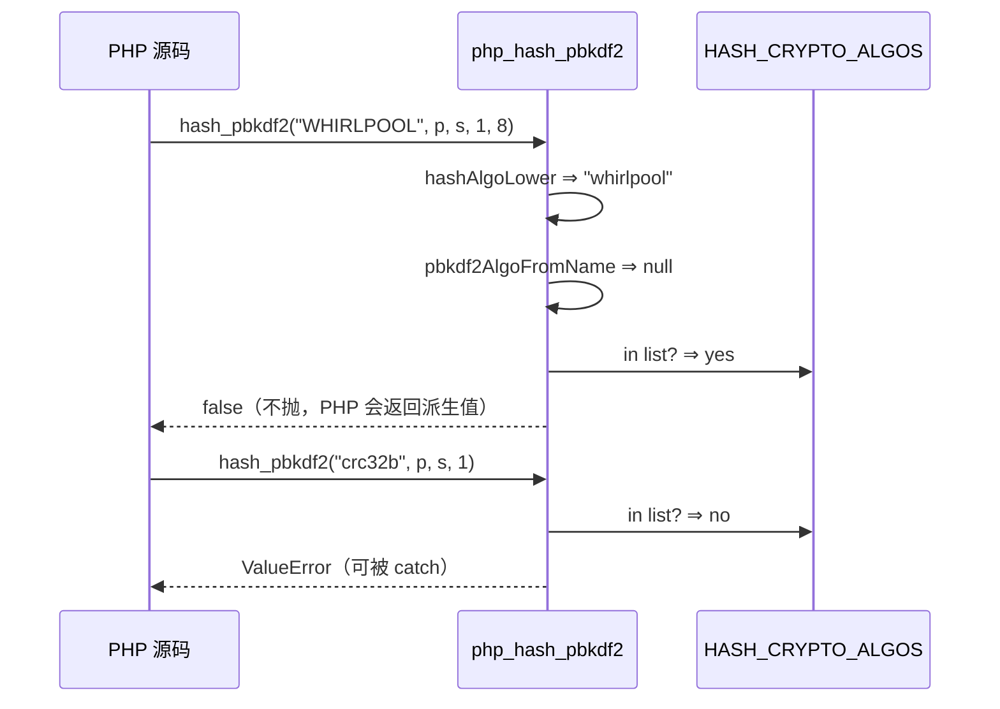

# AOT-CODEGEN-012 R-268：hash 算法注册表、大小写与三入口 ValueError（F-172-b）

- 日期：2026-10-24
- 代次锚：`nlk c9d1385fb7fffb355332f5ddb060a2b3`；`tpl 004172242604433ef5edf959ed2a9b27`；`irg 0b7106338d5ffe1342caee961734b8d8`／`ir fb2bb442ca27b98cf1df7e109a240e1f` 未变（均未提交）
- 工单：`docs/known-issues/AOT-CODEGEN-012-class-name-case-insensitive-lookup.md` §175

## 1. 高层摘要（TL;DR）

`hash_algos()` 此前只返回 AOT 实现的 10 项；`hash()` 对未知算法返回 `false`（PHP 8 抛 `ValueError`）；算法名大小写敏感（PHP 不敏感）。本轮按 PHP 8.5.8 实测把「PHP 认不认这个名字」与「AOT 会不会算」拆开：两张注册表（`hash_algos()` 60 项、`hash_hmac_algos()` 44 项，均按 PHP 原序），三入口（hash/hash_hmac/hash_pbkdf2）只在**不在注册表**时抛 ValueError，同时把 R-262 遗留在 `hash_pbkdf2` 的**过度致命**（把 PHP 支持但 AOT 未实现的算法当无效算法抛错）改成返回 false。

## 2. 影响范围

| 层 | 影响 |
|---|---|
| 运行期模板 | 三个 hash 入口的算法名分诊与大小写归一；`hash_algos()` 内容；新增 `hash_hmac_algos()` |
| 注册表 | `hash_hmac_algos` 新条目（nlk） |
| 语义面 | 未知/非加密算法的错误类别（false → ValueError）；`hash("SHA256")` 从 false → 正确摘要；`hash_pbkdf2` 对未实现算法不再抛错 |

## 3. 核心变更

| # | 变更 | 说明 |
|---|---|---|
| 1 | `HASH_ALGOS`（60）／`HASH_CRYPTO_ALGOS`（44） | 数据来自 PHP 8.5.8 实测**原序**；与实现能力解耦 |
| 2 | `hashAlgoLower` | 栈上 128B 小写化；>128 原样比较（自然落入「未知」） |
| 3 | 三入口分诊 | `hash` 查 60 集；`hash_hmac`／`hash_pbkdf2` 查 44 集；不在集 ⇒ ValueError；集内但未实现 ⇒ false |
| 4 | `hash_hmac_algos()` | 新增运行期函数＋注册表条目 |
| 5 | 门 C313 | 5 臂：两表全序／ValueError 矩阵／大小写／已实现值／反向守卫 |

## 4. 可视化概览（Code & Logic Map）

## 5. 详细变更分析

| 文件 | 变更点 |
|---|---|
| `src/aot/runtime_lib_template.zig` | `hashAlgoLower`（`:32474`）；`HASH_ALGOS`（`:32850`）／`HASH_CRYPTO_ALGOS`（`:32865`）／`hashAlgoInList`（`:32876`）／`hashAlgosToArray`；`php_hash_algos`（`:32892`）／新增 `php_hash_hmac_algos`（`:32897`）；三处尾支分诊 `:32558`／`:32623`／`:32781` |
| `src/aot/native_linker.zig` | `hash_hmac_algos` 注册（`:4848`） |
| `fuzzy_scripts_720/tmp/c313_hash_algos_gate_tmp.sh` | 新门 5 臂 |

## 6. 影响与风险评估

- **破坏式变更（向 PHP 靠拢）**：未知算法由「返回 false」变「抛 ValueError」；`hash_pbkdf2` 的未实现算法由「抛 ValueError」变「返回 false」（去过度致命）。
- **性能**：每次调用多一次 ≤12 字节的小写化（栈缓冲，无分配）；相对哈希本体可忽略。
- **未动面**：`hash_file()` 仍是 2 形参（F-62f 形参族）；`hash_init/update/final` 未实现；动态调用未接派发。
- **复测路径**：`bash fuzzy_scripts_720/tmp/c313_hash_algos_gate_tmp.sh`；邻居 `c312`／`c307`／`c311`。
- **读数**：C313 **5/5 SAME**（42 s，自证 5 CF）；C312 5/5、C307 4/4、C311 4/4；`zig build test` 21/21、**326/326**；主回归 **PASS=68 FAIL=0**。

## 7. 遗留问题/潜在问题

- **F-170 尾（范围收窄）**：PHP 支持但 AOT 未实现的算法（whirlpool/tiger*/gost*/haval*/snefru*/md2/md4/fnv*/joaat/murmur*/xxh*/ripemd256/320）在三个入口返回 `false`；`hash_algos()` 会如实列出它们。
- **值域面**：`hash()`/`hash_hmac()` 对非字符串实参仍返回 false（PHP 抛 TypeError），属 F-62f 族未接。

## 8. 后续建议

| 优先级 | 建议 | 影响面 | 落地成本 |
|---|---|---|---|
| P2 | F-170 尾第二段：ripemd256/320（复用现有 RIPEMD 表与轮函数） | hash 算法矩阵 | 中 |
| P3 | `hash_file()` 形参补齐（binary/options）＋未知算法 ValueError | hash_file 契约 | 低 |
| P3 | `hash_init/hash_update/hash_final` 增量接口 | hash API | 中 |
