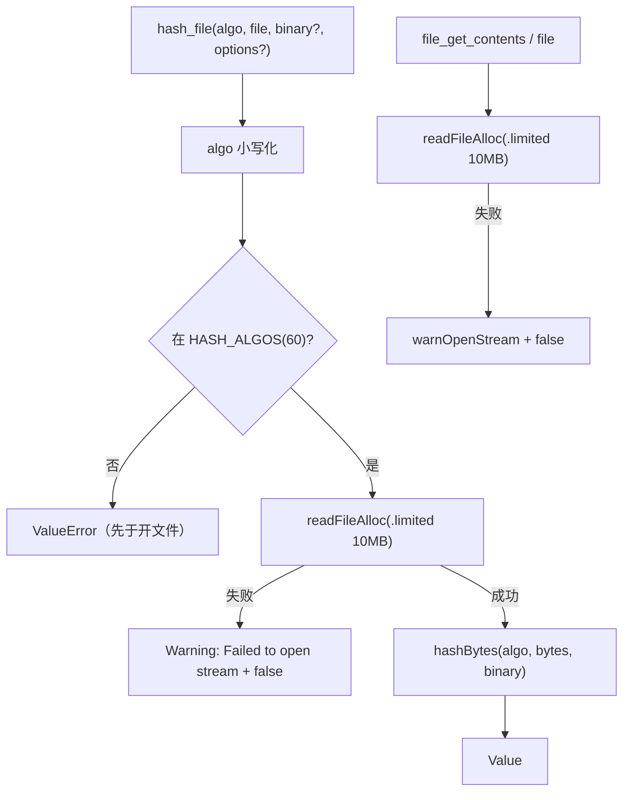
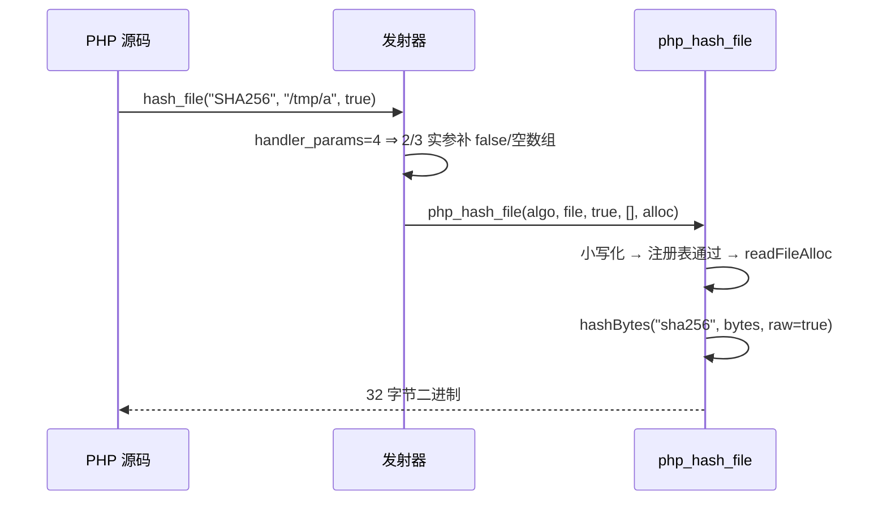

# AOT-CODEGEN-012 R-269：hash_file 四形参与错误契约（含 file/file_get_contents 不可编译修复）

- 日期：2026-10-24
- 代次锚：`nlk 32d899d270d279c03900afc24c74788c`；`tpl 41ddf903bb3673f2524b46518eaa350e`；`irg 0b7106338d5ffe1342caee961734b8d8`／`ir fb2bb442ca27b98cf1df7e109a240e1f` 未变（均未提交）
- 工单：`docs/known-issues/AOT-CODEGEN-012-class-name-case-insensitive-lookup.md` §176

## 1. 高层摘要（TL;DR）

`hash_file()` 在 AOT 里**完全不可用**：模板内部调用 `php_hash` 少传 `raw_output`，任何调用都编译失败；且只收 2 形参（PHP 是 4）。本轮把它重写成四形参并按 PHP 契约接线（二进制输出、算法名校验先于开文件、缺文件 Warning+false）。查证时又撞出同族两枚 P1：`file_get_contents()` 与 `file()` 因 Zig 0.16 的 `readFileAlloc` 第四参改成 `Io.Limit`（原裸 int）而**只要被调用就编译失败**——一并修复并补打开失败 Warning。

## 2. 影响范围

| 层 | 影响 |
|---|---|
| 运行期模板 | `hashBytes` 抽取；`warnOpenStream` 单点；`php_hash_file` 四形参；`php_file_get_contents`／`php_file` 的 API 漂移修复 |
| 注册表/发射器 | `hash_file` `handler_params=4` ＋ 缺省值；专用分支补位（嵌套与新调用同源） |
| 语义面 | `hash_file` 的 binary/options/算法校验/缺文件警告；`file_get_contents`／`file` 从「不可编译」到可用 |

## 3. 核心变更

| # | 变更 | 说明 |
|---|---|---|
| 1 | `hashBytes(algo, input, raw, alloc)` | `hash()` 与 `hash_file()` 共用字节入口；md5/sha1 改直接 `std.crypto.hash`，避免字符串往返与 `content_val` 泄漏 |
| 2 | `warnOpenStream(fn, path, err)` | 统一 `{fn}({path}): Failed to open stream: {reason}`；`FileNotFound`→`No such file or directory`、`AccessDenied`→`Permission denied` |
| 3 | `php_hash_file` 四形参 | 小写化 → 注册表（不在 ⇒ ValueError）→ 读文件（失败 ⇒ 告警 + false）→ `hashBytes` |
| 4 | `file_get_contents`／`file` 修复 | `readFileAlloc(..., .limited(10MB))`；打开失败告警 |
| 5 | 注册表/发射器 | `handler_params=4`＋`optional_defaults{false, 空数组}`；专用分支对 2/3 实参补位 |

## 4. 可视化概览（Code & Logic Map）

## 5. 详细变更分析

| 文件 | 变更点 |
|---|---|
| `src/aot/runtime_lib_template.zig` | `hashBytes`（`:32490`）／`php_hash` 包装（`:32563`）；`warnOpenStream`（`:36003`）；`php_hash_file` 四形参（`:36017`）；`php_file_get_contents`（`:4269`）／`php_file`（`:4710`）补 `Io.Limit` 与告警 |
| `src/aot/native_linker.zig` | `hash_file` 注册（`:4971`）与专用发射分支补位（`:24152`） |
| `fuzzy_scripts_720/tmp/c314_hash_file_gate_tmp.sh` | 新门 6 臂 |

## 6. 影响与风险评估

- **破坏式变更**：`hash_file` 由「不可编译」变可用；`file`／`file_get_contents` 由「不可编译」变可用（纯修复，无向后兼容负担）。
- **性能**：`hash_file` 一次 `readFileAlloc` + 一次 `hashBytes`；`file_get_contents` 路径不变（只多一次错误分支）。
- **未动面**：`file_get_contents` 的 offset/maxlen/context、`file()` 的标志与 context、`fopen` 的 stream 语义（F-173）；`hash_init/update/final`；动态调用派发。
- **复测路径**：`bash fuzzy_scripts_720/tmp/c314_hash_file_gate_tmp.sh`；邻居 `c313`／`c312`／`c307`／`c308`。
- **读数**：C314 **6/6 SAME**（32 s，自证 6 CF）；四邻门全绿；`zig build test` 21/21、**326/326**；主回归 **PASS=68 FAIL=0**。

## 7. 遗留问题/潜在问题

- **F-173（新立，P2）**：`file_get_contents` 的 `offset`/`maxlen` 与 stream context；`file()` 的 `FILE_IGNORE_NEW_LINES`/`FILE_SKIP_EMPTY_LINES`/context；`fopen`/`fgets`/`fwrite` 的 stream 语义。
- **F-170 尾**：`hash_file` 对未实现算法返回 false（PHP 返回摘要）。
- 说明：`hash_file` 与 `file_get_contents` 都无 offset 等可选形参，当前注册表只补到第 4/1 槽，显式多传实参会走编译期 arity 诊断。

## 8. 后续建议

| 优先级 | 建议 | 影响面 | 落地成本 |
|---|---|---|---|
| P2 | F-173：`file_get_contents` offset/maxlen＋`file()` 两标志 | 文件族 | 低-中 |
| P2 | `hash_init/hash_update/hash_final` 增量接口（内部 ctx 对象） | hash API | 中 |
| P3 | `fopen` 家族与 stream 资源语义（fgets/fread/fwrite/feof） | 文件族 | 高 |
