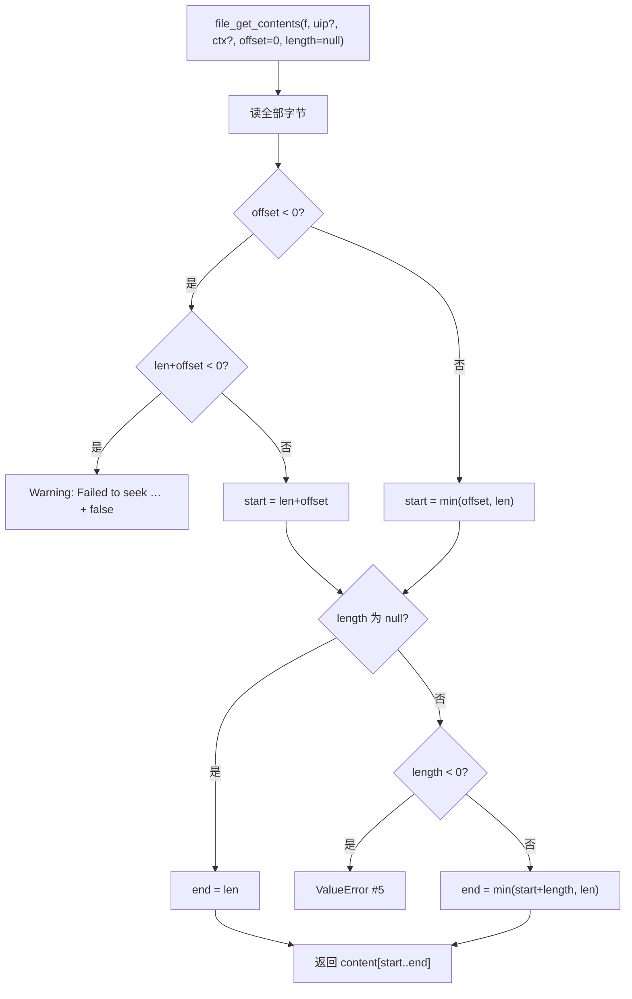
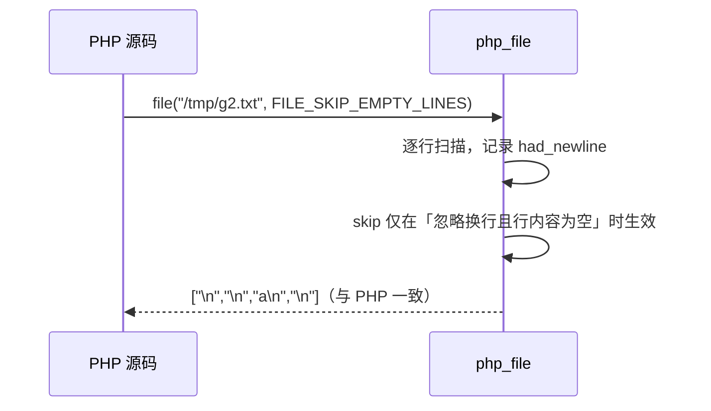

# AOT-CODEGEN-012 R-270：file_get_contents 的 offset/length 与 file() 的 flags（F-173 主体）

- 日期：2026-10-24
- 代次锚：`nlk 9d7510a06e5da4d28135c4c5147bbd66`；`tpl a502765c3371ea7d0dec24840f1efc69`；`irg 0b7106338d5ffe1342caee961734b8d8`／`ir fb2bb442ca27b98cf1df7e109a240e1f` 未变（均未提交）
- 工单：`docs/known-issues/AOT-CODEGEN-012-class-name-case-insensitive-lookup.md` §177

## 1. 高层摘要（TL;DR）

`file_get_contents()` 只接受 1 形参（PHP 5 个），`file()` 只接受 1 形参（PHP 3 个）且**行尾语义错**（末行总被补 `\n`）。本轮按实测把两函数补全：offset（含负值自尾部、越界空串、越过头部 seek 告警）、length（null/0/正/负 ValueError）、`FILE_IGNORE_NEW_LINES`/`FILE_SKIP_EMPTY_LINES` 的真实组合语义，以及 `FILE_USE_INCLUDE_PATH` 常量。

## 2. 影响范围

| 层 | 影响 |
|---|---|
| 运行期模板 | `php_file_get_contents` 五形参、`php_file` 三形参与行扫描重写；新增常量 |
| 注册表 | 两处 `file_get_contents` 与 `file` 条目补 `handler_params`/`optional_defaults` |
| 语义面 | 读文件族的切片/行集合结果；`file_get_contents` 补上 `content` 释放（原泄漏） |

## 3. 核心变更

| # | 变更 | 说明 |
|---|---|---|
| 1 | offset | 正值越界 ⇒ 空串；负值自尾部；`len + off < 0` ⇒ seek Warning + false |
| 2 | length | null ⇒ 到末尾；0 ⇒ 空串；负 ⇒ `ValueError … Argument #5 ($length) must be greater than or equal to 0` |
| 3 | file() 行扫描 | 按 `\n` 定位 + 记录是否换行结尾 ⇒ 末行无换行不补 `\n` |
| 4 | flags | 支持 2/4；★4 **单独使用**时空白行仍以 `"\n"` 保留（实测），仅与 2 同用才过滤 |
| 5 | 常量 | `FILE_USE_INCLUDE_PATH = 1` |
| 6 | 泄漏 | `file_get_contents` 的 `content` 补 `defer free`；`file()` 的逐行 `allocPrint` 立即释放 |

## 4. 可视化概览（Code & Logic Map）

## 5. 详细变更分析

| 文件 | 变更点 |
|---|---|
| `src/aot/runtime_lib_template.zig` | `php_file_get_contents`（`:4272`）：五形参、offset 三分支、length 校验、seek 告警；`php_file`（`:4747`）：三形参、行扫描重写、flags 组合；`FILE_USE_INCLUDE_PATH`（`:9510`） |
| `src/aot/native_linker.zig` | `file_get_contents` ×2（`:4446`／`:4766`）`handler_params=5`；`file`（`:4462`）`handler_params=3` |
| `fuzzy_scripts_720/tmp/c315_file_opts_gate_tmp.sh` | 新门 5 臂 |

## 6. 影响与风险评估

- **破坏式变更**：`file()` 末行无换行时不再凭空补 `\n`（修正）；`file()` 的 `FILE_SKIP_EMPTY_LINES` 语义纠正（原先会误删空白行）。
- **内存**：`file_get_contents` 从「每调用泄漏一份文件内容」变为正常释放；`file()` 的逐行拼接不再泄漏。
- **未建模**：`use_include_path`、stream context（AOT 无对应机制），仅吞下形参。
- **复测路径**：`bash fuzzy_scripts_720/tmp/c315_file_opts_gate_tmp.sh`；邻居 `c314`／`c313`。
- **读数**：C315 **5/5 SAME**（27 s，自证 5 CF）；C314 6/6、C313 5/5；`zig build test` 21/21、**326/326**；主回归 **PASS=68 FAIL=0**。

## 7. 遗留问题/潜在问题

- **F-173 尾**：`fopen`/`fgets`/`fread`/`fwrite`/`feof` 等 stream 语义；`use_include_path`；context 参数。
- **F-102 同族**：`file_get_contents` 在 `native_linker.zig` 有**两处注册**，本轮两处同步改；后续任何形参改动必须同时改两处。

## 8. 后续建议

| 优先级 | 建议 | 影响面 | 落地成本 |
|---|---|---|---|
| P2 | `fopen` 族 stream 语义（fgets/fread/fwrite/feof/rewind） | 文件族 | 高 |
| P3 | `file_put_contents` 的 flags（FILE_APPEND/LOCK_EX）与 context | 文件族 | 低 |
| P3 | `file()`/`file_get_contents` 的 `use_include_path`（若引入 include_path 机制再动） | 文件族 | 依赖上层设计 |
