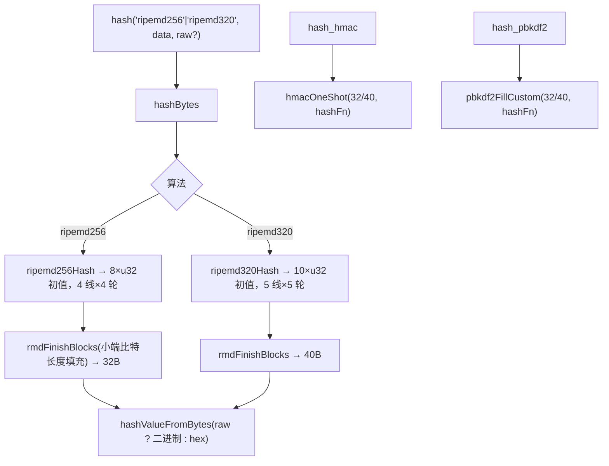
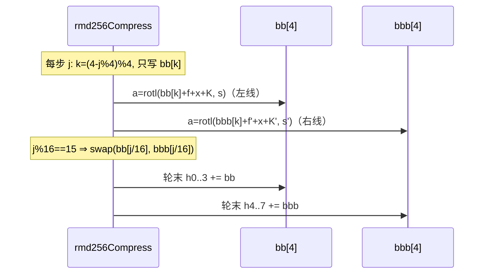

# AOT-CODEGEN-012 R-271：RIPEMD-256 / RIPEMD-320（F-170 尾第二段）

- 日期：2026-10-24
- 代次锚：`tpl e38ad1f63462c61091ebd82361c20337`；`nlk 9d7510a06e5da4d28135c4c5147bbd66`／`irg 0b7106338d5ffe1342caee961734b8d8`／`ir bb2bb442ca27b98cf1df7e109a240e1f` 未变（均未提交）
- 工单：`docs/known-issues/AOT-CODEGEN-012-class-name-case-insensitive-lookup.md` §178

## 1. 高层摘要（TL;DR）

RIPEMD-256/320 此前只在 `hash_algos()` 里"有名无实"（四入口均返回 false）。本轮按 RustCrypto 的 `c256.rs`/`c320.rs` 参考实现落地两条并行线压缩函数，接入 `hash`（含 raw）、`hash_hmac`（含 >64B 键）、`hash_pbkdf2`（hlen 32/40）。空串/abc 等规范向量与 PHP 8.5.8 逐字节一致。

## 2. 影响范围

| 层 | 影响 |
|---|---|
| 运行期模板 | 新增 `rmd256Compress`/`rmd320Compress`/`ripemd256Hash`/`ripemd320Hash`；三个入口新增分支 |
| 语义面 | `hash('ripemd256'|'ripemd320')`、`hash_hmac`、`hash_pbkdf2` 从 false → 真值 |

## 3. 核心变更

| # | 变更 | 说明 |
|---|---|---|
| 1 | 256 压缩 | 两条 4 寄存器线；128 轮函数与 `RMD_R160/RP160/S160/SP160`、`RMD_K128L/R` 复用 |
| 2 | 320 压缩 | 两条 5 寄存器线；160 轮函数（含 `c=rotl(c,10)`）、`RMD_K160L/R` 复用 |
| 3 | 交换语义 | 每轮末 `swap(bb[r], bbb[r])`，r＝轮号；**按物理下标**（不可改写成逻辑寄存器轮转） |
| 4 | 填充 | 复用 `rmdFinishBlocks`（小端 64 位比特长度） |
| 5 | 接入 | hash raw、hmac（32/40）、pbkdf2（hlen 32/40） |

## 4. 可视化概览（Code & Logic Map）

## 5. 详细变更分析

| 文件 | 变更点 |
|---|---|
| `src/aot/runtime_lib_template.zig` | `rmd256Compress`（`:32446`）／`rmd320Compress`（`:32484`）／`ripemd256Hash`（`:32522`）／`ripemd320Hash`（`:32533`）；`hashBytes` 分支（`:32718`/`:32720`）；hmac 分支；`Pbkdf2Algo`＋hlen（`:32881`）＋分派（`:33006`） |
| `fuzzy_scripts_720/tmp/c316_ripemd256_320_gate_tmp.sh` | 新门 5 臂 |

## 6. 影响与风险评估

- **破坏式变更**：无（原为 false，现为真值）。
- **性能**：每块 64 步（256）/80 步（320），无额外分配；与 160 同量级。
- **实现风险点（已踩一次）**：并行线的交换是**物理下标**交换，首版按逻辑寄存器轮转导致全错；已改为下标轮转并在注释里写明原因。
- **复测路径**：`bash fuzzy_scripts_720/tmp/c316_ripemd256_320_gate_tmp.sh`；邻居 `c313`／`c312`／`c311`／`c307`。
- **读数**：C316 **5/5 SAME**（30 s，自证 5 CF）；四邻门全绿；`zig build test` 21/21、**326/326**；主回归 **PASS=68 FAIL=0**。

## 7. 遗留问题/潜在问题

- **F-170 尾（仍开）**：whirlpool／tiger\*／gost\*／haval\*／snefru\*／md2／md4／fnv\*／joaat／murmur\*／xxh\* 仍未实现。
- `hash_init/update/final` 增量接口仍缺（全族同）。
- 连字符算法名（`RipeMD-320`）属未知算法（与 PHP 一致）。

## 8. 后续建议

| 优先级 | 建议 | 影响面 | 落地成本 |
|---|---|---|---|
| P3 | F-170 尾：md4/whirlpool（std 无；需自实现） | hash 算法面 | 高 |
| P3 | `hash_init/update/final` | hash API | 中 |
| P2 | F-158/F-117（嵌套三元/循环 phi）——需老铁裁方案 | 发射器核心 | 中-高 |
