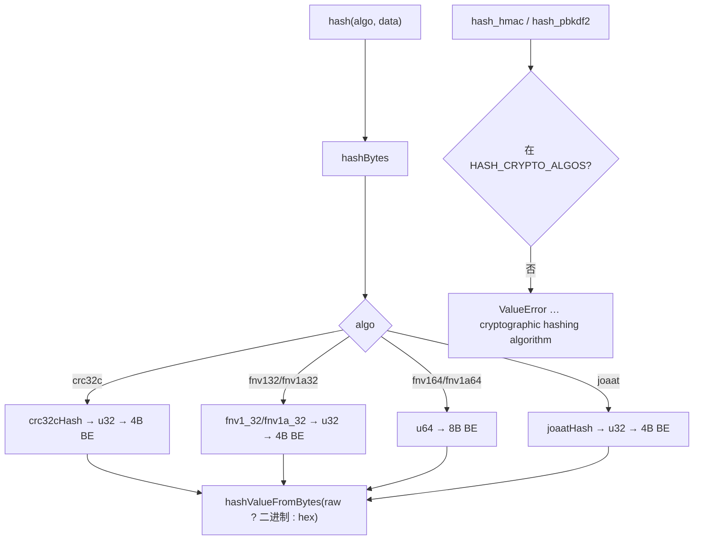
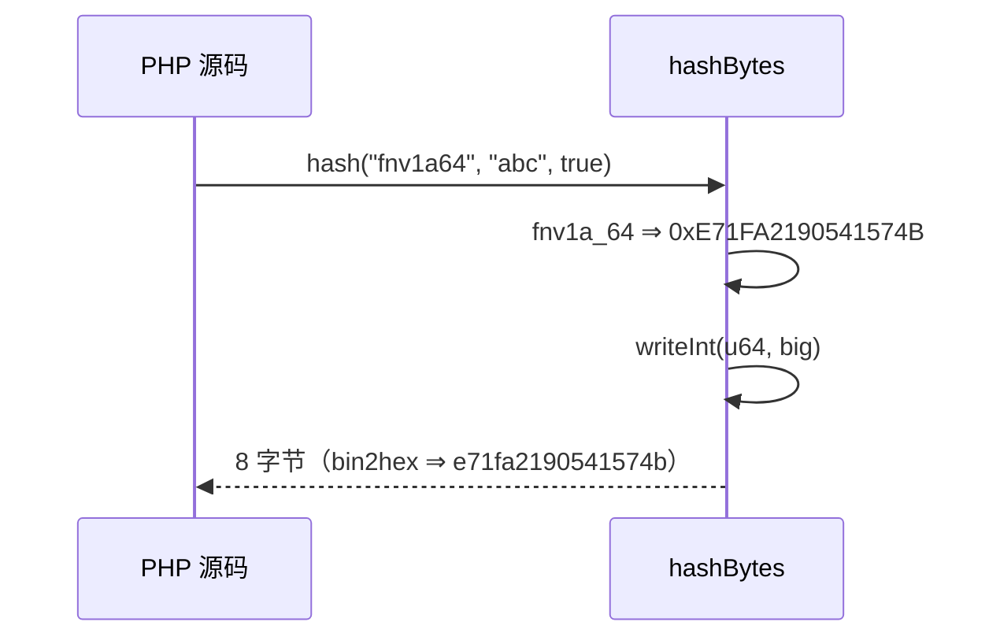

# AOT-CODEGEN-012 R-272：非加密校验和族（crc32c／fnv*／joaat）（F-170 尾第三段）

- 日期：2026-10-24
- 代次锚：`tpl ff6298bf7504eca858766528ca2b8624`；`nlk 9d7510a06e5da4d28135c4c5147bbd66`／`irg 0b7106338d5ffe1342caee961734b8d8`／`ir bb2bb442ca27b98cf1df7e109a240e1f` 未变（均未提交）
- 工单：`docs/known-issues/AOT-CODEGEN-012-class-name-case-insensitive-lookup.md` §179

## 1. 高层摘要（TL;DR）

`hash_algos()` 里的 crc32c／fnv132／fnv1a32／fnv164／fnv1a64／joaat 一直是有名无实（返回 false）。本轮按 PHP 实测值实现这六个非加密校验和，`hash()`（含 raw）与 `hash_file()` 全部对齐；`hash_hmac`／`hash_pbkdf2` 继续按 PHP 契约抛 ValueError。

## 2. 影响范围

| 层 | 影响 |
|---|---|
| 运行期模板 | 新增 CRC-32C 表与六个校验和函数；`hashBytes` 六分支（大端输出） |
| 语义面 | `hash()`／`hash_file()` 对这六个算法的返回值；hmac/pbkdf2 的拒绝面不变（反向守卫 12 形） |

## 3. 核心变更

| # | 变更 | 说明 |
|---|---|---|
| 1 | `crc32cHash` | 反射 poly 0x82F63B78，init/xorout 0xFFFFFFFF，comptime 建表 |
| 2 | `fnv1_32`/`fnv1a_32` | offset 0x811c9dc5、prime 0x01000193；1 与 1a 的 xor/mul 顺序不同 |
| 3 | `fnv1_64`/`fnv1a_64` | offset 0xcbf29ce484222325、prime 0x100000001b3 |
| 4 | `joaatHash` | Jenkins one-at-a-time（`+b; +=h<<10; ^=h>>6`，收尾 `+=h<<3; ^=h>>11; +=h<<15`） |
| 5 | 输出形态 | 六者一律**大端**（PHP raw 与 hex 字节同序） |

## 4. 可视化概览（Code & Logic Map）

## 5. 详细变更分析

| 文件 | 变更点 |
|---|---|
| `src/aot/runtime_lib_template.zig` | `crc32cTable`（`:32631`）／`CRC32C_TABLE`（`:32646`）／`crc32cHash`（`:32648`）；`fnv1_32`（`:32657`）／`fnv1a_32`（`:32666`）／`fnv1_64`（`:32675`）／`fnv1a_64`（`:32684`）／`joaatHash`（`:32693`）；`hashBytes` 六分支（`:32787`–`:32811`） |
| `fuzzy_scripts_720/tmp/c317_checksum_gate_tmp.sh` | 新门 5 臂 |

## 6. 影响与风险评估

- **破坏式变更**：无（原 false → 真值）。
- **性能**：CRC-32C 为按字节查表（1 op/byte），FNV/joaat 为常数级算术；无分配。
- **正确性证据**：六算法 × 七输入 + raw + hash_file 全 SAME；hmac/pbkdf2 拒绝矩阵 12 形全 SAME。
- **复测路径**：`bash fuzzy_scripts_720/tmp/c317_checksum_gate_tmp.sh`；邻居 `c316`／`c313`／`c312`。
- **读数**：C317 **5/5 SAME**（32 s，自证 5 CF）；三邻门全绿；`zig build test` 21/21、**326/326**；主回归 **PASS=68 FAIL=0**。

## 7. 遗留问题/潜在问题

- **F-170 尾（仍开）**：whirlpool／tiger\*／gost\*／haval\*／snefru\*／md2／md4／murmur3\*／xxh\*。
- `xxh*`／`murmur3*` 若后续要补，需明确 PHP 的种子/输出字节序（本轮未测）。
- `crc32cTable` 与 `crc32Bzip2Table` 不可合并（poly 与反射方向不同），两张 comptime 表并存。

## 8. 后续建议

| 优先级 | 建议 | 影响面 | 落地成本 |
|---|---|---|---|
| P3 | xxh32/64/3/128、murmur3a/c/f（先测种子与字节序） | hash 算法面 | 中 |
| P3 | md4（RFC 1320，std 无） | hash 算法面 | 中 |
| P3 | whirlpool/tiger/gost/haval（表量大） | hash 算法面 | 高 |
