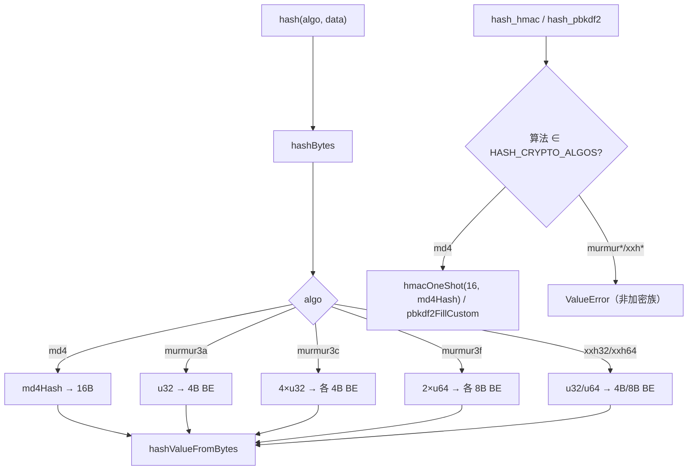
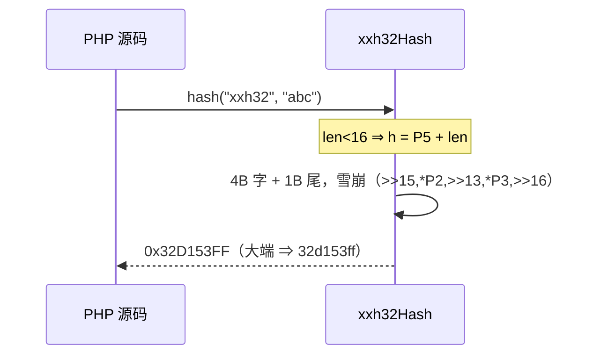

# AOT-CODEGEN-012 R-273：md4 / murmur3a·c·f / xxh32·64（F-170 尾第四段）

- 日期：2026-10-24
- 代次锚：`tpl 0b8faa9418bb5409d21d62c51dcea99a`；`nlk 9d7510a06e5da4d28135c4c5147bbd66`／`irg 0b7106338d5ffe1342caee961734b8d8`／`ir bb2bb442ca27b98cf1df7e109a240e1f` 未变（均未提交）
- 工单：`docs/known-issues/AOT-CODEGEN-012-class-name-case-insensitive-lookup.md` §180

## 1. 高层摘要（TL;DR）

`hash_algos()` 里还剩 6 个「轻量但未实现」的算法：md4、MurmurHash3 三变体、XXH32/64。本轮一次性补齐（规范来源：RFC 1320、smhasher `MurmurHash3.cpp`、xxHash `xxhash.h`），`hash()`（含 raw）与 `hash_file()` 全部对齐；md4 同时接入 `hash_hmac`／`hash_pbkdf2`（加密族），murmur3*/xxh* 保持 ValueError 拒绝。

## 2. 影响范围

| 层 | 影响 |
|---|---|
| 运行期模板 | 新增 md4 压缩/填充、MurmurHash3 三变体、XXH32/64；`hashBytes` 六分支；md4 进 hmac/pbkdf2 |
| 语义面 | 这 6 个算法的 `hash`/`hash_file` 从 false → 真值；hmmac/pbkdf2 的 md4 从「未实现(ValueError)」→ 真值 |

## 3. 核心变更

| # | 变更 | 说明 |
|---|---|---|
| 1 | md4 | RFC 1320：3 轮（F/G/H）、r 序（0..15／0,4,8,12,…／0,8,4,12,…）、s 表（3,7,11,19／3,5,9,13／3,9,11,15）、K=0x5a827999/0x6ed9eba1，小端填充 |
| 2 | murmur3a | x86_32(seed 0)：c1/c2、`rotl 15/13`、`*5+0xe6546b64`、fmix32 |
| 3 | murmur3c | x86_128(seed 0)：4 路 c1..c4、尾部按 `tl>=n` 链、双向合并与 fmix32 |
| 4 | murmur3f | x64_128(seed 0)：c1/c2 64 位、`rotl 31/33/27/31`、fmix64 |
| 5 | xxh32/xxh64 | seed 0 的四路并行主体＋mergeRound＋雪崩尾；全大端输出 |
| 6 | 加密性子集 | md4 属加密族（hmac/pbkdf2 支持，hlen 16）；murmur/xxh 仍被拒绝 |

## 4. 可视化概览（Code & Logic Map）

## 5. 详细变更分析

| 文件 | 变更点 |
|---|---|
| `src/aot/runtime_lib_template.zig` | `md4Hash`（`:32711`）／`md4Compress`（`:32737`）；`murmur3aHash`（`:32806`）／`murmur3cHash`（`:32842`）／`murmur3fHash`（`:32973`）；`xxh32Hash`（`:33051`）／`xxh64Hash`（`:33092`）；`hashBytes` 六分支（`:33255` 起）；hmac/pbkdf2 的 md4 |
| `fuzzy_scripts_720/tmp/c318_hash_more_gate_tmp.sh` | 新门 5 臂 |

## 6. 影响与风险评估

- **破坏式变更**：无（false → 真值；md4 的 hmac/pbkdf2 由 ValueError → 真值，与 PHP 一致）。
- **实现要点**：MurmurHash3 尾部必须照 C 的 switch 落穿改成 `if (tl >= n)` 链，否则会漏低字节；128 位输出按**逐字大端**写出。
- **性能**：均为线性单遍；xxh 有 4 路并行常量，无分配。
- **复测路径**：`bash fuzzy_scripts_720/tmp/c318_hash_more_gate_tmp.sh`；邻居 `c317`／`c316`／`c313`。
- **读数**：C318 **5/5 SAME**（37 s，自证 5 CF）；三邻门全绿；`zig build test` 21/21、**326/326**；主回归 **PASS=68 FAIL=0**。

## 7. 遗留问题/潜在问题

- **F-170 尾（5 项）**：whirlpool／tiger\*／gost\*／haval\*／snefru\*，以及 xxh3／xxh128 两种新式算法（复杂度显著更高）。
- murmur3c/f 的 128 位输出语义（逐字大端）只在 PHP 8.5.8 上验证；其它实现（如 Python mmh3）可能整体反转字节，属跨实现差异，不属 AOT 缺陷。

## 8. 后续建议

| 优先级 | 建议 | 影响面 | 落地成本 |
|---|---|---|---|
| P3 | xxh3／xxh128（xxHash3 规范，代码量大） | hash 算法面 | 高 |
| P3 | whirlpool／tiger／gost／haval／snefru（表量大） | hash 算法面 | 高 |
| P2 | `hash_init/update/final` 增量接口（对长数据更实用） | hash API | 中 |
