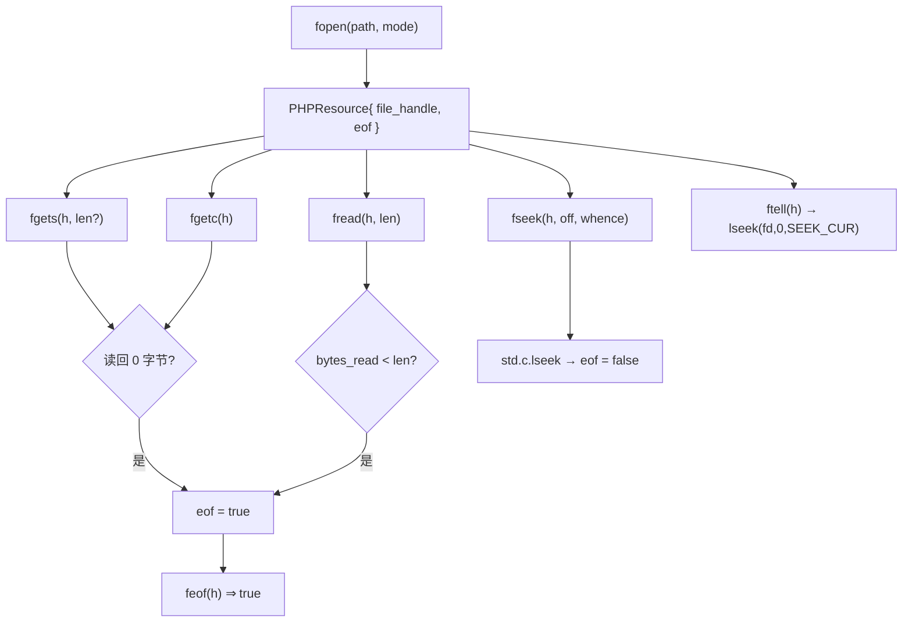
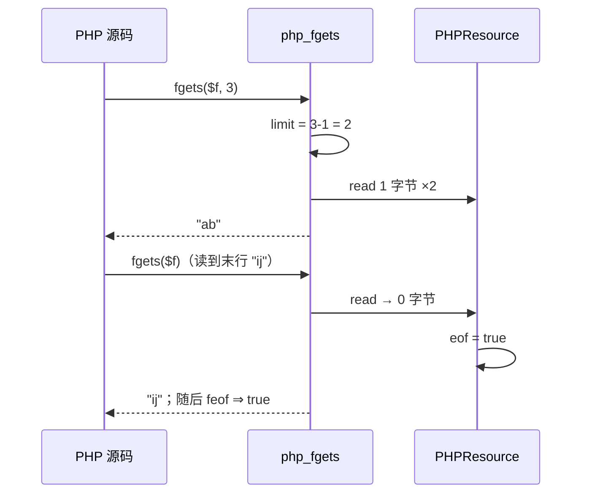

# AOT-CODEGEN-012 R-274：流族（feof/ftell/fseek/rewind/fgetc/fgets·length）＋文件系统 API 漂移修复

- 日期：2026-10-24
- 代次锚：`nlk a90c34994de41a3b95bc2dc0c0356c8d`；`tpl 7b6e7174ffd006cf35d424a7a1e73a92`；`irg 0b7106338d5ffe1342caee961734b8d8`／`ir bb2bb442ca27b98cf1df7e109a240e1f` 未变（均未提交）
- 工单：`docs/known-issues/AOT-CODEGEN-012-class-name-case-insensitive-lookup.md` §181

## 1. 高层摘要（TL;DR）

文件/流族存在一批**只要被调用就出错**的问题：`feof()` 完全未实现（调用即 undefined function 致命）、`rewind()` 把 resource 当整数指针（恒 false）、`fseek()` 与 `mkdir()` 编译失败、`file_exists/rmdir/rename/copy/unlink/getcwd/scandir` 因 Zig 0.16 的 `Io.Dir` API 漂移**全部编译失败**。本轮补齐流语义（feof/ftell/fseek/rewind/fgetc/fgets 长度形/fread EOF 与 ValueError），并把上述 API 漂移全部修正，同时给 `file_put_contents` 加上 `FILE_APPEND`。

## 2. 影响范围

| 层 | 影响 |
|---|---|
| 运行期模板 | 流族 8 个函数＋`streamLseek` 封装；`PHPResource.eof`；文件系统族 8 处 API 修正；`file_put_contents` 四形参 |
| 注册表/发射器 | 新增 `feof`/`ftell`/`fgetc`；`fgets` 2 槽、`fseek` 3 槽、`file_put_contents` 4 槽（两处注册＋专用分支） |
| 语义面 | 从「不可用/编译失败」→ 与 PHP 一致的读写与文件操作 |

## 3. 核心变更

| # | 变更 | 说明 |
|---|---|---|
| 1 | `feof` | `PHPResource.eof`：一次读尝试返回 0 字节时置位；`@`/`fseek` 成功/`rewind` 清除 |
| 2 | `fgets($h, $len)` | `$len` 给定时最多 `len-1` 字节 |
| 3 | `fread($h,$len)` | `len<=0` ⇒ ValueError；EOF 返回 `""`；buffer 正确释放 |
| 4 | `ftell`/`fseek`/`rewind` | 经 `std.c.lseek`（Zig 0.16 `Io.File` 无 seek）；`fseek` 三 whence 且成功清 EOF |
| 5 | `file_put_contents` | 四形参；`FILE_APPEND` 定位末尾（文件不存在则创建） |
| 6 | API 漂移 | `access/createDir/createDirPath/deleteDir/rename/copyFile/realPathFileAlloc/deleteFile` 全部补 `io`；`Permissions` 用 `@enumFromInt` |

## 4. 可视化概览（Code & Logic Map）

## 5. 详细变更分析

| 文件 | 变更点 |
|---|---|
| `src/aot/runtime_lib_template.zig` | `php_file_put_contents`（`:4254`）／`php_fread`（`:4381`）／`php_fgets`（`:4417`）／`php_fgetc`（`:4452`）／`php_feof`（`:4466`）／`streamLseek`（`:4473`）／`php_ftell`（`:4480`）／`php_fseek`（`:4489`）／`php_rewind`（`:36795`）；`PHPResource.eof`（`:2490`）；常量 `SEEK_*`；文件系统族 `:28137`–`:28204`、`php_getcwd`（`:4528`）、`php_unlink`（`:4555`）、迭代器 `:4516`／`:27615` |
| `src/aot/native_linker.zig` | `feof`/`ftell`/`fgetc` 注册（`:4466`–`:4468`）；`fgets`/`fseek` 槽位（`:4464`/`:4465`）；`file_put_contents` 两处注册（`:4445`／`:4770`）＋专用发射分支（`:23682`） |
| `fuzzy_scripts_720/tmp/c319_stream_fs_gate_tmp.sh` | 新门 5 臂 |

## 6. 影响与风险评估

- **破坏式变更**：无（原本不可用/编译失败）。
- **Zig 0.16 适配要点**：`Io.File` 不再自带 seek ⇒ 统一走 `std.c.lseek`；`Permissions` 是 `enum(mode_t)` ⇒ `@enumFromInt`；目录迭代 `next(io)`；`rename/copyFile` 需显式传 dir 与 io。
- **未建模**：`LOCK_EX`、stream context、`fopen` 的 `r+/w+/a+/x/c` 模式、`scandir` 的 `"."/".."` 与排序、文件系统失败路径的 Warning（F-175/F-176）。
- **复测路径**：`bash fuzzy_scripts_720/tmp/c319_stream_fs_gate_tmp.sh`；邻居 `c314`／`c315`。
- **读数**：C319 **5/5 SAME**（37 s，自证 5 CF）；C314 6/6、C315 5/5；`zig build test` 21/21、**326/326**；主回归 **PASS=68 FAIL=0**。

## 7. 遗留问题/潜在问题

- **F-175（新立，P2）**：`mkdir/rename/copy/unlink/rmdir/filesize/scandir` 失败时静默返回 false，缺 PHP 的 `Warning: …` 文案。
- **F-176（新立，P3）**：`scandir()` 不含 `"."`/`".."` 且未排序。
- **F-173 尾**：`fopen` 模式子集、`LOCK_EX`、stream context。
- 说明：`php_fgets` 仍逐字节 `read`（4KB 上限），长行会截断；后续可改为按块读。

## 8. 后续建议

| 优先级 | 建议 | 影响面 | 落地成本 |
|---|---|---|---|
| P2 | F-175：文件系统失败路径 Warning 文案表（7 函数） | 文件族诊断 | 中 |
| P2 | `fopen` 全模式（r+/w+/a+/x/c）＋`LOCK_EX` | 流族 | 中 |
| P3 | F-176：`scandir` 的 `.`/`..` 与排序 | 目录族 | 低 |
| P3 | `fgets`/`fread` 改块读（大文件性能） | 流族 | 中 |
