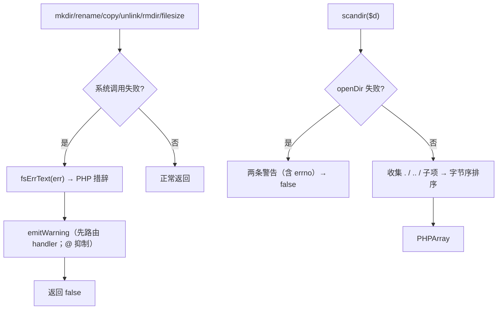
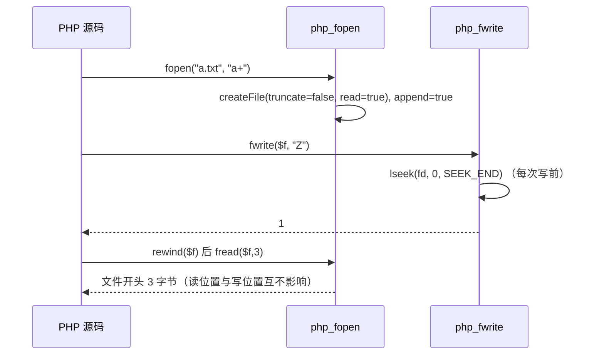

# AOT-CODEGEN-012 R-275：文件系统失败警告、scandir 语义与 fopen 全模式

- 日期：2026-10-24
- 代次锚：`tpl e121d277ebeab7e0e202b18e039e6133`；`nlk a90c34994de41a3b95bc2dc0c0356c8d`／`irg 0b7106338d5ffe1342caee961734b8d8`／`ir bb2bb442ca27b98cf1df7e109a240e1f` 未变（均未提交）
- 工单：`docs/known-issues/AOT-CODEGEN-012-class-name-case-insensitive-lookup.md` §182／§183

## 1. 高层摘要（TL;DR）

上一轮把文件系统函数从「不可编译」救活后，它们的**失败路径**仍然静默（PHP 会打 `Warning:`）；`scandir()` 还缺 `.`/`..` 且未排序；`fopen` 只认 `r/w/a`。本轮把 F-175（7 个函数的失败文案）、F-176（scandir 语义）关闭，并把 `fopen` 补到 `r/r+/w/w+/a/a+/x/x+/c/c+`（含 `a/a+` 的每次写定位末尾语义）。

## 2. 影响范围

| 层 | 影响 |
|---|---|
| 运行期模板 | `fsErrText`/`warnPf` 公共文案；7 个文件系统函数失败分支；`php_scandir` 重写；`php_fopen` 全模式；`php_fwrite` append 定位；`PHPResource.append` |
| 语义面 | 失败时的 stdout/stderr 与 PHP 一致；scandir 返回集/顺序；fopen 模式与 append 写 |

## 3. 核心变更

| # | 变更 | 说明 |
|---|---|---|
| 1 | 文案表 | `fsErrText`：`FileNotFound/PathAlreadyExists/DirNotEmpty/AccessDenied/NotDir/IsDir` → PHP 措辞 |
| 2 | 7 处失败警告 | `mkdir`/`rename`/`copy`/`unlink`/`rmdir`/`filesize`/`scandir`（scandir 两条，含 errno 2/13/20） |
| 3 | scandir | `.`+`..`+字节序排序；`ArrayList` 临时名释放；失败返回 false |
| 4 | fopen | 10 种模式；`b`/`t` 后缀剥离；失败 `{fn}({path}): Failed to open stream: …` |
| 5 | append | `PHPResource.append` ⇒ `php_fwrite` 每次写前 `lseek(…, SEEK_END)` |

## 4. 可视化概览（Code & Logic Map）

## 5. 详细变更分析

| 文件 | 变更点 |
|---|---|
| `src/aot/runtime_lib_template.zig` | `PHPResource.append`（`:2492`）；`php_fopen`（`:4339`）；`fsErrText`（`:4426`）／`warnPf`（`:4439`）／`php_fwrite` append（`:4451`）；`php_scandir`（`:4593`）；`php_unlink`（`:4672`）／`php_filesize`（`:4684`）；`php_mkdir`（`:28276`）／`php_rmdir`（`:28307`）／`php_rename`（`:28322`）／`php_copy`（`:28339`） |
| `fuzzy_scripts_720/tmp/c320_fs_warn_gate_tmp.sh` | 新门 5 臂 |

## 6. 影响与风险评估

- **破坏式变更**：`scandir` 的结果集与顺序变化（更贴 PHP）；失败路径新增 Warning 输出（更贴 PHP）。
- **内存**：`scandir` 的临时文件名数组有 `defer` 统一释放；`PHPArray` 元素仍由 runtime 字符串持有。
- **未建模**：`LOCK_EX`、stream context、`fopen` 的 `e` 后缀、`scandir` 的排序参数。
- **复测路径**：`bash fuzzy_scripts_720/tmp/c320_fs_warn_gate_tmp.sh`；邻居 `c319`／`c314`／`c315`。
- **读数**：C320 **5/5 SAME**（31 s，自证 5 CF）；三邻门全绿；`zig build test` 21/21、**326/326**；主回归 **PASS=68 FAIL=0**。

## 7. 遗留问题/潜在问题

- **F-173 尾**：`fopen` 的 `e` 后缀、`LOCK_EX`、stream context；`fopen` 的 `x+` 门内未覆盖。
- **未普查**：`stat/lstat/touch/chmod/filemtime/glob/readfile/fpassthru` 等是否已实现/可用——建议下一轮做一次文件族 API 存在性普查（类似本轮 C319 抓出 8 处漂移的做法）。

## 8. 后续建议

| 优先级 | 建议 | 影响面 | 落地成本 |
|---|---|---|---|
| P2 | 文件族 API 存在性普查（stat/touch/chmod/glob/readfile…） | 文件族 | 低-中 |
| P2 | `LOCK_EX`（flock）与 `scandir` 排序参数 | 文件族 | 低 |
| P2 | `hash_init/update/final` 增量接口 | hash API | 中 |
