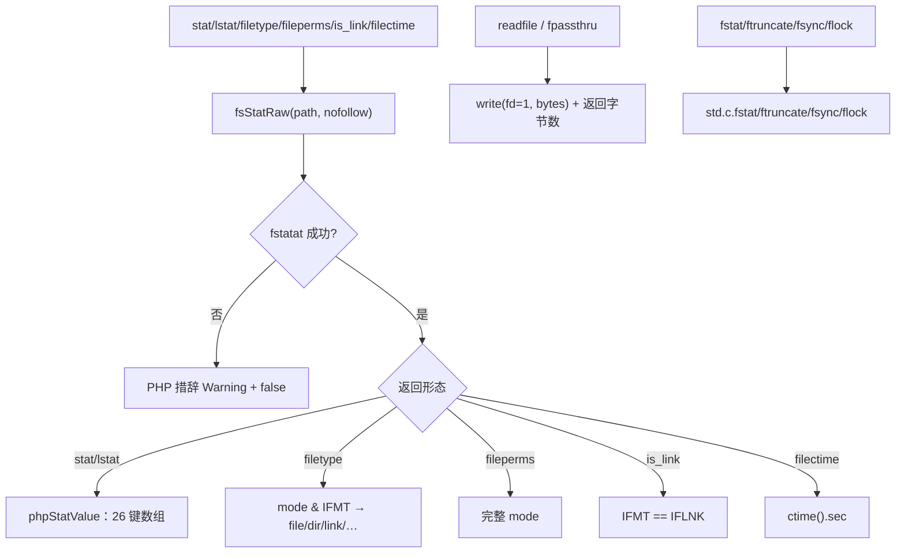
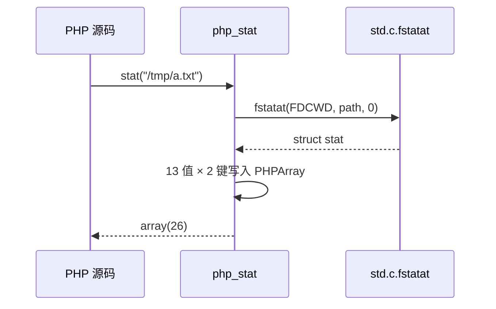

# AOT-CODEGEN-012 R-276：stat 族与剩余文件系统 API（F-177，普查驱动）

- 日期：2026-10-24
- 代次锚：`nlk a9508e317484cf4eec5747b6165506e9`；`tpl 672cee68dee4ca14f7adf359274407ff`；`irg 0b7106338d5ffe1342caee961734b8d8`／`ir fb2bb442ca27b98cf1df7e109a240e1f` 未变（均未提交）
- 工单：`docs/known-issues/AOT-CODEGEN-012-class-name-case-insensitive-lookup.md` §184

## 1. 高层摘要（TL;DR）

先做了一轮「文件族 API 存在性普查」（C321，24 臂，一函数一臂）：**18 臂 DIFF**，其中 16 个函数在 AOT 里根本未注册（调用即 `undefined function` 致命），另有 `filectime` 有实现却无注册。本轮把 stat 族（stat/lstat/filetype/fileperms/is_link/filectime）与 readfile/fpassthru/fstat/ftruncate/fsync/flock/umask/symlink/readlink/clearstatcache 全部接通，值、失败文案与 `@` 抑制行为均与 PHP 8.5.8 一致。

## 2. 影响范围

| 层 | 影响 |
|---|---|
| 运行期模板 | `fsStatRaw`/`phpStatValue`＋17 个入口；`LOCK_UN`/`LOCK_NB` 常量 |
| 注册表 | 17 项（两处表同步）；`filectime` 改为 `needs_allocator=false`（复用既有 1 形参实现） |
| 语义面 | stat 的 26 键结构、文件类型/权限、读取输出与计数、fd 操作、umask/symlink |

## 3. 核心变更

| # | 变更 | 说明 |
|---|---|---|
| 1 | `fsStatRaw` | `std.c.fstatat(AT.FDCWD, path, .{})`；`nofollow` 时加 `AT.SYMLINK_NOFOLLOW` |
| 2 | `phpStatValue` | 13 个值 × （数字键＋同名串键）＝26 键，与 PHP 一致 |
| 3 | 类型/权限 | `filetype` 用 `std.c.S.IFMT` 分类（走 lstat 语义）；`fileperms` 返回完整 mode（含类型位） |
| 4 | readfile/fpassthru | 直接写 fd 1，返回字节数；readfile 失败复用 `warnPf` |
| 5 | fd 操作 | `fstat`/`ftruncate`/`fsync`/`flock` 走 libc（`std.c.*`） |
| 6 | umask/symlink/readlink | `umask()` 查询＝置 0 取旧再恢复；symlink/readlink 失败文案按 PHP（不带路径） |

## 4. 可视化概览（Code & Logic Map）

## 5. 详细变更分析

| 文件 | 变更点 |
|---|---|
| `src/aot/runtime_lib_template.zig` | `fsStatRaw`（`:4646`）／`phpStatValue`（`:4656`）／`php_stat`（`:4673`）／`php_lstat`（`:4685`）／`php_filetype`（`:4698`）／`php_fileperms`（`:4722`）／`php_is_link`（`:4728`）／`php_chmod`（`:4735`）／`php_readfile`（`:4750`）／`php_fpassthru`（`:4762`）／`php_fstat`（`:4780`）／`php_ftruncate`（`:4789`）／`php_fsync`（`:4796`）／`php_flock`（`:4803`）／`php_umask`（`:4810`）／`php_symlink`（`:4822`）／`php_readlink`（`:4839`）／`php_clearstatcache`（`:4856`） |
| `src/aot/native_linker.zig` | 17 项注册（`:4456`–`:4472`，两处表同步） |
| `fuzzy_scripts_720/tmp/c321_fs_api_census_tmp.sh` | 普查侧门（24 臂，保留为残缺口台账：fgetcsv/fputcsv、disk_*、opendir 族） |
| `fuzzy_scripts_720/tmp/c322_stat_family_gate_tmp.sh` | 新门 5 臂（绿） |

## 6. 影响与风险评估

- **破坏式变更**：无（原为致命/未定义）。
- **实现注意**：`std.c.Stat` 是**平台相关**联合体，字段经 `dev/ino/mode/nlink/uid/gid/rdev/size/blksize/blocks` 与 `atime()/mtime()/ctime()` 访问器收口（三种 libc 变体都有这些成员）；错误分支不依赖 errno API（用「目标是否存在」区分 symlink/readlink 原因），避免平台差异。
- **未接**：`fgetcsv`/`fputcsv`（CSV 语义 + `$escape` Deprecated）、`disk_free_space`/`disk_total_space`（statfs）、`opendir`/`readdir`/`closedir`（F-178）。
- **复测路径**：`bash fuzzy_scripts_720/tmp/c322_stat_family_gate_tmp.sh`；普查 `c321`；邻居 `c319`／`c320`／`c314`。
- **读数**：C322 **5/5 SAME**（36 s，自证 5 CF）；三邻门全绿；`zig build test` 21/21、**326/326**；主回归 **PASS=68 FAIL=0**。

## 7. 遗留问题/潜在问题

- **F-178（新立，P2）**：`fgetcsv`/`fputcsv`、`disk_free_space`/`disk_total_space`、`opendir`/`readdir`/`closedir` 三臂仍红（C321 台账）。
- `chmod` 的失败文案目前只区分「不存在/无权限」两类近似文本（未逐 errno 对齐）；`umask` 查询为「置 0 再恢复」，并发多线程下非原子（AOT 主线程单执行模型下可接受）。
- `stat` 的 `dev/uid/gid/blocks` 在部分文件系统上可能返回 0（libc 结构提供则为准）。

## 8. 后续建议

| 优先级 | 建议 | 影响面 | 落地成本 |
|---|---|---|---|
| P2 | F-178：目录句柄族（opendir/readdir/rewinddir/closedir） | 目录族 | 中 |
| P2 | F-178：CSV 族（fgetcsv/fputcsv 的 `$escape` Deprecated 与引号规则） | CSV | 中 |
| P3 | disk_free_space/disk_total_space（statfs，跨平台字段） | 文件族 | 中 |
| P3 | `chmod` 逐 errno 文案 | 文件族诊断 | 低 |
