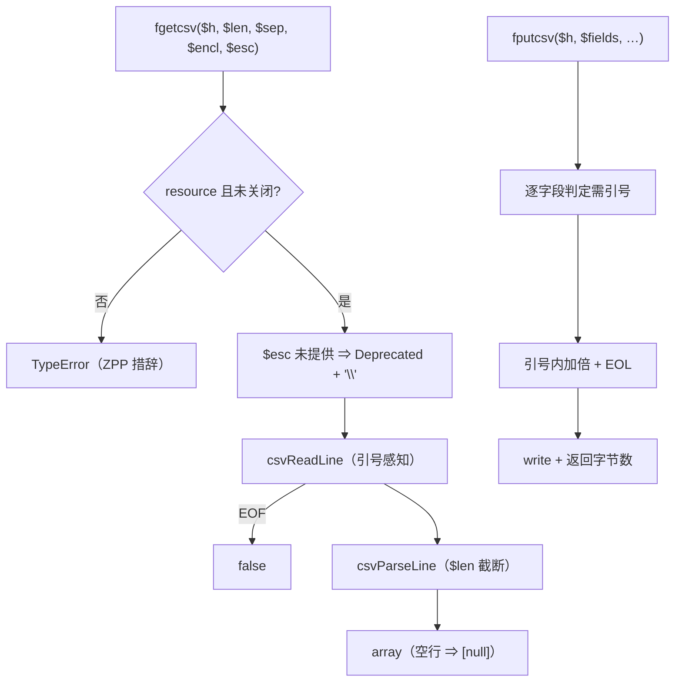
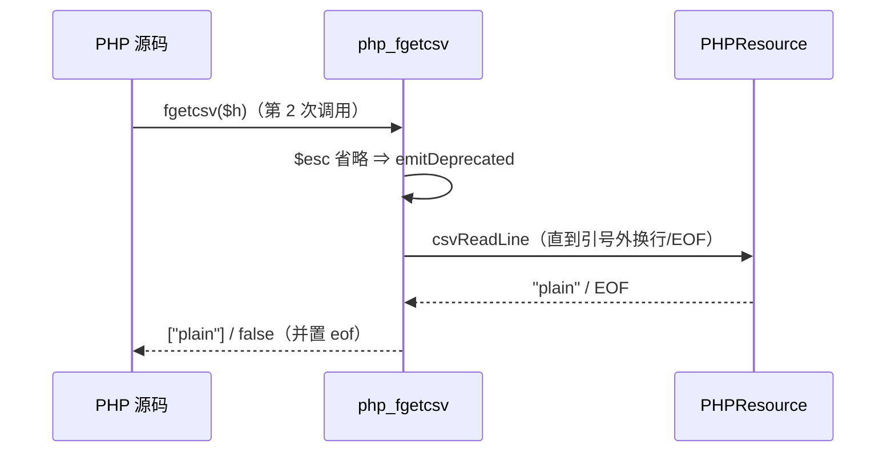

# AOT-CODEGEN-012 R-277：CSV 族 fgetcsv／fputcsv（F-178 第一段）

- 日期：2026-10-24
- 代次锚：`nlk 8f1fced47758920d5018b29d71e6116d`；`tpl d8e5e3074d9cc734511a82a1c3a70c05`；`irg 0b7106338d5ffe1342caee961734b8d8`／`ir fb2bb442ca27b98cf1df7e109a240e1f` 未变（均未提交）
- 工单：`docs/known-issues/AOT-CODEGEN-012-class-name-case-insensitive-lookup.md` §185

## 1. 高层摘要（TL;DR）

`fgetcsv`/`fputcsv` 在 AOT 里未注册（调用即致命）。本轮实现完整 CSV 读写：引号内分隔符/换行、`""` 转义、空行 `[null]`、`$length` 截断、自定义分隔符/enclosure/eol，以及 PHP 8.5 的 **每次调用** `$escape` Deprecated；并区分「非 resource」（ZPP 措辞）与「已关闭 resource」（函数体措辞）两套 TypeError。

## 2. 影响范围

| 层 | 影响 |
|---|---|
| 运行期模板 | `Value.hasResourceType`；CSV 三件套（参数归一/逻辑行/解析）＋两入口 |
| 注册表 | `fgetcsv` 5 槽／`fputcsv` 6 槽（缺省全 null 哨兵） |
| 语义面 | CSV 读写字节级一致；资源错误措辞两分 |

## 3. 核心变更

| # | 变更 | 说明 |
|---|---|---|
| 1 | null 哨兵 | 省略 `$escape` ⇒ `emitDeprecated(...)` 后按 `\`（与 PHP 逐次告警一致）；其余缺省 null → `,`／`"` |
| 2 | 逻辑行 | `csvReadLine` 引号感知（引号内 `\n` 不结束行；EOF 置 eof） |
| 3 | 解析 | `csvParseLine`：空行 ⇒ `[null]`；`""`⇒`"`；escape+enclosure 合并；收尾引号后残余字面量按 PHP 拼接 |
| 4 | 写出 | 需引号字符集＝分隔符/引号/`\n`/`\r`/`\t`/**空格**/escape；字段内引号加倍；EOL 参数化 |
| 5 | 资源错误 | `hasResourceType()` 区分两套 TypeError 措辞 |

## 4. 可视化概览（Code & Logic Map）

## 5. 详细变更分析

| 文件 | 变更点 |
|---|---|
| `src/aot/runtime_lib_template.zig` | `Value.hasResourceType`（`:2673`）；`csvParamChar`（`:4875`）／`csvReadLine`（`:4881`）／`csvParseLine`（`:4898`）／`php_fgetcsv`（`:4956`）／`php_fputcsv`（`:5000`） |
| `src/aot/native_linker.zig` | 两处注册表 `fgetcsv`／`fputcsv`（`:4473` 起） |
| `fuzzy_scripts_720/tmp/c323_csv_gate_tmp.sh` | 新门 5 臂（heredoc 写法） |

## 6. 影响与风险评估

- **破坏式变更**：无（原为未定义函数）。
- **内存**：解析用 `ArrayList`＋`defer deinit`；写出用临时缓冲后一次 `fileWriteAll`。
- **已知小差异**：显式传 `""` 作为 escape 时，PHP 视为「空 escape 不告警」，AOT 目前按 null 处理并告警（已在 §185.4 登记）。
- **复测路径**：`bash fuzzy_scripts_720/tmp/c323_csv_gate_tmp.sh`；邻居 `c322`／`c319`／`c320`。
- **读数**：C323 **5/5 SAME**（33 s，自证 5 CF）；三邻门全绿；`zig build test` 21/21、**326/326**；主回归 **PASS=68 FAIL=0**。

## 7. 遗留问题/潜在问题

- **gate 编写教训**：`printf`＋多层引号转义会让某几臂**静默生成空脚本**（表现为 DIFF 而非法解析错）⇒ 门臂一律用 heredoc ＋ `getenv("D")` 传路径（已写入回归规则 r155）。
- **F-178 剩余**：`opendir`/`readdir`/`closedir`、`disk_free_space`/`disk_total_space`（需 statfs 平台字段）。
- `fgetcsv` 的超长行无上限（ArrayList 增长）；`$length=1` 等边界未在门内覆盖。

## 8. 后续建议

| 优先级 | 建议 | 影响面 | 落地成本 |
|---|---|---|---|
| P2 | F-178：目录句柄族（opendir/readdir/rewinddir/closedir） | 目录族 | 中 |
| P3 | disk_free_space/disk_total_space（statfs extern 结构按平台声明） | 文件族 | 中 |
| P3 | CSV 边界补齐（`$length=1`、空 escape、极长行） | CSV | 低 |
