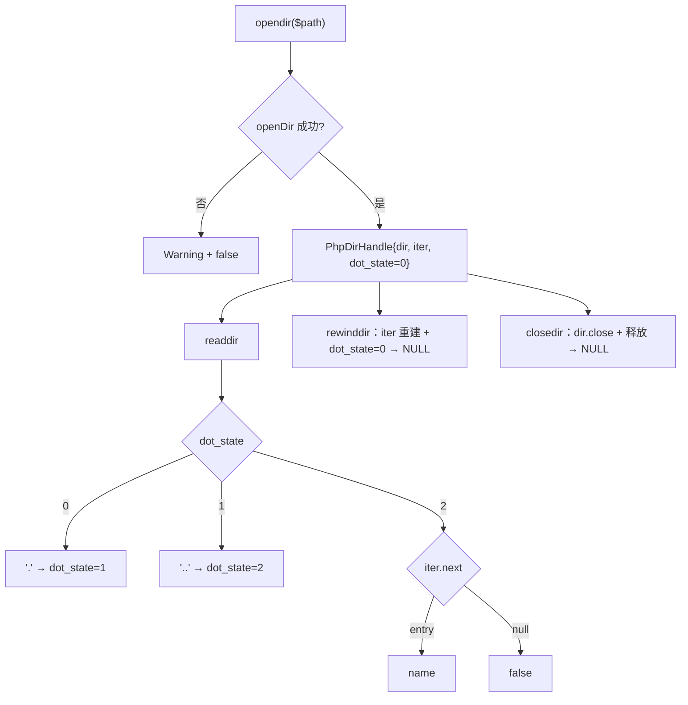
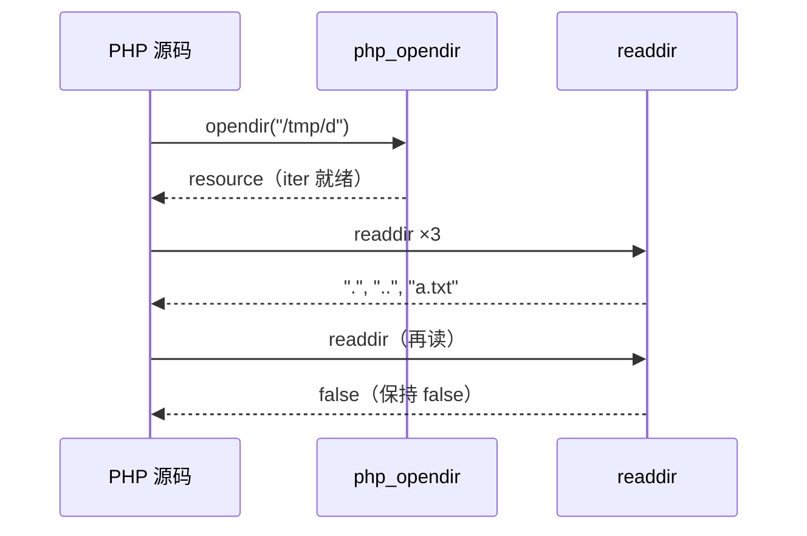

# AOT-CODEGEN-012 R-278：目录句柄族 opendir/readdir/rewinddir/closedir（F-178 第二段）

- 日期：2026-10-24
- 代次锚：`nlk aaac4a9d47c39e1f6c1fde06a1c660c5`；`tpl 47b67aab49ed01930ad8f32deb712bc8`；`irg 0b7106338d5ffe1342caee961734b8d8`／`ir fb2bb442ca27b98cf1df7e109a240e1f` 未变（均未提交）
- 工单：`docs/known-issues/AOT-CODEGEN-012-class-name-case-insensitive-lookup.md` §186

## 1. 高层摘要（TL;DR）

目录句柄族此前完全缺失（`opendir` 一调用即 undefined）。本轮给 `PHPResource` 加目录句柄字段与生命周期管理，实现四个函数并还原 PHP 的三档参数错误措辞（非 resource / 普通文件 / 已关闭句柄）。C321 普查随之从 6/24 提升到 **23/24 SAME**，仅剩 `disk_*` 一项。

## 2. 影响范围

| 层 | 影响 |
|---|---|
| 运行期模板 | `PHPResource.dir_handle` + release 兜底关闭；`PhpDirHandle`；`dirArgCheck` 三档分诊；四函数 |
| 注册表 | `opendir`（2 槽）/`readdir`/`rewinddir`/`closedir`（两处表同步） |
| 语义面 | 目录遍历（含 `"."`/`".."`）、复位、关闭返回值与错误措辞 |

## 3. 核心变更

| # | 变更 | 说明 |
|---|---|---|
| 1 | 句柄模型 | `PhpDirHandle{ dir, iter, dot_state }`；`dot_state` 0/1/2 负责先吐出 `.` 与 `..`（Zig 迭代器本身会跳过） |
| 2 | 生命周期 | `closedir` 立即 `dir.close` + `destroy`；`release()` 兜底关闭（refcount 归零时） |
| 3 | 参数分诊 | `dirArgCheck`：非 resource ⇒ ZPP 措辞；closed ⇒ open-stream 措辞；非目录资源 ⇒ valid-Directory 措辞 |
| 4 | rewinddir | 重建 iterator + `dot_state=0`；返回 NULL |
| 5 | 失败告警 | `opendir(<path>): Failed to open directory: <reason>` + false |
| 6 | 注册 | 两处注册表同步；`opendir` 第二参 context 缺省 null |

## 4. 可视化概览（Code & Logic Map）

## 5. 详细变更分析

| 文件 | 变更点 |
|---|---|
| `src/aot/runtime_lib_template.zig` | `PHPResource.dir_handle`（`:2494`）与 `release` 兜底；`PhpDirHandle`（`:5083`）／`dirArgCheck`（`:5099`）／`php_opendir`（`:5125`）／`php_readdir`（`:5151`）／`php_rewinddir`（`:5172`）／`php_closedir`（`:5184`） |
| `src/aot/native_linker.zig` | 四个注册项（`:4475` 起，两处表） |
| `fuzzy_scripts_720/tmp/c324_dir_handle_gate_tmp.sh` | 新门 5 臂 |

## 6. 影响与风险评估

- **破坏式变更**：无（原为未定义）。
- **资源安全**：目录句柄与 resource 同一分配器；`closedir` 幂等性——二次 `closedir` 会走 closed 分支抛 TypeError（与 PHP 一致），不会双重释放。
- **兼容**：`scandir` 仍独立实现（返回排序数组），与句柄族互不影响。
- **复测路径**：`bash fuzzy_scripts_720/tmp/c324_dir_handle_gate_tmp.sh`；普查 `c321`；邻居 `c322`／`c323`。
- **读数**：C324 **5/5 SAME**（26 s，自证 5 CF）；C322 5/5、C323 5/5；**C321 普查 23/24**；`zig build test` 21/21、**326/326**；主回归 **PASS=68 FAIL=0**。

## 7. 遗留问题/潜在问题

- **F-178 尾（仅剩）**：`disk_free_space`/`disk_total_space`（需 statfs extern 与平台结构体）。
- **F-178-b 新立（P3）**：`readdir(null)` 在 PHP 是 Deprecated + TypeError（`No resource supplied`，回退到「最近打开的目录流」），本轮未实现该全局栈。
- 目录条目顺序依赖文件系统（门内已排序比较）。

## 8. 后续建议

| 优先级 | 建议 | 影响面 | 落地成本 |
|---|---|---|---|
| P3 | F-178 尾：disk_free_space/disk_total_space | 文件族 | 中 |
| P3 | F-178-b：readdir(null) 的 last-opened 语义 | 目录族 | 低 |
| P2 | 文件族二次普查扩展（filemtime/stat 已绿；可扩展到 `glob` 标志、`parse_ini_file` 等） | 文件族 | 低-中 |
