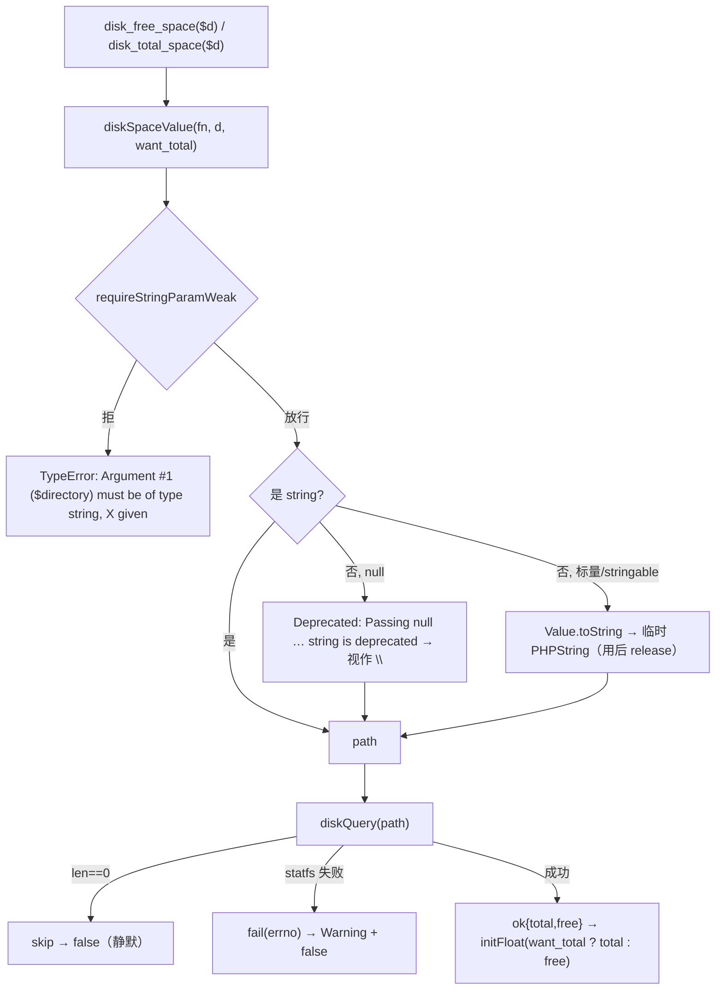
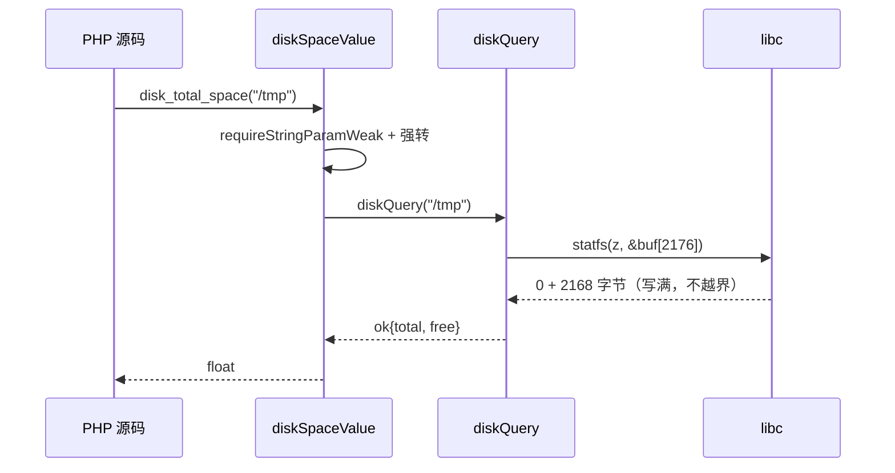

# AOT-CODEGEN-012 R-279：disk_free_space/disk_total_space（F-178 尾段）

- 日期：2026-10-24
- 代次锚：`nlk 0743f368302060217701fa4f4260fe25`；`tpl 6993030cd720c3c32d4af6ac4bf1559f`；`irg 0b7106338d5ffe1342caee961734b8d8`／`ir fb2bb442ca27b98cf1df7e109a240e1f` 未变（均未提交）
- 工单：`docs/known-issues/AOT-CODEGEN-012-class-name-case-insensitive-lookup.md` §187

## 1. 高层摘要（TL;DR）

`disk_free_space`/`disk_total_space` 此前未实现（C321 普查唯一剩余红项）。本轮按 POSIX `statfs`（macOS）／`statvfs`（Linux）实现，并还原 PHP 的完整形参口径：weak string 强转、`null` 的 Passing-null Deprecated、空路径静默 false、失败走 `strerror(errno)` 措辞、非标量走 TypeError。C321 文件系统 API 普查至此 **24/24 SAME**，F-178 全族（CSV／目录句柄／disk_*）收口。

> 附带一个**内存安全缺陷的归因与修复**：首版 extern 结构体尾部少 8 字节（2160 < 真实 2168），`statfs` 每次调用越界写 8 字节踩栈帧，表现为「两条调用同处一个表达式时必定 SIGSEGV、加一行调试打印就消失」的栈布局敏感型崩溃。

## 2. 影响范围

| 层 | 影响 |
|---|---|
| 运行期模板 | 两个平台结构体前缀 + `extern statfs/statvfs/strerror`；`diskQuery` 结果联合；weak-string 形参口径；两个导出函数 |
| 注册表 | `disk_free_space`／`disk_total_space`（两处表同步，`needs_allocator=false`） |
| 语义面 | 返回值类型（float）、路径等价、空路径静默、失败原因措辞、形参强转与 TypeError |

## 3. 核心变更

| # | 变更 | 说明 |
|---|---|---|
| 1 | `StatFsDarwin` | 前缀 `f_bsize(u32)/f_iosize(i32)/f_blocks/f_bfree/f_bavail(u64)` = 32 B；`_tail:[2144]u8` ⇒ 总 2176 ≥ 真实 **2168** |
| 2 | `StatVfsLinux` | 前缀 5×`c_ulong` = 40 B；`_tail:[112]u8` ⇒ 总 152 ≥ 真实 **112** |
| 3 | `diskQuery` | `union(enum){ ok, skip, fail: errno }`；`errno` 在 `statfs` 失败后**立即**读 `std.c._errno().*`，中间不夹其它 libc 调用 |
| 4 | 单位换算 | macOS：`f_bsize × f_blocks/f_bavail`；Linux：`(f_frsize ?: f_bsize) × …` |
| 5 | 形参口径 | 复用 `requireStringParamWeak`（标量/stringable 放行、其它 TypeError）；`null` ⇒ `emitDeprecatedPassingNull(...,"string")` 后按空串；标量走 `Value.toString` |
| 6 | 失败措辞 | `Warning: <fn>(): <strerror(errno)>` + false；空路径**不发** Warning |
| 7 | 注册 | 两处表各两枚（`:4479-4480`、`:4824-4825`） |

## 4. 可视化概览（Code & Logic Map）

## 5. 详细变更分析

| 文件 | 变更点 |
|---|---|
| `src/aot/runtime_lib_template.zig` | `StatFsDarwin`（`:5189`）／`StatVfsLinux`（`:5200`）；`strerror` extern（`:5216`）；`diskQuery`（`:5218`）；`diskSpaceValue`（`:5240`）；`php_disk_free_space`（`:5267`）／`php_disk_total_space`（`:5272`） |
| `src/aot/native_linker.zig` | 注册表两处各两枚（`:4479-4480`、`:4824-4825`） |
| `fuzzy_scripts_720/tmp/c325_disk_space_gate_tmp.sh` | 新永久门 5 臂（22 s） |

## 6. 影响与风险评估

- **破坏式变更**：无（原为未定义符号）。
- **内存安全**：修复了首版的结构体尾部越界（见 §187.3）。`var buf: StatFsDarwin = undefined;` 只在 `statfs` 返回 0 后读取，尾部余量 8 B，未来若系统结构体再增长亦有余量。
- **跨平台**：macOS/iOS 走 `statfs`；其它 POSIX 走 `statvfs`；`c_ulong` 宽度随目标 ABI。
- **易变值纪律**：可用/总字节数会随运行时刻变化 ⇒ C325 **只比较类型、正性与大小关系**，绝不比较绝对数值。
- **复测路径**：`bash fuzzy_scripts_720/tmp/c325_disk_space_gate_tmp.sh`；普查 `c321`；邻居 `c322`／`c323`／`c324`。
- **读数**：C325 **5/5 SAME**（22 s，自证 5 CF）；**C321 24/24 SAME**（`t19_disk` 转绿）；C322/C323/C324 各 5/5、`shifted=0`；`zig build test` **21/21 steps、326/326**；主回归 **PASS=68 FAIL=0**（`/tmp/r279_regression.log`，`SELF_CHECK_OK rows=68 uniq=68`）。

## 7. 遗留问题/潜在问题

- **F-178-b（P3）**：`readdir(null)` 的「回退到最近打开的目录流」语义仍未实现（需 last-opened 全局栈）。
- 本族返回 float，但字节数是**运行时刻快照**；PHP 同样不缓存（每次调用重新 statfs），行为一致。
- `strerror` 非线程安全；当前运行时单线程，若将来引入协程需换 `strerror_r`。

## 8. 后续建议

| 优先级 | 建议 | 影响面 | 落地成本 |
|---|---|---|---|
| P3 | F-178-b：readdir(null) 的 last-opened 语义 | 目录族 | 低 |
| P2 | 文件族普查再扩（`glob` 标志、`parse_ini_file`、`fscanf` 等） | 文件族 | 低-中 |
| P2 | `extern struct` 尾填充统一改成「前缀 + 显式 ≥sizeof 断言」模板，避免再手算 | 运行时模板 | 低 |
