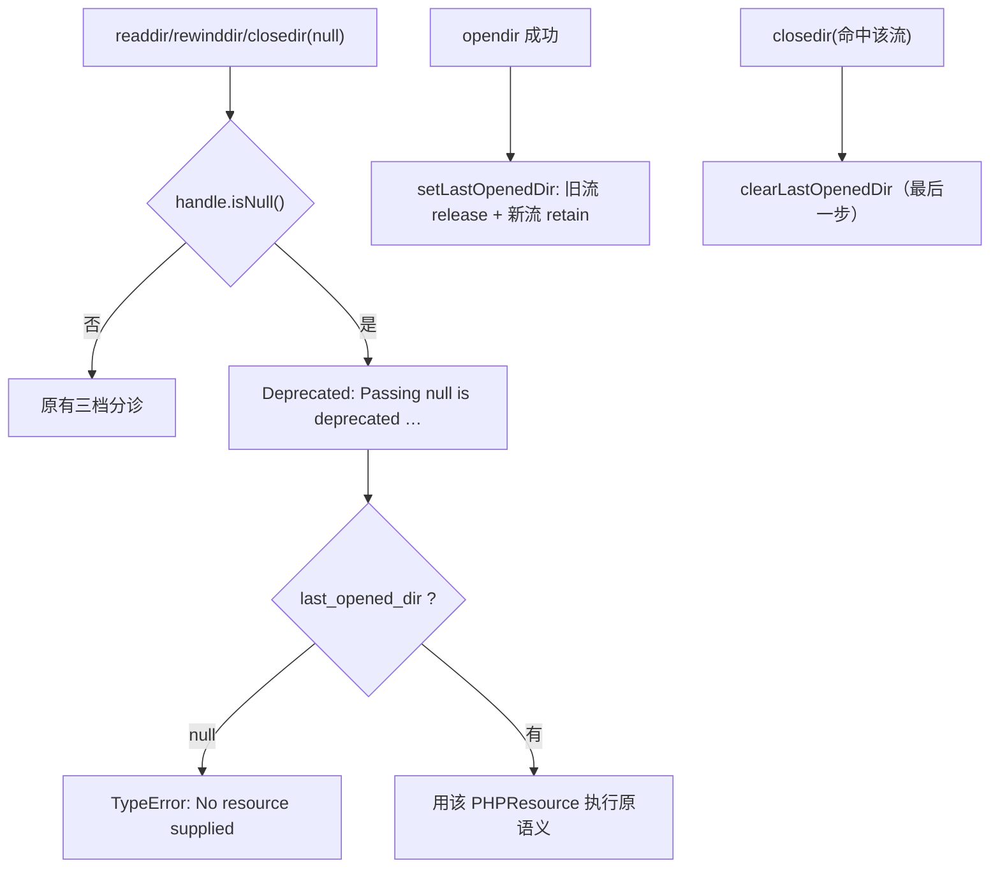
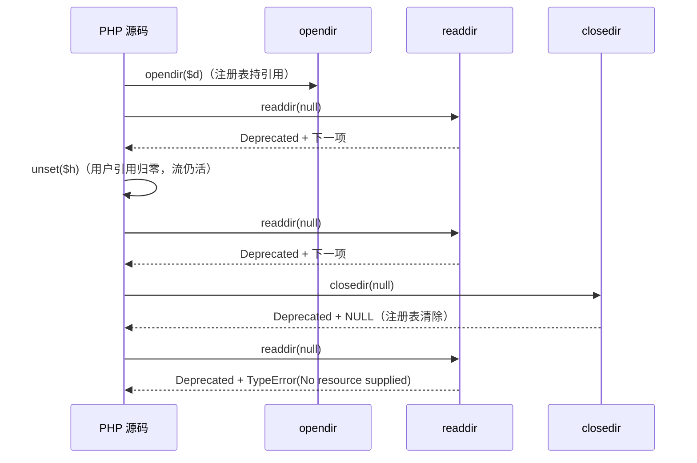

# AOT-CODEGEN-012 R-280：readdir/rewinddir/closedir(null) 的 last-opened 回退（F-178-b）

- 日期：2026-10-24
- 代次锚：`tpl c86b228e2bf08047aaf2c9ab37703091`；`nlk 0743f368302060217701fa4f4260fe25`／`irg 0b7106338d5ffe1342caee961734b8d8`／`ir bb2bb442ca27b98cf1df7e109a240e1f` 未变（均未提交）
- 工单：`docs/known-issues/AOT-CODEGEN-012-class-name-case-insensitive-lookup.md` §188

## 1. 高层摘要（TL;DR）

PHP 8 仍保留「`readdir/rewinddir/closedir(null)` 回退到最后打开的目录流」这套历史语义（每次调用先发一句专用 Deprecated），此前 AOT 三枚一律走 `must be of type resource or null, null given`。本轮在运行时加一个 last-opened 注册表，并还原**该流不随用户引用归零而释放**的真实生命周期（注册表自持一个引用），C326 五臂 stdout/stderr 逐字节对齐。

## 2. 影响范围

| 层 | 影响 |
|---|---|
| 运行期模板 | 新增 `last_opened_dir` 注册表 + 取/放助手；`dirArgCheck` 增加 null 分支；`opendir/closedir` 各一处挂钩；`init/deinitRuntime` 各一处复位/释放 |
| 发射器/注册表 | **无改动**（`needs_allocator`/槽位不变）⇒ 生成码中性 |
| 语义面 | 三函数的 null 形、last-opened 的设定/替换/清除、引用生命周期 |

## 3. 核心变更

| # | 变更 | 说明 |
|---|---|---|
| 1 | 注册表 | `last_opened_dir: ?*Value.PHPResource`；`setLastOpenedDir` 替换时释放旧引用、对新流 `retain`（PHP 行为：流不随用户 unset 释放） |
| 2 | 清除 | `clearLastOpenedDir` 按 identity 清除并释放；`closedir` 里**必须放在最后一步**（可能是最后一个引用） |
| 3 | null 形 | `dirArgCheck`：先发 `Deprecated: <fn>(): Passing null is deprecated, instead the last opened directory stream should be provided`（无 `parameter #1` 段），无流 ⇒ `TypeError: No resource supplied` |
| 4 | `@` 交互 | Deprecated 走 `emitDeprecated`（F-92 路由，可被 `@` 压），TypeError 照抛（门臂 `s4`） |
| 5 | 生命周期 | `initRuntime` 复位；`deinitRuntime` 释放注册表引用（否则关门时留一个对象） |

## 4. 可视化概览（Code & Logic Map）

## 5. 详细变更分析

| 文件 | 变更点 |
|---|---|
| `src/aot/runtime_lib_template.zig` | `last_opened_dir`（`:5099`）／`setLastOpenedDir`（`:5101`）／`clearLastOpenedDir`（`:5111`）／`dirArgCheck` null 分支（`:5129`）／`php_opendir`（`:5184`）／`php_closedir`（`:5315`）／`initRuntime`（`:511`）／`deinitRuntime`（`:864`） |
| `fuzzy_scripts_720/tmp/c326_dir_null_fallback_gate_tmp.sh` | 新永久门 5 臂 |

## 6. 影响与风险评估

- **破坏式变更**：无（此前 null 一律 TypeError，属"该支持而未支持"）。
- **内存安全**：注册表自持引用 ⇒ 必须保证「替换/关闭/关门」三条路径都放引用；`closedir` 内清除顺序放在最后，避免 use-after-free（门 t5 覆盖关闭后立即读）。
- **引用计数语义**：`unset` 掉全部用户引用后仍可读，是 PHP 实测行为（注册表持引用），不是缺陷。
- **未改动发射器** ⇒ 生成码中性；风险集中在运行时模板。
- **复测路径**：`bash fuzzy_scripts_720/tmp/c326_dir_null_fallback_gate_tmp.sh`；邻居 `c324`；普查 `c321`。
- **读数**：C326 **5/5 SAME**（32 s，自证 5 CF）；C324 5/5（29 s）；C321 **24/24**（112 s）；`zig build test` **21/21、326/326**；主回归 **PASS=68 FAIL=0**（`SELF_CHECK_OK rows=68 uniq=68`）。

## 7. 遗留问题/潜在问题

- **F-180（P1，本轮新立，与本批无关）**：关闭资源后 `PHPResource` 引用不归零 ⇒ `fopen/fclose` 漏 48 B + 2 alloc/次、`opendir/closedir` 漏 40 B + 1 alloc/次（`unset` 不关的路径 FLAT）。`php_closedir` 入口实测 `ref_count=4`（期望 2），`clearLastOpenedDir` 后仍残留一个无人释放的引用。需查生成码的 retain/release 配对，独立批次修。
- **F-181（P1，本轮新立，探针顺带撞出）**：用户函数形参为 `\Throwable` 时，传入 `RuntimeException`/`TypeError`/`Error` 一律被拒（`must be of type Throwable, RuntimeException given`），PHP 全部接受 ⇒ 内部异常类的继承链未接入形参类型检查。
- `readdir()` 零实参（ArgumentCountError）仍未实现（与其它内置函数同族缺口）。

## 8. 后续建议

| 优先级 | 建议 | 影响面 | 落地成本 |
|---|---|---|---|
| P1 | F-180：资源关闭后引用不归零（内存泄漏，所有 stream/dir 族共享） | 运行时 + 发射器 lifetime | 中 |
| P1 | F-181：`\Throwable`/`\Exception` 形参的继承链检查 | 形参类型检查 | 低-中 |
| P3 | 三函数的零实参 ArgumentCountError 口径 | 内置函数 arity | 低 |
