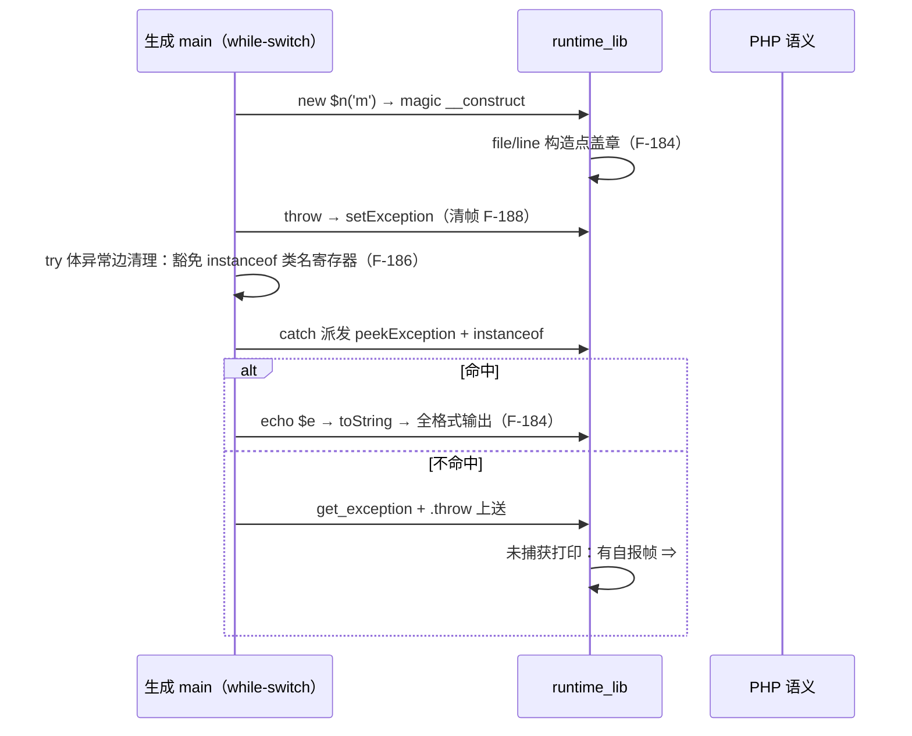

# AOT-CODEGEN-012 · R-281 收口：内置异常族继承链验收 + F-184～F-188 五缺陷修复

> 日期：2026-10-25 ／ 工单：`docs/known-issues/AOT-CODEGEN-012-class-name-case-insensitive-lookup.md` §189
> 代次锚：`nlk eb91f1be62c7225b8c883fa12e62c941`；`tpl 459f20aa839b0bd16c4a045d6251f00e`；`irg 0b7106338d5ffe1342caee961734b8d8`；`ir fb2bb442ca27b98cf1df7e109a240e1f`

## 1. 高层摘要（TL;DR）

R-281（内置异常族继承链）主体代码此前已入库（`20afbc5`），但验收链未跑。本批执行验收链时，
永久门 **C327 首跑仅 1/5**（交接文档"已与 PHP 全矩阵对齐"的结论只覆盖旧探针形状），揪出并修复
**五个真实 AOT 缺陷（F-184～F-188）**，最终：

- C327 门 **5/5 SAME**（rc/stdout/stderr 与 PHP 8.5.8 逐字节一致），`/bin/false` 自证 **5 CF**；
- 邻居门 C326 5/5、C324 5/5、C321 **24/24**；
- `zig build test` **21/21 steps、326/326 tests**；主回归 **PASS=68 FAIL=0**（SELF_CHECK_OK rows=68 uniq=68）。

另保住并纳入本批：工作区那 1 行 `var meta: ?*const ClassMeta`（HEAD `20afbc5` 本身编译不过的修复）。

## 2. 影响范围

| 层 | 文件 | 影响面 |
|---|---|---|
| 运行时模板 | `src/aot/runtime_lib_template.zig` | `php_echo`（对象分支）、异常 `__construct`（构造点盖 file/line 章）、异常 `__toString`（PHP 8.5 全格式）、`php_get_parent_class`（非法名 TypeError + 抛出帧自报）、`setException`/`php_handle_uncaught_exception`（帧生命周期 + 栈帧形状 + `in file:line` 改用异常自身位置） |
| 代码生成 | `src/aot/native_linker.zig` | 三处 `php_new_object_dynamic` 发射点（F-185）；`collectBlockUsedRegs` 与 `emitMissingConstStrings` 两处收集器补 `.instanceof`（F-186） |
| 门资产 | `fuzzy_scripts_720/tmp/c327_exception_hierarchy_gate_tmp.sh/.tsv` | 永久门 C327（5 臂）首次转绿 |
| 文档 | 工单 §189；本文 | 入档 |

## 3. 核心变更

| 编号 | 缺陷 | 根因一句话 | 修复要点 |
|---|---|---|---|
| F-184 | `echo $异常对象` 输出空串；拼接串类名错、缺尾巴 | `php_echo` 无对象分支；`__toString` 硬编码 `Exception: `；file/line 只在抛出点盖章 | 对象分支走 `PHPObject.toString`（无 `__toString` ⇒ 抛可捕获 `Error`）；`__toString` 重写为 `<类>: <msg> in <file>:<行>\nStack trace:\n#0 {main}`（无尾换行）；构造点盖 file/line 章 |
| F-185 | foreach 内 try/catch + 动态 `new $n()` ⇒ 生成码编译失败 | try 区发射裸调用 `!Value` 赋 `Value` | 镜像 `.new_object` 模式：`catch initNull()` + `hasException()` 轮询跳 handler（三处） |
| F-186 | `catch(LogicException)` 抓不中直接子类（距离 1 不中、2 中） | CSE 跨块转发类名常量 + CFG 无异常边 ⇒ 类名寄存器被死值清理置 null，instanceof 恒 false | 两个收集器（异常边豁免表 + catch 块 const.string 补物化）补 `.instanceof` 操作数 |
| F-187 | `get_parent_class('NoSuchClass')` 应抛 TypeError，旧版静默 false | 无 ZPP 校验 | 照 `get_class_methods` 样板 `throwThrowable("TypeError", ...)`；对象恒不抛 |
| F-188 | 未捕获 Fatal 栈帧缺 `#0 file(line): fn(args)` 帧 | AOT 无栈回溯，打印器硬编码 `#0 {main}` | 抛出帧自报：`setLastThrowFrame`（PHP debug 实参渲染：>15 截断加 `...`/`NULL`/`Array`/`Object(C)`）；`setException` 先清帧、抛出点后自报；打印器有帧则 `#0 …` + `#1 {main}` |

## 4. 可视化概览（Code & Logic Map）

### 4.1 分层与数据流

```mermaid
flowchart TB
    subgraph PHP["PHP 源（标准语法）"]
        A1["echo $e / \"x\".$e"] --> A2["try { new $n() } catch (A $e)"]
        A2 --> A3["get_parent_class('X')"]
    end
    subgraph CG["native_linker.zig 代码生成"]
        B1["try 区调用发射<br/>F-185: catch initNull + poll"]
        B2["异常边收集器<br/>F-186: +instanceof"]
        B3["catch 块 const.string 补物化<br/>F-186: +instanceof"]
    end
    subgraph RT["runtime_lib_template.zig 运行时"]
        C1["php_echo 对象分支<br/>F-184"]
        C2["异常 __construct/__toString<br/>F-184: 构造点盖章+全格式"]
        C3["php_get_parent_class<br/>F-187: TypeError"]
        C4["setException/throwThrowable<br/>F-188: 帧清空/自报"]
        C5["php_handle_uncaught_exception<br/>F-188: 帧形状+异常自身 file:line"]
    end
    A1 --> B1 & C1
    A2 --> B2 & B3
    A3 --> C3 --> C4 --> C5
    C2 --> C1
```

### 4.2 异常一次穿越的时序（修复后）



## 5. 详细变更分析

| 端 | 模块 | 变更点 |
|---|---|---|
| 运行时 | echo | `php_echo` 新增 `Value_isObject` 分支：`magic_toString != null or methods.__toString != null` 双谓词（与 instanceof-Stringable 同口径）→ `obj.toString()` 输出；否则 `throwThrowableDiscardCatch("Error", "Object of class X could not be converted to string")`，由调用点 hasException 轮询分派（`echo` 的 builtinInfo `may_raise` 默认 true ⇒ 轮询必在） |
| 运行时 | 异常族 | `__construct` 尾部盖 file/line 章（所有权照 `setException` 口径：`init → setProperty(retain) → defer release`，防 F-133 同款泄漏）；`__toString` 用 `this.class_name`＋message＋file＋line 拼 PHP 8.5 实测格式（**无**尾换行），`getProperty` 借用一律 `defer release` |
| 运行时 | get_parent_class | 对象恒不抛（`class_meta orelse findClass(class_name)`）；字符串未注册/其他类型 ⇒ `throwThrowable("TypeError", …, phpArgTypeWord)`＋`setLastThrowFrame`（**在 throwThrowable 之后**，setException 会清帧） |
| 运行时 | 未捕获打印 | `in <file>:<line>` 改用异常自身 file/line 属性（兜底 src）；`thrown in` 尾巴仍用当前 src；trace 有帧 ⇒ `#0 {ex_file}({ex_line}): {frame}\n#1 {main}`，无帧维持 `#0 {main}`；缓冲 1024→1536 |
| 运行时 | 帧机制 | `last_throw_frame`（512B 静态缓冲）＋`appendFrameArgText`（字符串>15 截断加 `...`、int、true/false、NULL、Array、Object(类名)）＋`setLastThrowFrame(fn, args)`；`setException` 入口清帧 |
| 生成器 | 动态 new | 三处（`:23688`/`:24025`/`:24259`）try 区改为 `catch runtime.Value.initNull()` + `if (runtime.hasException()) { @branchHint; generateCleanupCodeExcept(reg); 跳 handler / return error.RuntimeError; }`；try 区外维持 `try` 前缀 |
| 生成器 | 收集器 | `collectBlockUsedRegs`（异常边豁免表，治本）与 `emitMissingConstStrings` 的 used_regs（catch 块补物化，兜底）各补 `.instanceof => { object, class_name }` |

涉及文件：`src/aot/runtime_lib_template.zig`、`src/aot/native_linker.zig`、工单、本文、门脚本/TSV（既有资产转正）。

## 6. 影响与风险评估

- **破坏式变更**：否。所有修复为"补缺口"型：新分支/新收集项/新格式化；无既有绿色行为的口径变更。
  唯二可见输出变化：① 未捕获 Fatal 的 `in file:line` 从"打印时刻 src"改为"异常构造/抛出点"（对齐 PHP）；② 内置抛出点接入帧后未捕获栈多一帧（对齐 PHP）。
- **风险点**：F-186 豁免使异常路径上类名寄存器少一次提前释放（引用计数延后归还，最终由函数尾清理/后续死值释放平衡——C327/C321/回归全绿佐证无泄漏放大）；F-188 帧缓冲 512B 固态，超长参数截断（与 PHP 的回溯参数截断近似）。
- **复测路径**：`bash fuzzy_scripts_720/tmp/c327_exception_hierarchy_gate_tmp.sh`（5/5 SAME）→ 邻居 C326/C324/C321 → `zig build test` → `run_regression.sh`。

## 7. 遗留问题

- `__toString`/未捕获栈的多帧深度回溯仍非目标（恒 `#0 {main}` / 一帧自报）。
- F-188 仅 `get_parent_class` 抛出点接入；`get_class_methods`/`get_class_vars` 等同族站点未接入（现门全绿，按需增量）。
- F-180（P1 资源泄漏）仍在账上，独立批次处理；F-117/F-158（循环体三元/merge phi）待老铁裁甲案。
- 工作区未提交：`?*const ClassMeta` 一行 + 本批全部实现（入库前禁 checkout——HEAD `20afbc5` 单独编译不过）。

## 8. 后续建议

| 优先级 | 建议 | 影响面 | 成本 |
|---|---|---|---|
| P0 | 将工作区改动（1 行编译修复 + F-184～188）作为 R-281 收口提交入库 | 主干可编译性 | 低 |
| P1 | F-180 资源引用不归零（P1 泄漏）独立批次：`--dump-zig-path` 查 `opendir/closedir` 生成码 retain/release 配对 | 内存安全 | 中 |
| P1 | F-117/F-158 循环体三元/merge phi 物化（待甲案裁定后改造轮） | 代码生成正确性 | 高 |
| P2 | F-188 帧机制推广到 `get_class_methods`/`get_class_vars` 等同族内置抛出点 | Fatal 输出保真 | 低 |
| P2 | 给 C327 补一枚"多级 catch + finally 交互"臂（工单 §186.4 曾登记 finally×unmatched 红区） | 回归覆盖 | 低 |
