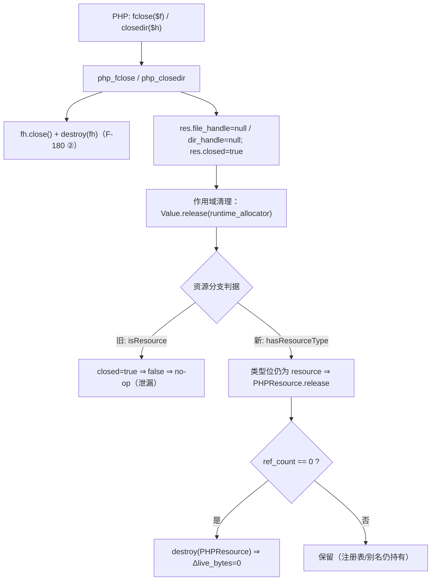
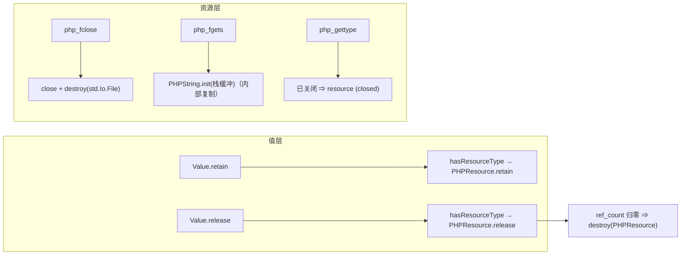
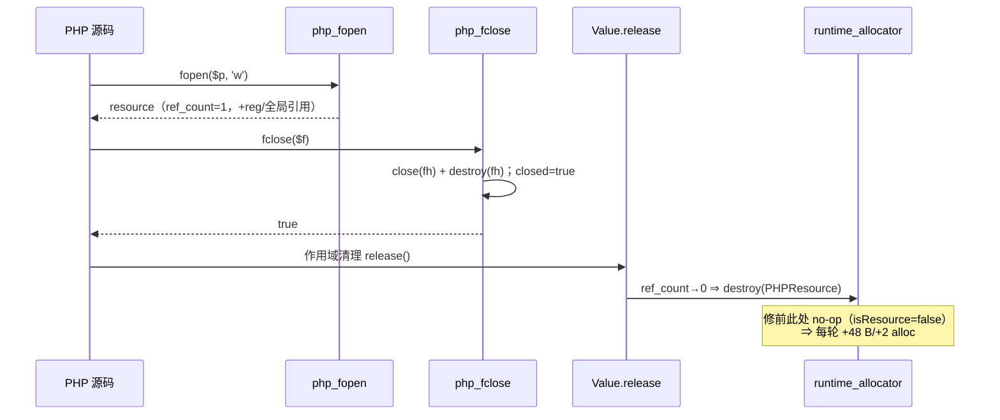

# AOT-CODEGEN-012 R-282：资源引用计数归零（F-180）＋ fgets 缓冲 dupe 泄漏（F-189）

- 日期：2026-10-26
- 代次锚：`nlk eb91f1be62c7225b8c883fa12e62c941`；`tpl dbae834cefacbca5eaf6d461b54fa591`；`irg 0b7106338d5ffe1342caee961734b8d8`；`ir fb2bb442ca27b98cf1df7e109a240e1f`
- 工单：`docs/known-issues/AOT-CODEGEN-012-class-name-case-insensitive-lookup.md` §190
- 主门：`fuzzy_scripts_720/tmp/c328_resource_refcount_gate_tmp.sh`（6 臂）

## 1. 高层摘要（TL;DR）

关闭资源（`fclose`/`closedir`）后，`PHPResource` 的引用计数**永远不归零**：`Value.retain/release` 用 `isResource()` 判分支，而它是 ZPP 语义谓词（对 `closed=true` 的资源返回 false）⇒ 关闭后所有 `Value.release` 变成 no-op。修法是把**所有权操作**改判类型位 `hasResourceType()`。同时 `php_fclose` 只 `close` 不 `destroy` 堆上的 `std.Io.File`（恒漏 8 B + 1 alloc/次），一并补上。顺带按 PHP 8 语义把 `gettype()` 的已关闭资源修成 `resource (closed)`，并修掉 `php_fgets` 里「先 `dupe` 再交 `PHPString.init`」的白分配（F-189，恒漏 1 alloc/次）。

量具（`ZIGPHP_ALLOC_STATS=1`，N=1000/3000 双跑）显示：`fopen+fclose` 由 **+96 000 B/+4 000 allocs**、`opendir+closedir` 由 **+80 000 B/+2 000 allocs** 全部降到 **Δ=0**；读写周期（含 `fgets`）由 **+2000 B/+2000 allocs** 降到 **Δ=0**。

## 2. 影响范围

| 层 | 影响 |
|---|---|
| 运行时值层 | `Value.retain`／`Value.release` 的资源分支改用类型位（所有权语义）；`isResource()` 保持 ZPP 语义不动 |
| 运行时资源层 | `php_fclose` 归零 `std.Io.File`；`gettype` 补 `resource (closed)`；`php_fgets` 去掉多余 `dupe` |
| 语义面 | `fclose`/`closedir` 之后：`is_resource()===false`、`gettype()==="resource (closed)"`、`readdir(null)` 的 Deprecated+TypeError 守卫不受影响 |
| 发射器/IR | **零改动**（`native_linker`/`ir_generator`/`ir` md5 未变） |

## 3. 核心变更

| # | 变更 | 位置 | 说明 |
|---|---|---|---|
| 1 | `Value.retain` 判定 | `runtime_lib_template.zig:2937` | `else if (self.hasResourceType())`：关闭后仍需 retain，才能与 release 对称 |
| 2 | `Value.release` 判定 | `:2973` | 同上；否则 `closed=true` 后归零路径整段失效（根因①） |
| 3 | `php_fclose` | `:4637` | `close` 后 `runtime_allocator.destroy(fh)` 再置 null（根因②，8 B+1 alloc/次） |
| 4 | `gettype` | `:29080` | 新增 `else if (val.hasResourceType()) "resource (closed)"`（旧落 `unknown type`） |
| 5 | `php_fgets`（F-189） | `:4658` | `PHPString.init` 内部本就 `alloc+memcpy` 复制入参 ⇒ 直接传栈缓冲，删除 `dupe`（旧写那份 dupe 无人释放） |
| 6 | 新门 C328 | `fuzzy_scripts_720/tmp/c328_resource_refcount_gate_tmp.sh` | 6 臂：a1 fopen/fclose、a2 opendir/closedir、a3 读写周期（含 fgets）、a4 unset-不关对照、b1 行为守卫、s1 敏感度 |

## 4. 可视化概览（Code & Logic Map）

## 5. 详细变更分析

| 文件 | 变更点 |
|---|---|
| `src/aot/runtime_lib_template.zig` | `Value.retain` `:2937`、`Value.release` `:2973`（`hasResourceType`）；`php_fclose` `:4637`（destroy 文件句柄）；`php_fgets` `:4658`（去 dupe，F-189）；`php_gettype` `:29080`（`resource (closed)`） |
| `fuzzy_scripts_720/tmp/c328_resource_refcount_gate_tmp.sh` | 新永久门 6 臂（N 双跑 + 行为守卫 + 敏感度） |
| `fuzzy_scripts_720/tmp/c328_resource_refcount_tmp.tsv` | 门读数（资产） |
| `docs/known-issues/AOT-CODEGEN-012-class-name-case-insensitive-lookup.md` | §190 落地记录 |
| `docs/handoff/2026-10-26/AOT-F180_交接_2026-10-26.md` | 交接（含门设计与复现探针） |

## 6. 影响与风险评估

- **破坏式变更**：无（修前是泄漏＋`gettype` 错值；`isResource()` 语义保持不变）。
- **风险点（已由 b1 臂钉死）**：归零路径一旦多释放，会表现为 `closedir` 后 `readdir(null)` 崩溃或 `is_resource` 错值 ⇒ b1 逐字节比 PHP。
- **注册表交互**：R-280 的 last-opened 目录流自持一个引用，归零必须留给它；b1 覆盖「关闭后 `readdir(null)` ⇒ TypeError `No resource supplied`」。
- **复测路径**：`bash fuzzy_scripts_720/tmp/c328_resource_refcount_gate_tmp.sh`；邻居 `c326`／`c324`／`c327`／`c321`；`zig build test --summary all`；`bash fuzzy_scripts_720/run_regression.sh`。
- **读数**：C328 **6/6 SAME**（33 s；a1 17260/17260、a2 17180/17180、a3 18182/18182、a4 19274/19274、s1 敏感度 Δ>0）；自证 `AOT_BIN=/bin/false` **6 CF**；邻居 C326 5/5（32 s）、C324 5/5（29 s）、C327 5/5（45 s）、C321 **24/24**（112 s）；`zig build test` **21/21 steps、326/326**；主回归 **PASS=68 FAIL=0**（`SELF_CHECK_OK rows=68 uniq=68`）。

## 7. 遗留问题/潜在问题

| 编号 | 级别 | 说明 |
|---|---|---|
| 新候选① | P2 | `PHPResource.release` 归零时对**未 fclose 就释放**的 `file_handle` 只 `destroy` 不 `close`（fd 泄漏，内存不漏）；低频但真实 |
| 新候选② | P2 | F-188 帧机制推广：`get_class_methods`/`get_class_vars` 等同族内置抛出点接入 `setLastThrowFrame`（现仅 `get_parent_class`） |
| F-117/F-158 | P1 | 循环体三元/merge phi 物化缺口（伪影族），待老铁裁定「甲案收窄条件」后单独改造轮 |
| 门构造性盲区 | — | 泄漏量具只能看见**分配器记账**层面的泄漏；fd 级泄漏（候选①）需另建 `ls /dev/fd` 型探针 |

## 8. 后续开发/优化建议

| 优先级 | 建议 | 影响面 | 落地成本 |
|---|---|---|---|
| P1 | F-117/F-158 phi 物化改造（待裁定） | 发射器核心 | 中-高 |
| P2 | 候选①：未关闭资源释放时的 fd 泄漏（`release` 里补 `close`） | 运行时资源层 | 低 |
| P2 | 候选②：F-188 帧机制推广到同族内置抛出点 | 运行时诊断措辞 | 低-中 |
| P3 | 把 C328 的敏感度臂模式（`s1` 必须 Δ>0）推广到后续所有泄漏门 | 门基础设施 | 低 |
