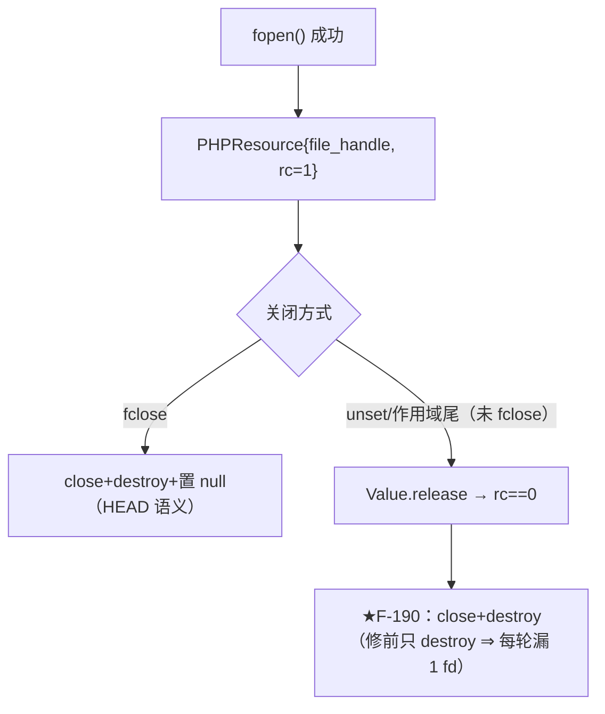
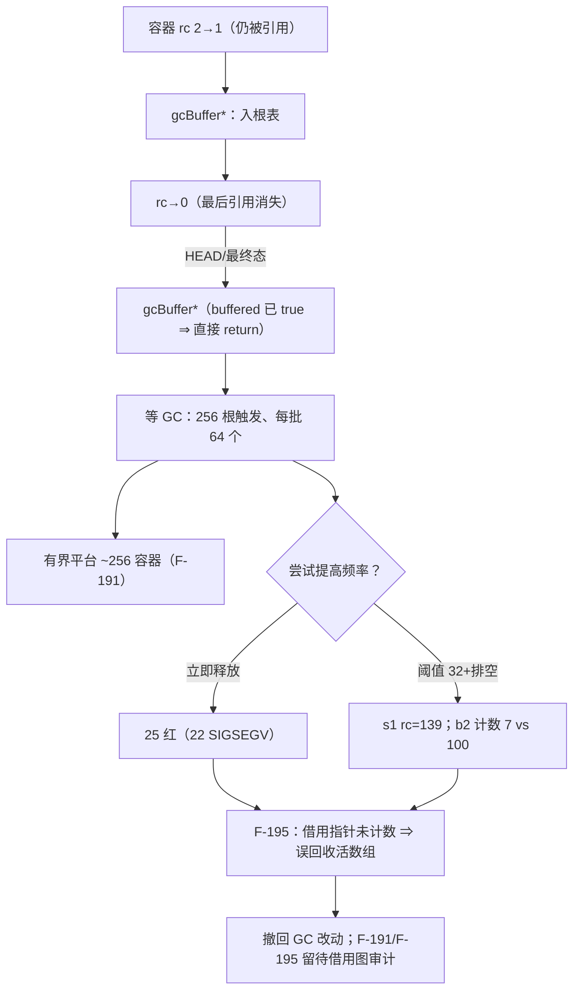
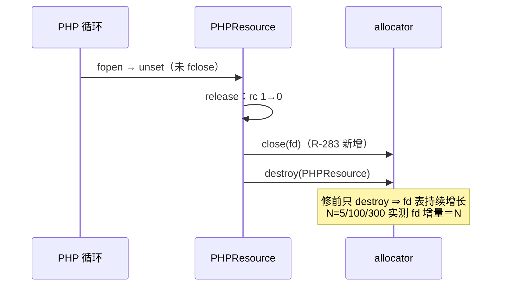

# AOT-CODEGEN-012 R-283：未 `fclose` 资源的 fd 泄漏（F-190，已闭）＋ GC 滞留与预存崩溃（F-191／F-195，已定性未修）

- 日期：2026-10-26
- 代次锚（最终态）：`nlk eb91f1be62c7225b8c883fa12e62c941`；`tpl 3d7ac9775929e26416c189ad4d0353b3`；`irg 0b7106338d5ffe1342caee961734b8d8`；`ir fb2bb442ca27b98cf1df7e109a240e1f`
- 工单：`docs/known-issues/AOT-CODEGEN-012-class-name-case-insensitive-lookup.md` §191
- 门资产：`c329_gc_buffer_gate_tmp.sh`（**KNOWN_RED**，F-191/F-195 复现）、`c328_*`（已绿，本轮修敏感度臂）

## 1. 高层摘要（TL;DR）

- **F-190（已闭）**：`PHPResource.release` 归零时对 `file_handle` 只 `destroy` 不 `close` ⇒ 任何**未 `fclose` 就被释放**的资源每轮漏 1 个 fd（分配器记账看不见）。修法：归零路径 `close` 后再 `destroy`。实测 `fopen+unset` 的 fd 增长由 **N（5/100/300 均为 1）** 降为常量 1（每循环结构 1 个），`fclose` 路径仍 0。
- **F-191（已定性，未修）**：容器 rc 从 2→1 时进 GC buffer，随后 rc→0 仍只“重新入队”，只能等 GC 批量回收（阈值 256 根/4096 事件、**每批 64**、退出不跑）⇒ 在“先共享后丢弃”的循环里，驻留量被钉在 **约 256 个容器 / ~90–120 KB / fd ≤2×阈值** 的**有界平台**（不是无界增长；N<256 时表现为逐轮增长）。
- **F-195（P0，预存崩溃，未修）**：为修 F-191 而提高 GC 频率（立即释放／阈值 32＋排空）⇒ **主回归 25 红（22 个 SIGSEGV）**、且最小复现 `for($i=0;$i<255;$i++) $keep[] = [$i];` 在 **HEAD 上 N≥255 即 SIGSEGV**。根因：运行时有**未计数的借用指针**（`Elements.parent`、`array_internal_pointers`、迭代器/foreach 快照、by-ref Ref cell），GC 的 MarkGray/Scan 与“未入 buffer 的活容器引用”交互时会误回收仍存活的数组。⇒ GC 改造必须先做借用图审计，属独立设计轮；**本批已整体撤回 GC 改动**。

## 2. 影响范围

| 层 | 影响 |
|---|---|
| 运行时资源层 | `PHPResource.release` 归零路径补 `close`（F-190，唯一保留的实现改动） |
| 运行时 GC 层 | **净零改动**（两次尝试均被回归否决并撤回，阈值/批量/退出收集恢复 HEAD 语义） |
| 门资产 | C328 s1 敏感度臂改真分配（`"sens".$i`）；新增 C329（KNOWN_RED，F-191/F-195 复现） |
| 发射器/IR | 零改动 |

## 3. 核心变更

| # | 变更 | 位置 | 说明 |
|---|---|---|---|
| 1 | 归零关 fd | `runtime_lib_template.zig:2636` | `fh.close(getIo())` 后再 `destroy`；`php_fclose` 已 close 并置 null ⇒ 不二次关闭 |
| 2 | C328 s1 臂 | `c328_resource_refcount_gate_tmp.sh` | 敏感度臂由同一 interned 串改为每轮拼接新串（判据 Δla>0 ∧ Δlb>0 未放宽），修后 `la 1105→3107`、`lb 89k→301k` |
| 3 | C329（新，KNOWN_RED） | `c329_gc_buffer_gate_tmp.sh` | 8 臂：a1 数组字面量、a2 数组+资源、a3 对象+资源、a4 闭包别名、a5 append、b1 fd 窗口、b2 真环守卫、s1 敏感度（=F-195 复现） |

## 4. 可视化概览（Code & Logic Map）

## 5. 详细变更分析

| 文件 | 变更点 |
|---|---|
| `src/aot/runtime_lib_template.zig` | `PHPResource.release` 归零路径补 `close`（`:2636`）；GC 侧净零改动 |
| `fuzzy_scripts_720/tmp/c329_gc_buffer_gate_tmp.sh`（新） | F-191/F-195 复现资产，头部标 **KNOWN_RED** 并写明两次尝试被否决的数据 |
| `fuzzy_scripts_720/tmp/c329_gc_buffer_tmp.tsv`（新） | 红基线：a1/a2/a3/a5 DIFF、a4/b1/b2 SAME、s1 rc=139 |
| `fuzzy_scripts_720/tmp/c328_resource_refcount_gate_tmp.sh` | s1 敏感度臂改真分配 |

**关键实测**
| 形状（N=1000/3000 或 5/100/300） | 修前 | 修后（最终态） |
|---|---|---|
| `fopen+unset` fd 增量（N=5/100/300） | 5/100/300（逐轮 1） | **1/1/1**（每循环 1，F-193） |
| `fopen+fclose` fd 增量 | 0 | 0（C328 a1 Δlb/Δla=0） |
| `opendir+closedir` | 0 | 0（C328 a2） |
| 读写周期（含 fgets） | 0（F-189 已修） | 0（C328 a3） |
| `[1,2,3]` 每轮丢弃 | **未变（F-191，GC 侧净零改动）**：N=100→300 时 lb 32 560→96 512（≈+320 B/轮） | N=3000/9000 稳定在 98 144/95 968（≈256 容器平台，a1 DIFF 记录） |
| 对象环 `gc_collect_cycles()`（N=100） | 100（=PHP） | 100（b2 SAME） |

## 6. 影响与风险评估

- **破坏式变更**：无（GC 恢复 HEAD 语义；F-190 只在归零路径补 close，`php_fclose` 已置 null 不会二次关闭）。
- **回归证据（决定性）**：
  - 尝试甲（rc==0 立即摘根+deinit）：`PASS=43 FAIL=25`（22 个 exit=139，含 f006/f007/f033/f034/f037…）。
  - 尝试乙（阈值 256→32 ＋ 触发即排空全部根）：C329 `s1` rc=139；`b2` 计数 `7 vs PHP 100`。
  - 最终态（仅 F-190）：定向脚本 f006/f007/f033 全 rc=0；C328 **6/6**；`zig build test` **21/21、326/326**；主回归 **PASS=68 FAIL=0**。
- **为什么不是“门放松”**：C329 的 a 臂保持严格 `Δ==0`，当前如实报红；F-191 的“有界”结论来自 N=3000/9000 的实测平台（lb 98 144/95 968），不是判据放宽。
- **复测路径**：`bash fuzzy_scripts_720/tmp/c329_gc_buffer_gate_tmp.sh`（预期红）；`c328`（应绿）；`run_regression.sh`。

## 7. 遗留问题/潜在问题

| 编号 | 级别 | 说明 |
|---|---|---|
| **F-195** | **P0** | **预存崩溃**：`for($i=0;$i<255;$i++) $keep[] = [$i];` ⇒ SIGSEGV（HEAD 与最终态均复现；N≤200 不崩）。GC 自动回收误伤仍存活数组，疑点：`Elements.parent`/`array_internal_pointers`/迭代器/Ref cell 等未计数借用指针；`gcScanBlackValue` 对同一子容器的重复 `ref_count += 1` 也会扭曲计数 |
| **F-191** | P2 | GC 批量滞留：平台 ≈256 容器 / ~90–120 KB / fd ≤2×阈值；提高回收频率会撞 F-195，必须先修 F-195 |
| F-192 | P2 | 真环残余：数组 by-ref 自引用环计数恒 0（PHP=N）；对象环 N≥300 时 `collected` 只有 236/300（批处理尾巴） |
| F-193 | P2 | 每个循环结构残留 1 个语句临时值（fd/内存各 1） |
| F-194 | P2 | by-ref 数组自赋值后 `echo …, gc_collect_cycles(), "\n"` 尾随换行丢失（HEAD 即存在） |
| F-117/F-158 | P1 | 循环体三元/merge phi 物化缺口，待裁定 |

## 8. 后续开发/优化建议

| 优先级 | 建议 | 影响面 | 落地成本 |
|---|---|---|---|
| **P0** | **F-195**：GC 误回收活数组崩溃——先做**借用图审计**（列出所有不计数持有者：`Elements.parent`、`array_internal_pointers`、迭代器快照、Ref cell、`has_active_refs`），再决定“借用方持引用”或“GC 只从完整根集标记”；门：`$keep[]=[$i]` N=255/300/3000 必须稳定，且对象/数组真环仍能收 | 运行时 GC 核心 | 高 |
| P2 | F-191：F-195 修好后，把“归零仍 buffered”改为立即回收或触发即排空 | 运行时 GC | 中（依赖 P0） |
| P2 | F-192/F-193/F-194 分别独立取整（环计数/临时值/echo 实参） | 运行时+发射器 | 低-中 |
| P3 | 门基础设施：泄漏门统一“平台判定”（多 N 采样看趋势）而非单点相等 | 门 | 低 |
