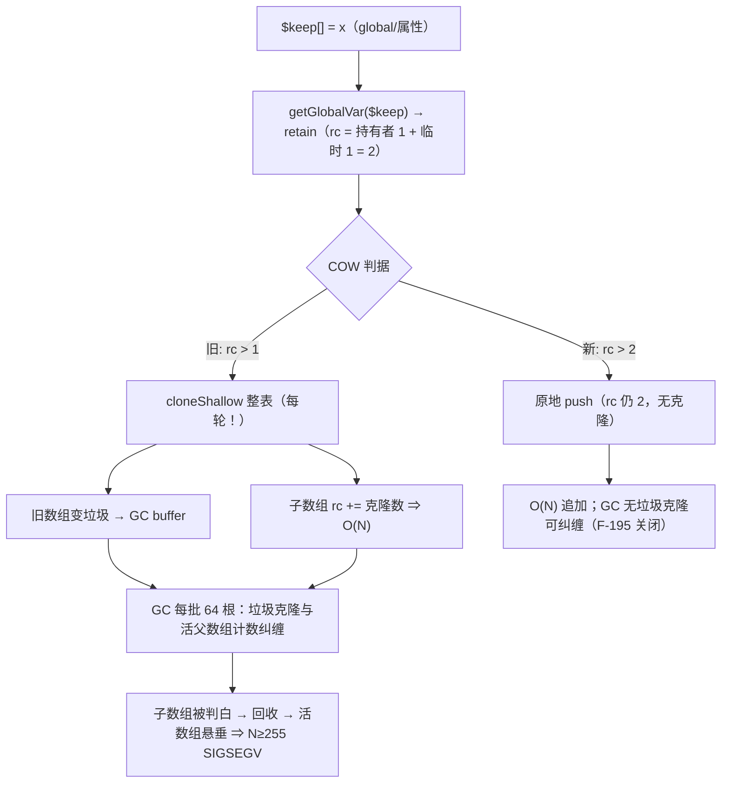
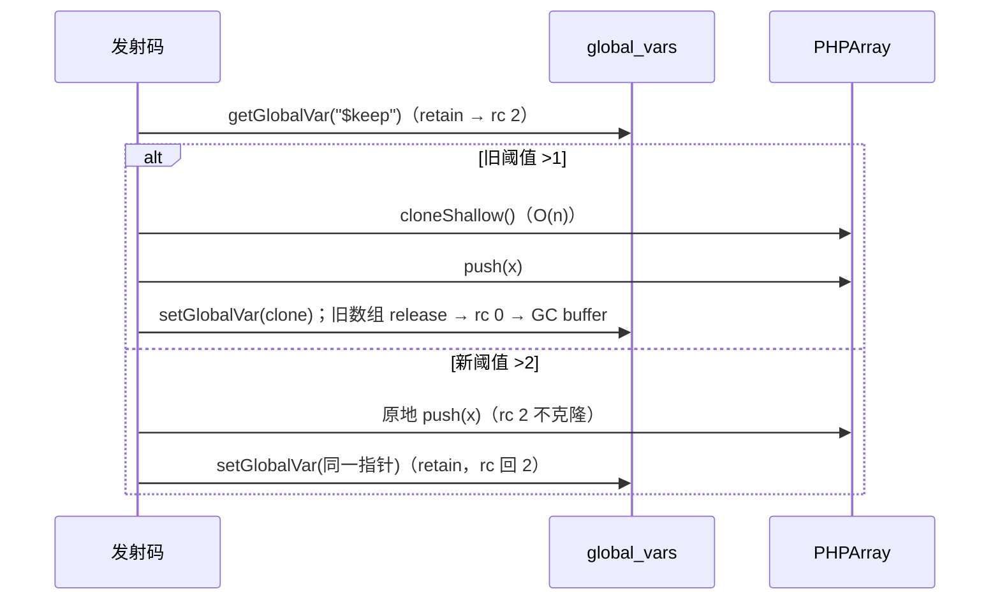

# AOT-CODEGEN-012 R-284：`$a[] = x` 的每轮整表克隆（F-196）＋ GC 误回收崩溃（F-195）——发射器 COW 阈值修复

- 日期：2026-10-26
- 代次锚：`nlk c3a4a41a1c3d1f790ef03ae8d847c796`；`tpl 3d7ac9775929e26416c189ad4d0353b3`（= R-283 终态，本轮**未改运行时**）；`irg 0b7106338d5ffe1342caee961734b8d8`；`ir fb2bb442ca27b98cf1df7e109a240e1f`
- 工单：`docs/known-issues/AOT-CODEGEN-012-class-name-case-insensitive-lookup.md` §192
- 门：`c329_gc_buffer_gate_tmp.sh`（F-191 复现；s1 兼作 F-195 崩溃守卫）、`c328_*`（资源引用计数）

## 1. 高层摘要（TL;DR）

`$a[] = x` 在**非 alloca** 分支（全局/属性等）先 `getGlobalVar`/属性读把数组读进寄存器——这一步**会 retain**，于是 `ref_count` 恒 ≥2；发射器的 COW 判据是 `ref_count > 1` ⇒ **每轮 append 都把整个数组 `cloneShallow` 一次**。后果有两层：

1. **O(N²) 克隆**：`$a[]=$i` 跑 5 000 次要 826.7 ms，20 000 次要 >10 s（超时）；修后 7.3 ms / 11.0 ms（**≈113×**，20 000 次由“跑不完”变 11 ms）。克隆出的旧数组全部变成 GC buffer 里的垃圾。
2. **N≥255 SIGSEGV（F-195，预存崩溃）**：`$keep[] = [$i]`（子项是数组）时，克隆把子数组 rc 抬到 O(N)；GC 每批只处理 64 个根，回收垃圾克隆与仍存活的 `$keep` 对子数组的计数纠缠 ⇒ 子数组被误判为白 ⇒ 回收后活数组悬垂 ⇒ 崩。

修法只有一处：非 alloca 分支的 COW 阈值改为 `ref_count > 2`（把“本次读取的临时 retain”计入）。真实共享时 rc ≥3（持有者＋读取临时＋另一持有者）⇒ 仍克隆；alloca 分支的 load 不 retain，语义不变，保持 `> 1`。

## 2. 影响范围

| 层 | 影响 |
|---|---|
| 发射器（nlk） | `.array_push` 非 alloca 分支 COW 条件 `>1` → `>2` |
| 运行时模板 | **零改动**（本轮所有 GC 改动均被回归否决并撤回，tpl 保持 R-283 终态） |
| 语义面 | 数组值语义（COW）不变：5 形矩阵与 PHP 逐字节一致（见 §5） |
| 性能面 | 追加/写入全局或属性数组由 O(N²) 降到 O(N) |

## 3. 核心变更

| # | 变更 | 位置 | 说明 |
|---|---|---|---|
| 1 | COW 阈值补偿读取临时引用 | `src/aot/native_linker.zig` `.array_push` 非 alloca 分支 | `ref_count > 1` ⇒ `> 2`；注释钉死“读取已 retain，真实共享 rc≥3” |
| 2 | 门资产状态更新 | `c329_gc_buffer_gate_tmp.sh` 头部 | 记录 a 臂仍红（F-191 未修）、s1 不再崩溃（F-195 已闭）、两次 GC 尝试的否决数据 |

## 4. 可视化概览（Code & Logic Map）

## 5. 详细变更分析

| 文件 | 变更点 |
|---|---|
| `src/aot/native_linker.zig` | `.array_push` 非 alloca 分支 COW 阈值 `>2`（含 F-195 归因注释） |
| `fuzzy_scripts_720/tmp/c329_gc_buffer_gate_tmp.sh` | 头部状态更新（KNOWN_RED 原因改为 F-191；s1 由 CRASH 转 SENS） |

**验证矩阵（与 PHP 逐字节一致）**
| 形 | PHP | AOT（修后） |
|---|---|---|
| `$a=[1]; $b=$a; $a[]=2;` | b=1 a=2 | b=1 a=2 |
| `$c=[1]; $d=&$c; $c[]=2;` | d=2 | d=2 |
| `$e=['x'=>1]; $f=$e; $e['y']=2;` | f=1 e=2 | f=1 e=2 |
| `$g=[]; $g[]=2; $g[]=3;` | 3 | 3 |
| `$h=[[1]]; $i=$h; $h[]=[2];` | i=1 h=2 | i=1 h=2 |

**性能（同一探针，`microtime`）**
| N | 修前 | 修后 | PHP |
|---|---|---|---|
| 5 000 | 826.7 ms | **7.3 ms** | 0.1 ms |
| 20 000 | **>10 s（超时）** | **11.0 ms** | 0.1 ms |

**崩溃复现（`$keep[] = [$i]`）**
| N | 修前（HEAD 与 R-283 终态） | 修后 |
|---|---|---|
| 255 / 300 / 1 000 / 3 000 | **SIGSEGV（rc=139）** | rc=0 |
| 9 000 | —（前值已崩） | rc=0 |

## 6. 影响与风险评估

- **破坏式变更**：无。COW 语义矩阵全等；`ref_count > 2` 只在“读取临时”存在时放宽，真实共享仍复制。
- **回归证据**：
  - 本修复（仅 nlk）：`zig build test` **21/21、326/326**；主回归 **PASS=68 FAIL=0**（`/tmp/r284_*.log`）。
  - 追加 GC 立即回收后再跑：**PASS=43 FAIL=25**（22 个 exit=139，与 R-283 同一批 f006/f007/f033…）⇒ **GC 改动已整体撤回**；这条反证说明 F-191 的借用指针问题独立于 COW 克隆。
  - 邻居门（终态）：C329 4/8（a1/a2/a3/a5 DIFF＝F-191；a4/b1/b2 SAME；s1 SENS）、C328 **6/6**、C326 5/5、C324 5/5、C327 5/5、C321 **24/24**。
- **风险点**：非 alloca 但**未** retain 的数组来源若存在“真共享且 rc 恰为 2”，会被误判为独占。已核对现有非 alloca 来源（`getGlobalVar`/属性读/数组读均 retain）；语料 68/68 绿。
- **复测路径**：`bash fuzzy_scripts_720/tmp/c329_gc_buffer_gate_tmp.sh`（a 臂应红、s1 应 SENS）；`c328`；`run_regression.sh`。

## 7. 遗留问题/潜在问题

| 编号 | 级别 | 说明 |
|---|---|---|
| **F-191** | P2 | GC 缓冲滞留仍在：a1/a2/a3/a5 在 N=3000/9000 的 `lb` 为 98 144/95 968 等（≈256 容器平台，fd ≤2×阈值）。**修复前提**：先做借用图审计（`Elements.parent`、`array_internal_pointers`、foreach 快照/迭代器 `ref_lock_count`、by-ref `Ref` cell），否则立即回收会 25 红 |
| F-192 | P2 | 真环残余：数组 by-ref 自引用环计数恒 0（PHP=N）；对象环 N≥300 只收 236/300 |
| F-193 | P2 | 每循环结构残留 1 个语句临时值（fd/内存各 1） |
| F-194 | P2 | by-ref 数组自赋值后 `echo …, gc_collect_cycles(), "\n"` 尾随换行丢失（HEAD 即存在） |
| F-117/F-158 | P1 | 循环体三元/merge phi 物化缺口，待裁定 |

## 8. 后续开发/优化建议

| 优先级 | 建议 | 影响面 | 落地成本 |
|---|---|---|---|
| P2 | F-191：借用图审计 → 再决定“借用方持引用”或“GC 完整根集标记”（拒绝再试频率调参） | 运行时 GC | 高 |
| P2 | 把“读取临时 retain 计入 COW 阈值”推广核查其它 COW 站点（`array_set`、属性写、`array_merge` 族） | 发射器/运行时 | 中 |
| P2 | F-192/F-193/F-194 各自独立取整 | 运行时/发射器 | 低-中 |
| P3 | 增加 append 性能门（N=20 000 追加 <100 ms）防 O(N²) 回潮 | 门 | 低 |
