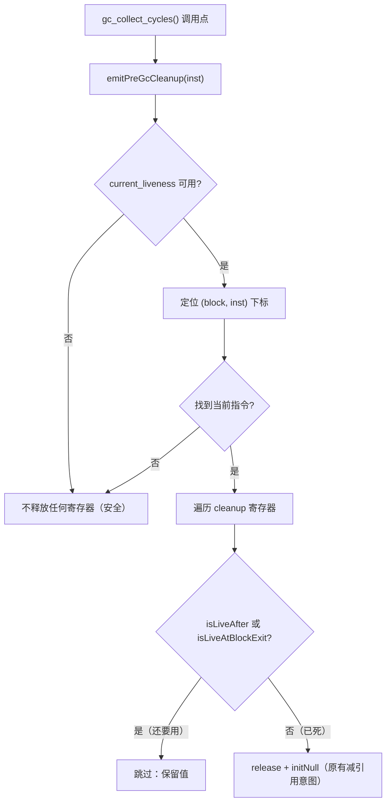
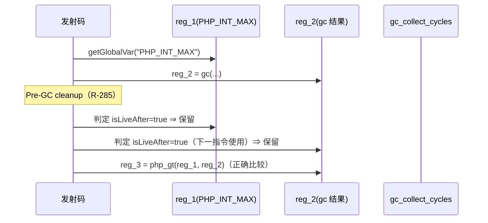

# AOT-CODEGEN-012 R-285：GC 前置清理误清活寄存器（F-194 echo 丢实参 ＋ F-197 表达式活操作数被清空）

- 日期：2026-10-26
- 代次锚：`nlk 8986ec5c13616967deb6b7b3ddf1930a`；`tpl 3d7ac9775929e26416c189ad4d0353b3`（本轮未改运行时）；`irg 0b7106338d5ffe1342caee961734b8d8`；`ir fb2bb442ca27b98cf1df7e109a240e1f`
- 工单：`docs/known-issues/AOT-CODEGEN-012-class-name-case-insensitive-lookup.md` §193
- 门：`fuzzy_scripts_720/tmp/c330_pregc_const_gate_tmp.sh`（5 臂）

## 1. 高层摘要（TL;DR）

`gc_collect_cycles()` 调用点前，发射器有一段 `emitPreGcCleanup`：把**所有** cleanup 寄存器 `release + 置 null`，用于避免临时引用抬高 refcount 阻止循环检测。但它**没有任何 liveness 依据**，于是把两类“还要用”的寄存器清掉了：

1. **跨语句常量 CSE**：IR 会把相同字面量复用到同一寄存器（后续语句直接读该 reg，不再发 `const.*`）。清理把该 reg 置 null ⇒ 之后的 `echo` 丢尾随实参（`"\n"` 消失，多字节字面量尾字节消失）——**F-194**。
2. **同一表达式的活操作数**：`echo "a=", PHP_INT_MAX > gc_collect_cycles(), "\n";` 中 `PHP_INT_MAX` 由 `getGlobalVar` 载入寄存器，比较在 gc 调用**之后**执行；清理把它清成 null ⇒ `null > 2` 为 false ⇒ echo 输出空串——**F-197**。

修法：给 `emitPreGcCleanup` 加 **liveness 过滤**——只释放“此 GC 调用点之后已死、且块出口也不活跃”的寄存器；拿不到 liveness 或定位不到当前指令时**一个都不放**（安全优先）。

## 2. 影响范围

| 层 | 影响 |
|---|---|
| 发射器（nlk） | `emitPreGcCleanup` 重写：新增当前指令定位（block/inst 下标）+ `isLiveAfter` / `isLiveAtBlockExit` 双守卫；调用点传入 `inst` |
| 运行时模板 | 零改动 |
| 语义面 | 含 `gc_collect_cycles()` 的表达式/后续语句；环检测能力不变（by-ref 环仍返回 2，对象环 b2 守卫仍与 PHP 一致） |

## 3. 核心变更

| # | 变更 | 位置 | 说明 |
|---|---|---|---|
| 1 | 指令定位 | `emitPreGcCleanup` | 扫描 `func.blocks` 找到当前指令指针，得到 `(bidx, iidx)`；找不到则不清理 |
| 2 | liveness 双守卫 | 同上 | `isLiveAfter(bidx,iidx,reg)` 或 `isLiveAtBlockExit(bidx,reg)` 为真 ⇒ 跳过 |
| 3 | 无 liveness 不清理 | 同上 | `current_liveness == null` 直接 return（旧行为是照清，危险） |
| 4 | 调用点 | `.call` 发射臂 | `emitPreGcCleanup(writer, inst, inst.result)` |

## 4. 可视化概览（Code & Logic Map）

## 5. 详细变更分析

| 文件 | 变更点 |
|---|---|
| `src/aot/native_linker.zig` | `emitPreGcCleanup` 重写（liveness 过滤 + 指令定位）；`.call` 臂传 `inst` |
| `fuzzy_scripts_720/tmp/c330_pregc_const_gate_tmp.sh`（新） | 5 臂：t1 echo 内 gc+by-ref 环（布尔化 gc 返回值，规避 F-192a 计数差）、t2 mixed 语句、t3 两次 gc 调用、t4 函数作用域、t5 无 gc 守卫 |

**探针矩阵（stdout 对比 PHP）**
| 形 | 修前 | 修后 |
|---|---|---|
| `echo "a=", gc(), "\n";` + by-ref 环 + 后续 3 条 echo | `b=2c=42END`（换行全丢） | 与 PHP 一致（仅 `gc()` 计数 2 vs 1＝F-192a） |
| `echo "a=", PHP_INT_MAX > gc(), "\n";` | `a=`（空） | `a=1` |
| 无环、两次 gc 调用 / 函数内 / 无 gc | 正常 | 正常 |

## 6. 影响与风险评估

- **破坏式变更**：无。清理仍在“寄存器确实已死”时执行，环检测能力未退化（`gc_collect_cycles()` 对 by-ref 数组环仍返回 2；C329 b2 对象环守卫仍与 PHP 一致）。
- **为什么不是“直接删掉清理”**：实测删除后 by-ref 数组环返回 0（临时引用仍持环 ⇒ 检测不到）。liveness 过滤同时保住两者。
- **风险点**：块顺序扫描定位对跨块多实例（同一 `IR.Instruction` 指针只出现一次）安全；若将来 IR 复制指令导致指针重复，定位到的第一处可能不是真位置 ⇒ 保守跳过若干可释放寄存器，只影响 refcount 精简，不影响正确性。
- **回归证据**：`zig build test` **21/21、326/326**（`/tmp/r285_buildtest.log`）；主回归 **PASS=68 FAIL=0**（`/tmp/r285_regression.log`）。
- **复测路径**：`bash fuzzy_scripts_720/tmp/c330_pregc_const_gate_tmp.sh`（应 5/5）；`c329`（a 臂红＝F-191，b2/s1 绿）；`run_regression.sh`。

## 7. 读数

| 腿 | 读数 |
|---|---|
| C330 | **5/5 SAME**（22 s）；自证 `AOT_BIN=/bin/false` **5 CF** |
| C329 | 4/8（a1/a2/a3/a5 DIFF＝F-191；a4/b1/b2/s1 SAME，s1 兼 F-195 崩溃守卫） |
| C328 | **6/6 SAME**（32 s） |
| 邻居 C326/C324/C327/C321 | 5/5、5/5、5/5、**24/24** |
| `zig build test` | **21/21 steps、326/326** |
| 主回归 | **PASS=68 FAIL=0**（`/tmp/r285_regression.log`，`SELF_CHECK_OK rows=68 uniq=68`，rc=0） |

## 8. 遗留问题/潜在问题

| 编号 | 级别 | 说明 |
|---|---|---|
| F-192a | P3 | 数组 by-ref 自引用环 `gc_collect_cycles()` 计数 AOT=2 / PHP=1（环被收集，仅计数不同）；对象环 N≥300 尾巴另计 |
| F-191 | P2 | GC 缓冲平台（见 §191/§192），C329 a 臂红 |
| F-193 | P2 | 每循环结构 1 个语句临时值残留 |
| — | — | 其它“无 liveness 依据的批量 release”点位尚未普查（建议下一轮 grep 全部 `cleanup_regs` 消费点） |
