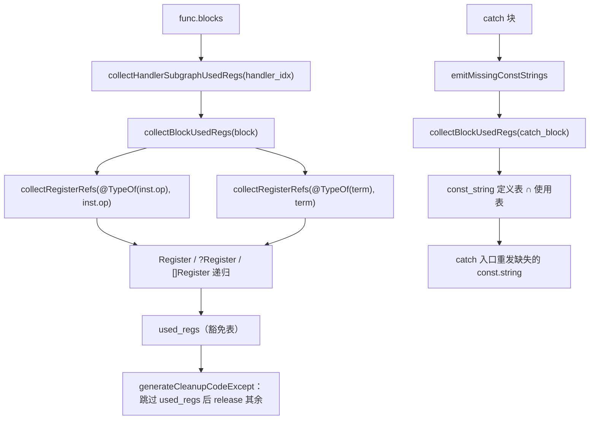

# AOT-CODEGEN-012 R-286：异常边操作数普查结构化（F-198）

- 日期：2026-10-26
- 代次锚：`nlk 008e92b845e0b8bd751089280509af89`；`tpl 3d7ac9775929e26416c189ad4d0353b3`（未改运行时）；`irg 0b7106338d5ffe1342caee961734b8d8`／`ir fb2bb442ca27b98cf1df7e109a240e1f` 均未变（均未提交）
- 工单：`docs/known-issues/AOT-CODEGEN-012-class-name-case-insensitive-lookup.md` §194
- HEAD：`b30690b`

## 1. 高层摘要（TL;DR）

异常路径的寄存器豁免与 catch 常量重建，此前各维护一张**手写 op 表**（`collectBlockUsedRegs` 的 switch、`emitMissingConstStrings` 的第二个 switch），只列"记得住的 op"。而 IR 的 `const.string` 会跨块 CSE（同一字面量在 try 外与 catch 内复用同一寄存器）⇒ 表里没列的 op（本轮实测 `static_method_call` 实参、`static_property_set` 值、`array_ensure` 键）读到的是被异常边 cleanup 清成 null 的常量，或从未赋值的常量。两面均实测复现（AOT `litgot:` vs PHP `litgot:lit`；AOT `got:` vs PHP `got:lit`）。本轮把两张表收成**一张编译期结构递归收集器** `collectRegisterRefs`（Register / `[]Register` / `?Register`，跳过自引用 `Type`），异常边 cleanup 与常量重建共用；新门 C331 七臂全绿。

## 2. 影响范围

| 层 | 影响 |
|---|---|
| 发射器（`native_linker.zig`） | 异常边 cleanup 的豁免集合、catch 入口 const.string 重建的收集方式 |
| 语义面 | try/catch 内复用 try 外/catch 外定义的字面量（常量寄存器）时的取值正确性 |
| 生成码 | 仅"异常路径上少释放若干仍在用的寄存器"；正常路径代码不变 |
| 运行期模板 | 无改动（`tpl` 锚不变） |

## 3. 核心变更

| # | 变更 | 说明 |
|---|---|---|
| 1 | 新增 `collectRegisterRefs(comptime T, value, set)` | 按 `@typeInfo` 递归：`Register` 直接收；`?Register` 解包；`[]Register` 逐项；结构体逐字段；union `inline else` 展开；**跳过 `IR.Type`**（自引用 union 且从不携带寄存器）；其余（int/bool/字符串/非 Register 指针）忽略 |
| 2 | `collectBlockUsedRegs` 改为一行收集 | 指令 `inst.op` 与 `block.terminator` 各调一次收集器；删除 120 行手写 switch |
| 3 | `emitMissingConstStrings` 复用同一收集器 | 删除第二个手写 switch（原仅 concat/call/method_call/instanceof），catch 块引用集一律走 `collectBlockUsedRegs` |

## 4. 可视化概览（Code & Logic Map）



```mermaid
sequenceDiagram
  participant IR as IR（跨块 CSE）
  participant E as 发射器
  participant R as 运行时
  IR->>E: entry: reg_0 = const.string "lit"; try{ boom() } catch{ static.call C::f(reg_0) }
  E->>E: handler 子图使用集（旧：漏 static.call 实参 ⇒ 不含 reg_0）
  E-->>R: throw 点 cleanup 把 reg_0 release+null
  E-->>R: catch 内 static.call 收到 null ⇒ 输出 "got:"
  Note over E: R-286：结构化收集后 reg_0 在豁免表内 ⇒ 不再被清
```

## 5. 详细变更分析

| 文件 | 变更点 |
|---|---|
| `src/aot/native_linker.zig` | `collectBlockUsedRegs`（`:697`）改调结构化收集器；新增 `collectRegisterRefs`（`:712`）；`emitMissingConstStrings`（`:19741`）改用 `collectBlockUsedRegs` |
| `fuzzy_scripts_720/tmp/c331_exhandler_operands_gate_tmp.sh` | 新门 7 臂（a1–a7） |
| `fuzzy_scripts_720/tmp/c331_exhandler_operands_tmp.tsv` | 门读数 |

**C331 臂设计**

| 臂 | 形状 | 修前状态 |
|---|---|---|
| a1 | catch 复用 **try 前**常量作 `static.call` 实参 | 实测红：AOT `litgot:` / PHP `litgot:lit` |
| a2 | catch 复用 **try 内 throw 之后**才赋值的常量（常量重建面） | 实测红：AOT `got:` / PHP `got:lit` |
| a3 | catch 中 `static.set` 的值复用 try 前常量（IR 证跨块复用） | 结构面（同 a1 机制，未单独取修前读数） |
| a4 | catch 中 `array.ensure` 的键复用 try 前常量，键名可观测（`array_keys`） | 结构面（同上） |
| a5 | 守卫：`method.call` 实参（修前已在表内） | 修前即 SAME，须保持 |
| a6 | 守卫：try 正常完成（无异常） | 修前即 SAME |
| a7 | 守卫：嵌套 try/catch，内层类型不中重抛到外层 | 修前即 SAME |

**普查结论（R-285 §193.5 遗留项）：`cleanup_regs` 批量释放点位逐个定性**

| 点位 | 路径性质 | 依据 | 结论 |
|---|---|---|---|
| `emitPreGcCleanup` | 中途（gc 调用前） | R-285 已按 liveness 过滤 | 已闭环（F-194/F-197） |
| `generateCleanupCodeExcept` | 中途（异常边 → handler） | 豁免表＝处理器子图使用集；本轮补齐操作数普查 | 已闭环（F-198） |
| `emitMissingConstStrings` | 中途（catch 入口重发） | 本轮复用同一收集器 | 已闭环（F-198） |
| 单块函数尾 4 处（ret/throw/无 terminator） | 终止点（紧接 return/throw） | 路径随即离开函数 | 无需 liveness |
| `generateReturnInBlock` | 终止点（紧接 return） | 仅释放 alloca 且排除返回寄存器 | 无需 liveness |
| 状态机 `current_cleanup_regs` 设置/恢复 | 不释放 | 仅作用域包装 | 无需 liveness |

## 6. 影响与风险评估

- **破坏式变更**：无。生成码仅在异常路径上"少释放若干仍被 handler 子图使用的寄存器"，这些寄存器由函数尾 cleanup 统一回收。
- **内存代价**：泄漏探针（catch 内每轮 `static.call` 用同一常量，N=1000/9000/27000 三跑）显示 N=1000 与 N=9000 的 `live_bytes/live_allocs` **完全相等**（123241/2196）⇒ 非逐轮滞留；N=27000 有一次性偏差（+6112/+144），不随迭代线性增长。
- **风险点**：递归收集器把 `.retain/.release/.unset_var/.debug_print/.yield_*` 等操作数也纳入豁免表（生成器族本就不在 AOT 范围）⇒ 只会使异常路径更保守。
- **复测路径**：`bash fuzzy_scripts_720/tmp/c331_exhandler_operands_gate_tmp.sh`；自证 `AOT_BIN=/bin/false`；邻居 C327/C328/C329/C330。
- **读数**：C331 **7/7 SAME**（34 s，自证 **7 CF**）；C327 5/5；C328 6/6；C329 4/8（a1/a2/a3/a5 DIFF＝F-191 既有红，a4/b1/b2/s1 SAME，零转移）；C330 5/5；`zig build test` **21/21、326/326**；主回归 **PASS=68 FAIL=0**（`SELF_CHECK_OK rows=68 uniq=68`）。

## 7. 遗留问题/潜在问题

- **F-191**（GC 缓冲容器有界平台）仍开：C329 a1/a2/a3/a5 红，需 borrow-graph 审计后重设计 GC，不能靠提高回收频率掩盖。
- **F-192a**：数组 by-ref 自引用环 `gc_collect_cycles()` 计数 AOT=2 / PHP=1（环已收集，只差计数）。
- **F-193**：每个循环结构残留一条语句级临时量。
- 常量 CSE 的跨块复用规则仍是隐式约定（本轮按"重复即复用"实测取证），未在 IR 层做支配性校验；若未来 CSE 规则变化，C331 是唯一守卫。

## 8. 后续建议

| 优先级 | 建议 | 影响面 | 落地成本 |
|---|---|---|---|
| P0 | F-191：先做借用图审计（`Elements.parent`、`array_internal_pointers`、foreach 快照 `ref_lock_count`、by-ref `Ref` cell），再重设计 GC | 运行期内存 | 高 |
| P1 | F-117/F-158：循环体/表达式位嵌套三元的 merge phi 物化（需老铁裁定收窄条件） | 代码生成 | 高 |
| P2 | F-192a：环计数口径对齐 | 运行期 GC | 低 |
| P2 | 异常路径常量重建扩到 handler 子图（当前只重建 catch 块本体；u4 实测 merge 块会自行重发，暂无需） | 发射器 | 低 |
