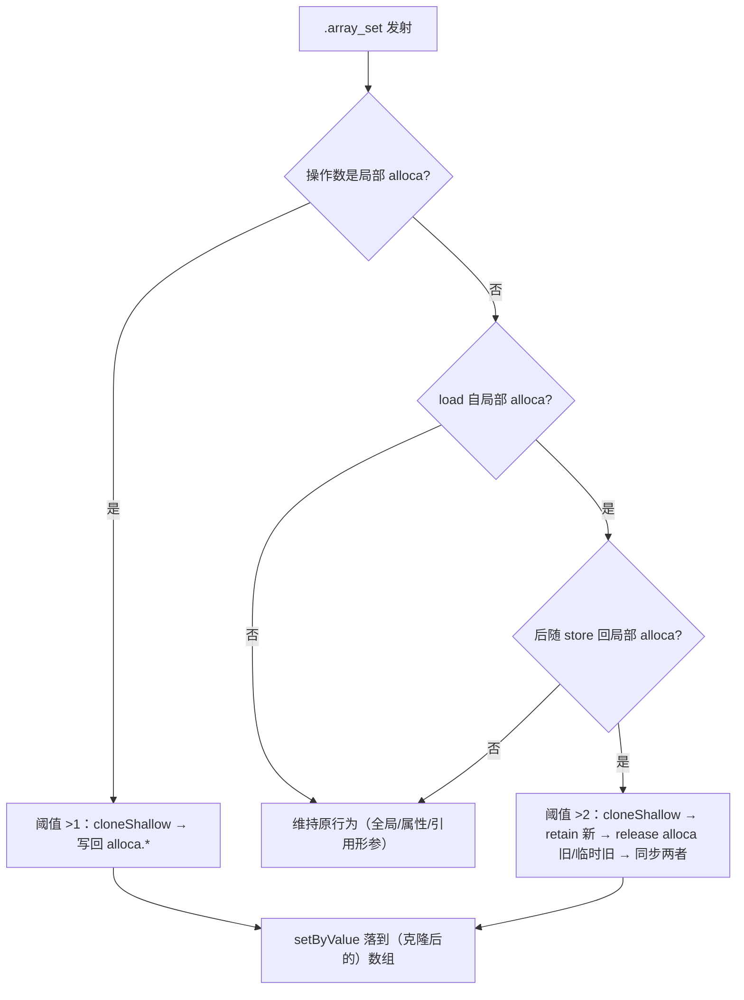

# AOT-CODEGEN-012 R-288：局部变量元素写的写时复制（F-201）

- 日期：2026-10-26
- 代次锚：`nlk d767d4dcd84cbb17e7ea2f1e55b6b50e`；`tpl 3d7ac9775929e26416c189ad4d0353b3`（未改运行时）；`irg 0b7106338d5ffe1342caee961734b8d8`／`ir fb2bb442ca27b98cf1df7e109a240e1f` 未变（均未提交）
- 工单：`docs/known-issues/AOT-CODEGEN-012-class-name-case-insensitive-lookup.md` §196
- HEAD：`b30690b`

## 1. 高层摘要（TL;DR）

`$a[$k] = v` 的常规 IR 是「`load` 临时 → `array.set` → `store` 回 alloca」。发射器直接在共享的 `PHPArray` 上调 `setByValue`，没有 COW ⇒ `$b = $a; $a["x"] = 9;` 连 `$b` 一起改（PHP 值语义要求 `$b` 不变）。append（R-284）与全局路径（`setGlobalVar`）本来就正确，缺口只在**局部 alloca 的元素写**。本轮在发射器识别该形状并先 `cloneShallow`、再同步 alloca 与临时寄存器；新增永久门 C332（10 语义臂 + 1 泄漏臂）全绿，主回归无红。

## 2. 影响范围

| 层 | 影响 |
|---|---|
| 发射器（`native_linker.zig`） | `.array_set` 的数组分支新增 COW；新增两个只读判定助手 |
| 语义面 | 局部数组的 `$a[$k]=v` 与副本隔离（PHP 值语义） |
| 生成码 | 仅"操作数来自局部 alloca"的 `.array_set` 多一条 `ref_count` 分支；其余形状一字不变 |
| 运行期模板 | 无改动（`tpl` 锚不变） |

## 3. 核心变更

| # | 变更 | 说明 |
|---|---|---|
| 1 | `isLoadedFromLocalAlloca(reg)` | 判断寄存器是否由"从局部 alloca `load`"定义（排除引用形参 alloca） |
| 2 | `storeBackAllocaAfter(inst, reg)` | 定位 `.array_set` 之后紧跟的 `store reg → 局部 alloca`，返回该 alloca |
| 3 | `.array_set` COW 两条：直接 alloca 用 `>1`；load 临时形状用 `>2` | load **恒 retain**，那份引用计入 `ref_count`；真实共享时 rc ≥3 |
| 4 | 克隆时引用账目 | 非直接形状：先给克隆补一份临时引用，再归还 alloca 与临时对旧数组的引用（retain 新 → release 旧，防 old==new UAF） |
| 5 | `isRefCarryingAlloca(alloca)` 排除引用载体 | 引用形参 / `make_ref` / 闭包 `use(&$v)` / foreach 引用 / **带 `store{no_cow}` 的引用赋值落点** ⇒ 这类 alloca 的元素写必须写穿共享数组，**禁止 COW** |

★第 5 条是首轮主回归（FAIL=2：`f044_json_deepops_merge_diff`、`f110_os_sim_process_memory_filesystem`）抓出来的：两枚脚本都用**引用链**遍历写入（`$ref = &$data; $ref = &$ref[$k];` ／ `$cur = &$this->root; $cur = &$cur[$p];`）。引用变量的写必须改到原数组；首版把克隆写回引用槽，切断了链，导致 `deepSet`/`mkdir`/`writeFile` 全部丢写。排除引用载体后两枚脚本逐字节 SAME，门里固化为 a11/a12 守卫。

## 4. 可视化概览（Code & Logic Map）



```mermaid
sequenceDiagram
  participant PHP as "$b = $a; $a['x'] = 9"
  participant E as 发射器
  participant R as 运行时
  PHP->>R: $a=[1,2]; $b=$a ⇒ 数组 rc=2（a、b 各一份）
  E->>R: load $a（临时 retain）⇒ rc=3（alloca_a + alloca_b + 写临时）
  E->>E: 3 > 2 ⇒ 判定为真实共享
  E->>R: cloneShallow → a 指向克隆；b 仍指向原表
  E->>R: setByValue 只落在克隆上
  Note over E: 修前：无 COW，直接改共享表 ⇒ b 也出现 x（cb=3）
```

## 5. 详细变更分析

| 文件 | 变更点 |
|---|---|
| `src/aot/native_linker.zig` | `isLoadedFromLocalAlloca`／`storeBackAllocaAfter`（`:889` 附近）；`.array_set` 数组分支 COW（`:24680` 附近） |
| `fuzzy_scripts_720/tmp/c332_element_cow_gate_tmp.sh` | 新门 11 臂（a1–a10 + s1 泄漏臂） |
| `fuzzy_scripts_720/tmp/c332_element_cow_tmp.tsv` | 门读数 |

**C332 臂设计**

| 臂 | 形状 | 修前 |
|---|---|---|
| a1 | `$b=$a; $a["x"]=9` ⇒ b 不得变 | 红（cb=3、bx=Y） |
| a2 | COW 后第二次写 `$b["y"]=8` | 红（丢写） |
| a3 | 字符串键共享写 | 红（bk=5） |
| a4 | 三重持有者 | 红 |
| a5 | append 守卫（R-284） | 绿（须保持） |
| a6 | 引用形参元素写（写穿，不得克隆） | 绿 |
| a7 | 对象属性元素写 | 绿 |
| a8 | 循环内连续元素写 | 绿 |
| a9 | unset 副本后写 | 绿 |
| a10 | 按值传参内写（调用方不受影响） | 绿 |
| a11 | 引用链 `$ref = &$data; $ref = &$ref[$k]; $ref = v`（必须写穿） | 首轮回归暴露：首版红（丢写） |
| a12 | 对象属性引用链 `$cur = &$this->root; $cur = &$cur[$p]; ...` | 首轮回归暴露：首版红（丢写） |
| s1 | 共享写循环 N=3000/9000 双跑 ⇒ Δlive_bytes==0 ∧ Δlive_allocs==0 | 修前线性泄漏（≈416 B/轮） |

## 6. 影响与风险评估

- **破坏式变更**：无。非目标形状生成码不变。
- **内存**：s1 泄漏臂 `lb=18724/18724 la=101/101`（两档完全相等）；修前的错误版本在同一探针上 N=2000/20000 分别为 `832000/8349448`、`2105/20110`（≈416 B/轮、1 alloc/轮）——正是"克隆后未归还旧引用"的账目错误，本轮一并修正。
- **性能**：无共享的局部元素写不触发克隆；共享写只在首次分离时克隆一次。
- **复测路径**：`bash fuzzy_scripts_720/tmp/c332_element_cow_gate_tmp.sh`；自证 `AOT_BIN=/bin/false`；邻居 C331/C330/C328/C329。
- **读数**：C332 **13/13**（12 语义臂 + s1 泄漏臂，59 s，自证 **13 CF**）；C331 7/7；C330 5/5；C328 6/6；C329 4/8（a1/a2/a3/a5＝F-191 既有红，零转移）；`zig build test` **21/21、326/326**；主回归 **PASS=68 FAIL=0**（`SELF_CHECK_OK rows=68 uniq=68`；首轮 FAIL=2 由引用链问题引起，修正后复跑全绿）。

## 7. 遗留问题/潜在问题

- **F-201-b**：嵌套元素写 `$a["k"][0]=9` 走 `.array_set_nested`/`.array_ensure`，不在本轮形状内（实测仍共享 `bk=9`）。
- **F-199 / F-199-b**：`$arr[$k] = &$v` 仍按值拷贝（见 §195；需要堆 Ref 单元与 GC 根登记才能安全落地）。
- **F-202（新立，P2）**：字符串偏移写整体失效——`$s="ab"; $s[0]="x";` AOT 仍输出 `ab`（函数内与全局同现）；本轮 diff 零触及该分支，属既存缺陷（`php_string_offset_set(&__arr_deref, ...)` 改的是临时副本且无回落）。
- **F-192a**：`gc_collect_cycles()` 计数口径未修（见 §195.2）。

## 8. 后续建议

| 优先级 | 建议 | 影响面 | 落地成本 |
|---|---|---|---|
| P0 | F-199：堆 Ref 单元 + `release` 时 rc>0 也登记 possible root（元素引用 + 可回收环一次打通） | 引用/GC | 高 |
| P1 | F-201-b：`.array_set_nested` / `.array_ensure` 的 COW（同一套 alloca/临时判定可复用） | 数组语义 | 中 |
| P2 | F-202：字符串偏移写回（生成码改走返回值或写回 alloca） | 字符串语义 | 低 |
| P2 | F-192a：计数只认"从真实环根可达"的 white 集合 | 运行期 GC | 中 |
