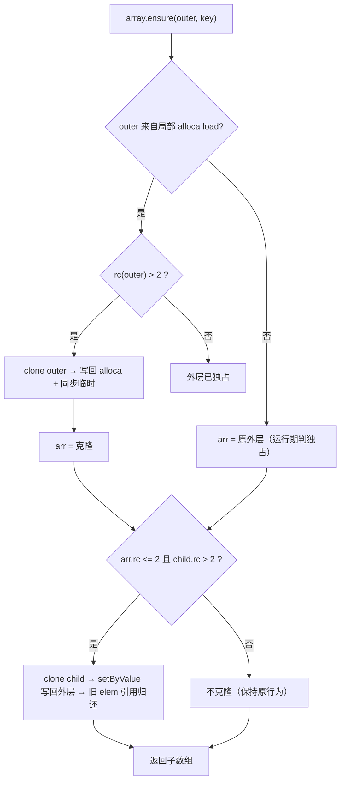

# AOT-CODEGEN-012 R-289：嵌套元素写的写时复制（F-201-b）

- 日期：2026-10-26
- 代次锚：`nlk 07357ddfd5295e1ffee4cd3667813f7e`；`tpl 3d7ac9775929e26416c189ad4d0353b3`（未改运行时）；`irg 0b7106338d5ffe1342caee961734b8d8`／`ir fb2bb442ca27b98cf1df7e109a240e1f` 未变（均未提交）
- 工单：`docs/known-issues/AOT-CODEGEN-012-class-name-case-insensitive-lookup.md` §197
- HEAD：`b30690b`

## 1. 高层摘要（TL;DR）

`$a[$k][$k2] = v` 的 IR 是「`load` 外层 → `array.ensure[$k]` → `array.set`」，**没有回写 store**，发射器直接在共享子数组上写 ⇒ `$b = $a; $a["k"][0] = 9;` 把 `$b["k"][0]` 一起改。本轮在 `.array_ensure` 臂做两处 COW：外层来自局部 alloca 的 load 且共享时先克隆并写回；子数组仍共享且外层**运行期独占**时再克隆写回外层。C333 新门 7/7、泄漏臂两档完全平坦。

## 2. 影响范围

| 层 | 影响 |
|---|---|
| 发射器（`native_linker.zig`） | `.array_ensure` 臂新增两段 COW 与所有权转移；新增 `loadSourceAlloca`（`isLoadedFromLocalAlloca` 改由它实现） |
| 语义面 | 嵌套元素写与副本隔离（`$a[$k][$k2]=v`、`$a[$k][]=v`） |
| 运行期模板 | 无改动（`tpl` 锚不变） |
| 已知限制 | 「经副本变量写」（`$b = $a; $b[...] = ...`）受既存 **F-203** 影响，不在本轮判据内 |

## 3. 核心变更

| # | 变更 | 说明 |
|---|---|---|
| 1 | 外层 COW | 外层操作数是「局部 alloca 的 load」且 `ref_count > 2`（alloca + 写临时 + 另一持有者）⇒ `cloneShallow` + 写回 alloca；先 retain 克隆再归还 alloca/临时对旧数组的引用（同 F-201 账目） |
| 2 | 子数组 COW | 外层**独占**（运行期 `arr.ref_count <= 2`，含写临时那份；三层嵌套时外层可能是上一层克隆）且子数组 `ref_count > 2`（槽 + `get` 的 retain + 另一持有者）⇒ 克隆子数组、`setByValue` 写回外层 |
| 3 | 所有权转移 | 子克隆存入后释放 `elem` 对旧子数组的引用，并让 `elem` 指向克隆（返回的寄存器持有克隆的一份引用，由 cleanup 归还） |
| 4 | `loadSourceAlloca` | 把「寄存器是否来自局部 alloca load」抽成返回 alloca id 的助手；引用载体（`isRefCarryingAlloca`）排除 |

★账目坑：`PHPArray.get` **恒 retain**（`getByValue` 亦然）⇒ 独占子数组在检查点的 rc 是 **2**（槽 + 返回引用）。首版按 `>1` 判定 ⇒ 每轮误克隆，泄漏臂 `lb=940816→2592104`、`la=3109→9108`（≈1 个 PHPArray/轮）。改为 `>2` 并把返回引用的所有权转给克隆后，同一探针 `18476`（单写）／`19408、106`（两档完全相等）。

## 4. 可视化概览（Code & Logic Map）



```mermaid
sequenceDiagram
  participant PHP as "$b=$a; $a['k'][0]=9"
  participant E as 发射器
  participant R as 运行时
  PHP->>R: $a、$b 共享外层 O；子 K 仅 O 持有
  E->>R: load $a（临时 retain）⇒ O.rc = 3
  E->>R: rc>2 ⇒ clone O'；写回 $a；O 只剩 $b（rc=1）
  E->>R: ensure O'['k'] ⇒ K（K.rc = O'槽 + get-retain = 2）
  E->>R: 外层独占且 K.rc>2 ⇒ clone K'；写回 O'；归还 get 引用
  E->>R: array.set 只落在 K'
  Note over E: 结果：$b 的 K 不变（bk=1），$a 的 K' 为 9
```

## 5. 详细变更分析

| 文件 | 变更点 |
|---|---|
| `src/aot/native_linker.zig` | `loadSourceAlloca`（`:827` 附近）；`.array_ensure` 臂两段 COW（`:24845` 附近） |
| `fuzzy_scripts_720/tmp/c333_nested_cow_gate_tmp.sh` | 新门 7 臂（a1–a6 + s1 泄漏臂） |
| `fuzzy_scripts_720/tmp/c333_nested_cow_tmp.tsv` | 门读数 |

**C333 臂设计**

| 臂 | 形状 | 修前 |
|---|---|---|
| a1 | 两层共享：`$b=$a; $a["k"][0]=9` | 红（bk=9） |
| a2 | 三层共享：`$a["k"]["j"][0]=9` | 红（bk=9） |
| a3 | 嵌套追加：`$a["k"][] = 9` | 红（cb=2） |
| a4 | 守卫：引用链 `$r=&$a; $r["k"][0]=9`（写穿） | 绿（须保持） |
| a5 | 守卫：全局作用域同形 | 红→绿 |
| a6 | 守卫：独占嵌套写 + 追加 | 绿 |
| s1 | 泄漏臂：共享副本存在时的嵌套覆盖循环 N=3000/9000 | 修前首版线性泄漏 |

## 6. 影响与风险评估

- **破坏式变更**：无。子数组 COW 仅在「外层运行期独占且子数组确有其他持有者」时发生。
- **内存**：s1 `lb=19408/19408 la=106/106`（两档相等）；s2（无副本）`18996/103` 同样平坦。
- **性能**：独占嵌套写不克隆（单写探针 18476 B/99 allocs）。
- **复测路径**：`bash fuzzy_scripts_720/tmp/c333_nested_cow_gate_tmp.sh`；自证 `AOT_BIN=/bin/false`；邻居 C332/C331/C330/C328/C329。
- **读数**：C333 **7/7**（32 s，自证 **7 CF**）；C332 13/13；C331 7/7；C330 5/5；C328 6/6；C329 4/8（a1/a2/a3/a5＝F-191，零转移）；`zig build test` **21/21、326/326**；__REGRESSION_LINE__

## 7. 遗留问题/潜在问题

- **F-203（P1，新立，既存）**：`$b = $a` **没有被物化为独立变量槽**（IR 里只有一个 alloca，`$b` 只剩一个 borrow 临时）⇒ 经副本变量写（`$b["x"]=9`）会改到 `$a`（实测 `ca=2` vs PHP 1，单层就错；嵌套只是同族）。本轮修复对「经属主变量写」的形状正确；经副本写的形状在 F-203 修好前仍错，C333 门头已注明。
- **F-199 / F-199-b / F-202 / F-192a**：见 §195／§196，仍未修。
- `.array_set_nested` 臂（部分路径）仍按值写，等价风险由 F-203 遮蔽；F-203 落地后需复测。

## 8. 后续建议

| 优先级 | 建议 | 影响面 | 落地成本 |
|---|---|---|---|
| P0 | F-203：变量 home 槽（禁止把「副本变量」折叠成单个 borrow 临时；或 mem2reg 时保证写回一致） | IR/变量语义 | 高 |
| P1 | F-199：堆 Ref 单元 + rc>0 登记 possible root | 引用/GC | 高 |
| P2 | F-192a：`gc_collect_cycles` 计数只认真实环根 | 运行期 GC | 中 |
| P2 | F-202：字符串偏移写（先物化常量 CSE 的字符串变量） | 字符串语义 | 中 |
