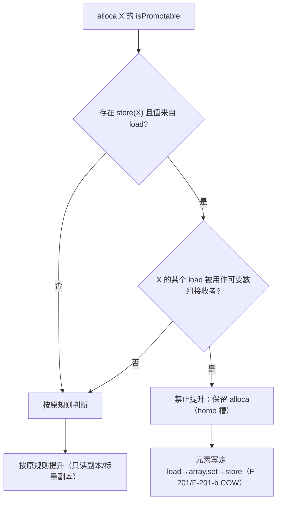

# AOT-CODEGEN-012 R-290：副本变量必须有 home 槽（F-203）

- 日期：2026-10-26
- 代次锚：`nlk 07357ddfd5295e1ffee4cd3667813f7e`；`tpl 3d7ac9775929e26416c189ad4d0353b3`；`irg 0b7106338d5ffe1342caee961734b8d8`／`ir fb2bb442ca27b98cf1df7e109a240e1f` 未变；**`opti 202cc7f18ac63ffc5a454da88d5a084a`**（本轮唯一改动文件，新增锚）
- 工单：`docs/known-issues/AOT-CODEGEN-012-class-name-case-insensitive-lookup.md` §198
- HEAD：`b30690b`

## 1. 高层摘要（TL;DR）

mem2reg 会把 `$b = $a` 这种**副本赋值**提升掉：`$b` 没有独立 alloca（home 槽），IR 里只剩一个 borrow 临时。于是对 `$b` 的元素写直接落在 `$a` 的共享数组上（`$b["x"] = 9` 改掉 `$a`，PHP `ca=1` / AOT 修前 `ca=2`；嵌套写同族）。本轮在 `isPromotable` 里补一条窄守卫：**副本赋值 + 该变量被当作可变数组接收者使用 ⇒ 禁止提升**，保留 alloca 交给内存路径（含 F-201/F-201-b 的 COW）。用「全局关闭 mem2reg」实验先证伪/证实方向，再落地窄守卫。

## 2. 影响范围

| 层 | 影响 |
|---|---|
| 优化器（`src/aot/optimizer.zig`） | `isPromotable` 新增两组预扫集合与一条拒绝规则 |
| 语义面 | 经副本变量写数组（元素/嵌套/追加）与源变量隔离 |
| 生成码 | 仅命中守卫的变量保留 alloca（多一对 load/store）；其余提升不变 |
| 运行时模板／发射器 | 无改动（nlk/tpl/irg/ir 锚不变） |

## 3. 核心变更

| # | 变更 | 说明 |
|---|---|---|
| 1 | 预扫 `load_result_regs` | 全函数 `.load` 结果寄存器集合（识别"副本赋值"的值来源） |
| 2 | 预扫 `mut_receiver_regs` | `array.set`／`array.set_nested`（outer）／`array.ensure`／`array.push`／`array.unset` 的接收者；并沿 `cast`/`move` 链回溯到不动点 |
| 3 | `isPromotable` 拒绝规则 | 扫描到 `store(ptr=alloca, value∈load_result_regs)` ⇒ `has_copy_store`；扫描到该 alloca 的某个 `load` 结果 ∈ `mut_receiver_regs` ⇒ `has_mut_load`；两者同时成立 ⇒ `return false` |

**方向验证（mem2reg 全局关闭实验，已还原）**：关闭后 c1（`$b["x"]=9`）与 n7（`$b["k"][0]=7`）逐字节 SAME；`--emit-ir` 显示预优化 IR 确有两个 alloca 与 `store(load $a) → alloca_b`。据此确定根因是提升，而非发射器的内存路径。

## 4. 可视化概览（Code & Logic Map）



```mermaid
sequenceDiagram
  participant IR as 预优化 IR
  participant O as mem2reg
  participant R as 生成码
  IR->>O: alloca_a, alloca_b; store(load a) → b; load b → array.set
  O->>O: F-203 守卫命中（副本 store + 可变接收者）⇒ 保留 b 的 alloca
  O->>R: b 的元素写仍是 load→set→store
  R->>R: F-201 COW：b 共享时先克隆再写，a 不变（ca=1/cb=2）
```

## 5. 详细变更分析

| 文件 | 变更点 |
|---|---|
| `src/aot/optimizer.zig` | `promoteMemoryToRegisters` 预扫（`:1843` 附近）；`isPromotable` 签名＋规则（`:2351` 附近） |
| `fuzzy_scripts_720/tmp/c334_copy_home_slot_gate_tmp.sh` | 新门 8 臂（a1–a7 + s1 泄漏臂） |
| `fuzzy_scripts_720/tmp/c334_copy_home_slot_tmp.tsv` | 门读数 |

**C334 臂设计**

| 臂 | 形状 | 修前 |
|---|---|---|
| a1 | `$b=$a; $b["x"]=9` ⇒ a 不变 | 红（ca=2、ax=Y） |
| a2 | `$b["k"][0]=7`（副本嵌套写） | 红（ak=7） |
| a3 | `$b[]=9`（副本追加） | 绿（append 走 setGlobalVar/COW 路径；须保持） |
| a4 | `$b=[7]`（整体重赋） | 绿 |
| a5 | 守卫：副本只读（允许提升） | 绿 |
| a6 | 守卫：标量副本算术（允许提升） | 绿 |
| a7 | 守卫：循环内经副本写 5 次 | 红→绿 |
| s1 | 泄漏臂：经副本写循环 N=3000/9000 | 绿（`18984/18984、105/105` 两档相等） |

## 6. 影响与风险评估

- **破坏式变更**：无。守卫只影响「副本赋值 + 可变数组接收者」这一形状；只读副本与标量副本仍提升。
- **性能**：命中守卫的变量多保留一对 load/store；形状窄，未做全局基准（避免报估算值）。
- **复测路径**：`bash fuzzy_scripts_720/tmp/c334_copy_home_slot_gate_tmp.sh`；自证 `AOT_BIN=/bin/false`；邻居 C333/C332/C331/C330/C328/C329。
- **读数**：C334 **8/8**（36 s，自证 **8 CF**）；C333 7/7；C332 13/13；C331 7/7；C330 5/5；C328 6/6；C329 4/8（a1/a2/a3/a5＝F-191，零转移）；`zig build test` **21/21、326/326**；主回归 **PASS=68 FAIL=0**（`SELF_CHECK_OK rows=68 uniq=68`）。

## 7. 遗留问题/潜在问题

- 守卫依据「副本 store + 可变数组接收者」两个语法条件；若未来引入新的容器变更 op（未列入 `mut_receiver_regs`），需要同步扩展（C334 的 a1/a2 会兜底）。
- 读取型副本（`$b = $a; echo $b["x"];`）仍提升，这是安全的（只读）。
- **F-191／F-192a／F-199／F-202** 仍开（见 §195–§197）。

## 8. 后续建议

| 优先级 | 建议 | 影响面 | 落地成本 |
|---|---|---|---|
| P1 | F-199：堆 Ref 单元 + rc>0 登记 possible root | 引用/GC | 高 |
| P1 | 对 mem2reg 的其它「无 home」形状做一次普查（如 `$b = foo()` 后经 $b 写再被别名读取） | IR/变量语义 | 中 |
| P2 | F-192a：`gc_collect_cycles` 计数只认真实环根 | 运行期 GC | 中 |
| P2 | F-202：字符串偏移写（先物化常量 CSE 的字符串变量） | 字符串语义 | 中 |
