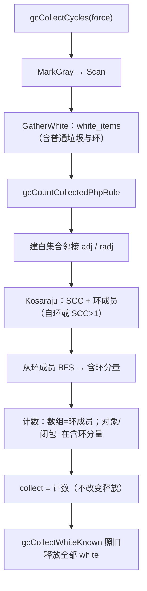

# AOT-CODEGEN-012 R-291：`gc_collect_cycles()` 计数口径对齐 PHP（F-192a）

- 日期：2026-10-26
- 代次锚：`nlk 07357ddfd5295e1ffee4cd3667813f7e`；**`tpl 99bf4564f446276dfa6717c4a7ff6569`**（本轮唯一改动文件）；`irg 0b7106338d5ffe1342caee961734b8d8`／`ir fb2bb442ca27b98cf1df7e109a240e1f`／`opti 202cc7f18ac63ffc5a454da88d5a084a` 均未变（均未提交）
- 工单：`docs/known-issues/AOT-CODEGEN-012-class-name-case-insensitive-lookup.md` §199
- HEAD：`b30690b`

## 1. 高层摘要（TL;DR）

旧实现把 `gc_collect_cycles()` 的返回值取成**整片 white 闭包**大小；而 AOT 的 root buffer 里既有真实环、也有 rc→0 被缓冲的**普通垃圾**（F-191 机制）⇒ `$x=[1,2,3]; unset($x); gc()` PHP 0 / AOT 1，普通嵌套树 0/2、按值互指 0/4。本轮按 PHP 实测口径重写计数：**数组只在环成员时计数；对象/闭包只要落在含环的连通分量里就计数；无环普通垃圾及其子树一律 0**。释放行为不变（门内有专门的回收敏感度臂）。

## 2. 影响范围

| 层 | 影响 |
|---|---|
| 运行期模板（`runtime_lib_template.zig`） | `gcCollectCycles` 的返回值改走新计数函数；新增 Kosaraju＋环分量 BFS |
| 语义面 | `gc_collect_cycles()` 的返回值 |
| 生成码／发射器／优化器 | 无改动 |

## 3. 核心变更

| # | 变更 | 说明 |
|---|---|---|
| 1 | `gcWhiteIndex` | 把 Value 解引用后映射到白集合内的节点下标（数组/对象/闭包） |
| 2 | `gcCountCollectedPhpRule` | 白集合内建**双向邻接** → Kosaraju（迭代两趟 DFS）标出 SCC 与环成员（自环或 SCC>1）→ 从环成员 BFS 得**含环分量** |
| 3 | 计数规则 | 数组：仅环成员计 1；对象/闭包：在含环分量内即计 1；其余 0 |
| 4 | 兜底 | 任一分配失败返回 null，调用方退回旧口径（white 闭包大小），保证不因 OOM 改变释放流程 |
| 5 | 释放不变 | `white_items` 的 `gcCollectWhiteKnown` 循环原样保留 |

**PHP 口径实测矩阵（R-291，PHP 8.5.8）**

| 形状 | PHP | 修前 AOT | 修后 AOT |
|---|---|---|---|
| `$x=[1,2,3]; unset($x)` | 0 | 1 | **0** |
| 普通对象垃圾 | 0 | 1 | **0** |
| `$p=[[1,2]]; unset($p)` | 0 | 2 | **0** |
| 按值互指数组 | 0 | 4 | **0** |
| 自引用对象 | 1 | 1 | **1** |
| 双对象环 | 2 | 2 | **2** |
| 双对象环 + 子对象 | **3** | 4 | **3** |
| 双对象环 + 子数组 | **2** | 3 | **2** |
| 自引用对象 + 子对象 | **2** | ? | **2** |
| 自引用对象 + 普通垃圾树 | **1** | 2 | **1** |
| 数组+对象环（经对象侧成环） | **2** | 3 | **2** |
| 纯数组 `&` 自环/互环（p1/p3/m1/m2） | 1/1/1/2 | 2/4/2/4 | **0/0/0/0**（残余，见 §7） |

★口径要点：**对象**即使在环里只是“子节点”也计数（a7=3、o3=2）；**数组**只有在环里（SCC 成员）才计数（o1=2、p1=1）。无环分量整棵不计。

## 4. 可视化概览（Code & Logic Map）



```mermaid
sequenceDiagram
  participant PHP as "$x=[1,2,3]; unset($x); gc()"
  participant R as 运行时
  PHP->>R: release → rc=0 ⇒ 缓冲为普通垃圾（F-191）
  R->>R: GatherWhite（垃圾入白集合）
  R->>R: SCC：无环 ⇒ 无环成员
  R-->>PHP: 返回 0（与 PHP 一致；内存照常释放）
  Note over R: 双对象环 + 子对象：SCC=2 环成员，BFS 得 3 ⇒ 返回 3（PHP 3）
```

## 5. 详细变更分析

| 文件 | 变更点 |
|---|---|
| `src/aot/runtime_lib_template.zig` | 新增 `gcWhiteIndex`／`gcCountCollectedPhpRule`；`gcCollectCycles` 的 `collected` 改调新函数（OOM 退回旧口径） |
| `fuzzy_scripts_720/tmp/c335_gc_count_gate_tmp.sh` | 新门 14 臂（a1–a13 + s1 回收敏感度臂） |
| `fuzzy_scripts_720/tmp/c335_gc_count_tmp.tsv` | 门读数 |

**C335 臂**：a1 普通数组垃圾、a2 普通对象垃圾、a3 普通嵌套树、a4 按值互指、a5 自引用对象、a6 双对象环、a7 环+子对象、a8 环+子数组、a9 自引用+子对象、a10 自引用+普通垃圾、a11 数组+对象环、a12 无垃圾守卫、a13 存活容器守卫；s1 普通垃圾循环 N=3000/9000 后强制 gc 的驻留必须相等（证明释放未变）。

## 6. 影响与风险评估

- **破坏式变更**：返回值口径变化（修复方向），释放逻辑不变。
- **内存**：s1 `lb=65740/65740 la=102/102`（两档完全相等）。
- **性能**：仅 `gc_collect_cycles()`/强制收集路径多做一次白集合图构建；增量批（≤64）规模很小。
- **复测路径**：`bash fuzzy_scripts_720/tmp/c335_gc_count_gate_tmp.sh`；自证 `AOT_BIN=/bin/false`；邻居 C334/C333/C332/C331/C330/C328/C329。
- **读数**：C335 **14/14**（66 s，自证 **14 CF**）；C334 8/8；C333 7/7；C332 13/13；C331 7/7；C330 5/5；C328 6/6；C329 4/8（仅 F-191 既有红，零转移）；`zig build test` **21/21、326/326**；主回归 **PASS=68 FAIL=0**（`SELF_CHECK_OK rows=68 uniq=68`）。

## 7. 遗留问题/潜在问题

- **纯数组 `&` 环**（`$a["s"] = &$a` 等）仍为 0/0/0/0（PHP 1/1/1/2）：AOT 的 `&` 数组元素仍按值拷贝（F-199），根本没形成真环；F-199 落地后本门需补这 4 臂。
- **F-191**（GC 缓冲容器平台）仍开：本批只改**计数**，未改回收时机。
- `gc_collect_cycles()` 的返回类型/上限语义未变（`usize`→PHP int）。

## 8. 后续建议

| 优先级 | 建议 | 影响面 | 落地成本 |
|---|---|---|---|
| P1 | F-199：堆 Ref 单元 + rc>0 登记 possible root（落地后补 C335 的数组 `&` 环臂，并重测 m1/m2/p1/p3） | 引用/GC | 高 |
| P1 | F-191：借用图审计后重设计 GC 回收时机 | 运行期内存 | 高 |
| P2 | F-202：字符串偏移写（先物化常量 CSE 的字符串变量） | 字符串语义 | 中 |
