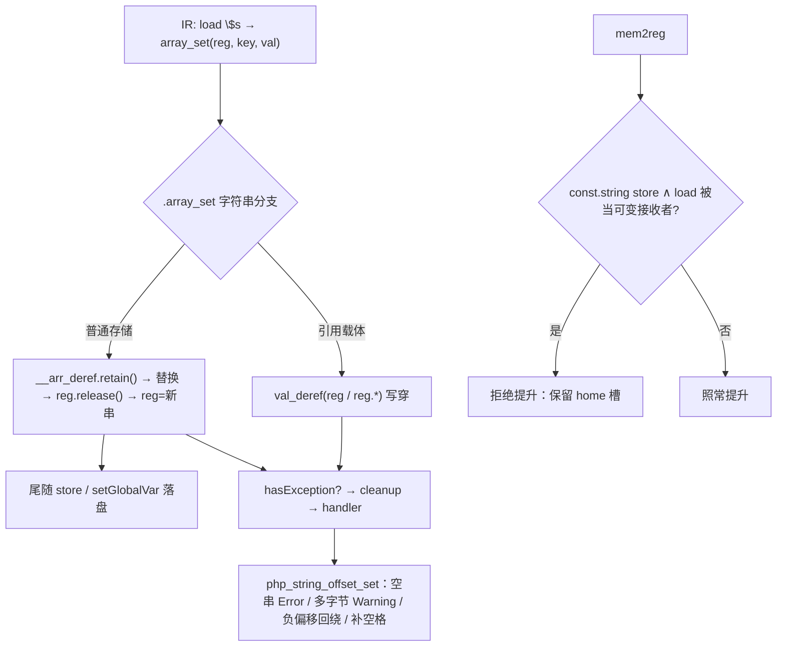
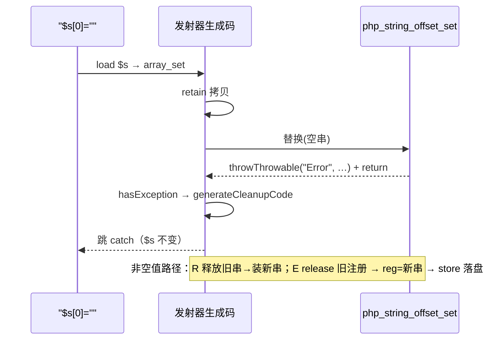

# AOT-CODEGEN-012 R-292：字符串偏移写全契约（F-202）＋新立 F-204

- 日期：2026-10-26
- 代次锚：**`nlk 436db4fc07ccae00023cd631238f5bb5`**；**`tpl 407c44d5f7ce5869d89a9d4fea299068`**；**`opti 553a2e540da638f3766911b1f0941dd1`**；`irg 0b7106338d5ffe1342caee961734b8d8`／`ir fb2bb442ca27b98cf1df7e109a240e1f` 未变
- 工单：`docs/known-issues/AOT-CODEGEN-012-class-name-case-insensitive-lookup.md` §200
- 提交：三枚源随 `01e8c61` 入库（内容与本轮验收代次逐字节一致）；本文档与门资产未提交。HEAD `01e8c61`

## 1. 高层摘要（TL;DR）

`$s[0] = "x"` 在 AOT **整体失效**（`$s="ab"` 写后仍是 `ab`，函数内/全局同现）。根因三层：发射器只改 `__arr_deref` 临时拷贝、运行期 helper 契约残缺（负偏移/越界/空串全静默、标量按 byte 取）、mem2reg 把 `const.string` 初始化的字符串变量提升掉使替换不可见。本轮三处同批修好：发射器按「引用载体写穿 / 普通存储 retain+交还」落盘并补异常路由；`php_string_offset_set` 按 PHP 8.5.8 实测契约重写；优化器沿用 F-203 同构守卫拒绝提升。附带的 A/B 归因揭示**既存 F-204**：helper 抛出的异常在循环内被 catch 时每次抛出漏 ~8 次分配／510 B。

## 2. 影响范围

| 层 | 影响 |
|---|---|
| 发射器（`native_linker.zig`） | `.array_set` 的**字符串分支**（对象/数组分支未动）；新增异常路由 |
| 运行期模板（`runtime_lib_template.zig`） | `php_string_offset_set` 重写 |
| 优化器（`optimizer.zig`） | mem2reg 新增 `const_string_result_regs` 预扫与拒绝提升条件 |
| 语义面 | 字符串偏移赋值（值/告警/异常/长度） |
| 未触及 | 嵌套字符串写（`$a["s"][0]`）、`&` 引用单元（F-199） |

## 3. 核心变更

| # | 变更 | 说明 |
|---|---|---|
| 1 | 发射器：引用载体分支 | 引用形参 alloca（`**Value`）→ `val_deref(reg.*)`；`ref_ptr`/`isRefCarryingAlloca`（`*Value`）→ `val_deref(reg)`；寄存器仍持 Ref，尾随 store 复存同一 Ref（幂等） |
| 2 | 发射器：普通存储分支 | `__arr_deref.retain()` → helper 替换 → `reg.release(); reg = __arr_deref`（所有权转移，成功/抛出两路都不漏） |
| 3 | 发射器：异常路由 | 分支内 `if (runtime.hasException())` → `generateCleanupCode` → handler／`return error.RuntimeError`（空串 `Error` 可捕获） |
| 4 | 运行期：helper 重写 | `val_deref` 起手；`toString` 取首字节；空串抛 `Error`；多字节 Warning；负偏移回绕；`==len` 追加；`>len` 补空格；`errdefer` 覆盖分配失败 |
| 5 | 优化器：提升守卫 | `const_string_result_regs` 预扫；`has_const_string_store ∧ has_mut_load ⇒ 拒绝提升`（与 F-203 同一收口） |

**PHP 8.5.8 实测契约（C336 逐字节钉死）**

| 形状 | PHP 行为 | AOT（修后） |
|---|---|---|
| `$s="ab"; $s[0]="x"` | `xb` | `xb` |
| `$s[2]="Z"`（`==len`） | `abZ`，len=3 | 同 |
| `$s[5]="x"`（`>len`） | `ab   x`，len=6 | 同 |
| `$s[-1]="x"` | `ax` | 同 |
| `$s[-3]="x"` | Warning `Illegal string offset -3`，不变 | 同 |
| `$s[0]=""` | 可捕获 `Error: Cannot assign an empty string to a string offset` | 同 |
| `$s[0]="xy"` | Warning `Only the first byte…`，取 `x` | 同 |
| `$s[0]=5` / `1.9` | `toString` 首字节（`0x35` / `0x31`） | 同 |
| `$s[0]=true` / `false` / `null` | `'1'` / 空串 `Error` / 空串 `Error` | 同 |
| 引用形参 `function f(string &$s){$s[0]="x";}` | 写穿调用方 | 同 |

## 4. 可视化概览（Code & Logic Map）

## 5. 详细变更分析

| 文件 | 变更点 |
|---|---|
| `src/aot/native_linker.zig` | `.array_set` 字符串分支重写（两路载体 + retain/交还 + 异常路由） |
| `src/aot/runtime_lib_template.zig` | `php_string_offset_set` 按实测契约重写 |
| `src/aot/optimizer.zig` | `const_string_result_regs` 预扫；`isPromotable` 增加参数与拒绝条件 |
| `fuzzy_scripts_720/tmp/c336_string_offset_gate_tmp.sh` | 新门 18 臂（a1–a16 语义 + s1/s2 泄漏） |
| `fuzzy_scripts_720/tmp/c336_string_offset_tmp.tsv` | 门读数 |

**C336 臂**：a1 局部写、a2 全局写、a3 `==len` 追加、a4 `>len` 补空格、a5 负偏移、a6 负越界告警、a7 空串 Error、a8 int 值、a9 float 值、a10 多字节告警、a11 bool 两态、a12 null、a13 只读守卫、a14 数字字符串偏移、a15 引用形参写穿、a16 引用实参（全局）写穿；s1 成功写泄漏臂（N=3000/9000）、s2 抛出泄漏臂（每轮新串 + 空串抛出，N=3000/9000）。

## 6. 影响与风险评估

- **破坏式变更**：字符串偏移从这里「静默无效」变为 PHP 契约（值/告警/异常三类可观测面都变）。
- **性能**：成功路径多一次 `retain`/`release`（引用计数原子操作级）；异常路径多一次 `hasException` 分支（`@branchHint(.unlikely)`）。
- **内存**：s1 `LEAKFLAT`（成功路径零泄漏，实测两档相等）。
- **复测路径**：`bash fuzzy_scripts_720/tmp/c336_string_offset_gate_tmp.sh`；自证 `AOT_BIN=/bin/false`；邻居 C328–C335。
- **读数**：C336 **17/18**（92 s；a1–a16＋s1 全绿，s2 红＝F-204，自证 `AOT_BIN=/bin/false` **18 CF**；s1 `LEAKFLAT lb=18300/18300 la=100/100`）；邻居 C328 6/6、C329 4/8（F-191 既有红，零转移）、C330 5/5、C331 7/7、C332 13/13、C333 7/7、C334 8/8、C335 14/14；`zig build test` **21/21 steps、326/326**；主回归 **PASS=68 FAIL=0**（`/tmp/r292_regression.log`，`SELF_CHECK_OK rows=68 uniq=68 total=68`）

## 7. 遗留问题/潜在问题

- **F-204（P1，新立，既存）**：helper 抛出的异常在循环内被 catch ⇒ 每次抛出漏 ~8 allocs／~510 B（`intdiv(1,0)` 复现；HEAD 与 R-292 代次读数一致）。C336 `s2` 保留为已知红（非本门判据）。
- 嵌套字符串写 `$a["s"][0]="x"`（`.array_ensure` 无字符串分支）、`$r=&$s; $r[0]="x"`（F-199 族）、属性载体 `$o->s[0]="x"`、复合赋值 `$s[0].="x"` 均未覆盖。
- `php_string_offset_set` 对 `index_val` 仍走 `toInt()`（保留既有转换口径），非数值字符串偏移未实测。

## 8. 后续建议

| 优先级 | 建议 | 影响面 | 落地成本 |
|---|---|---|---|
| P0 | F-204：定位 helper 抛出 → 调用点路由 → catch 链的每抛出泄漏（`intdiv` 最小复现，先看 cleanup 是否漏还异常对象内部持有） | 异常/内存 | 中 |
| P1 | 嵌套字符串写补 `.array_ensure` 字符串分支（`$a["s"][0]="x"`） | 字符串语义 | 中 |
| P2 | F-199：堆 Ref 单元（`$r=&$s` 字符串写穿随之可测） | 引用/GC | 高 |
| P2 | 属性载体与复合赋值形态补门臂 | 门覆盖 | 低 |
