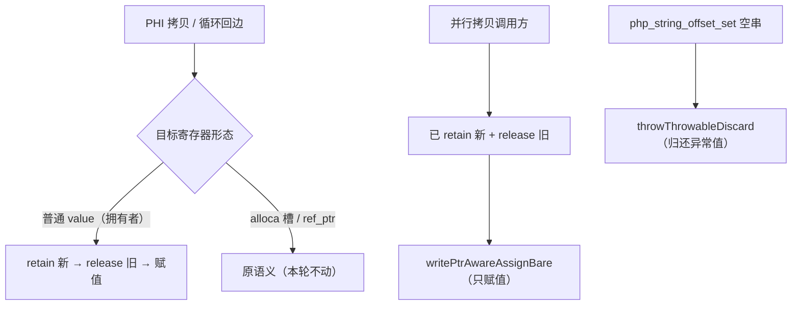
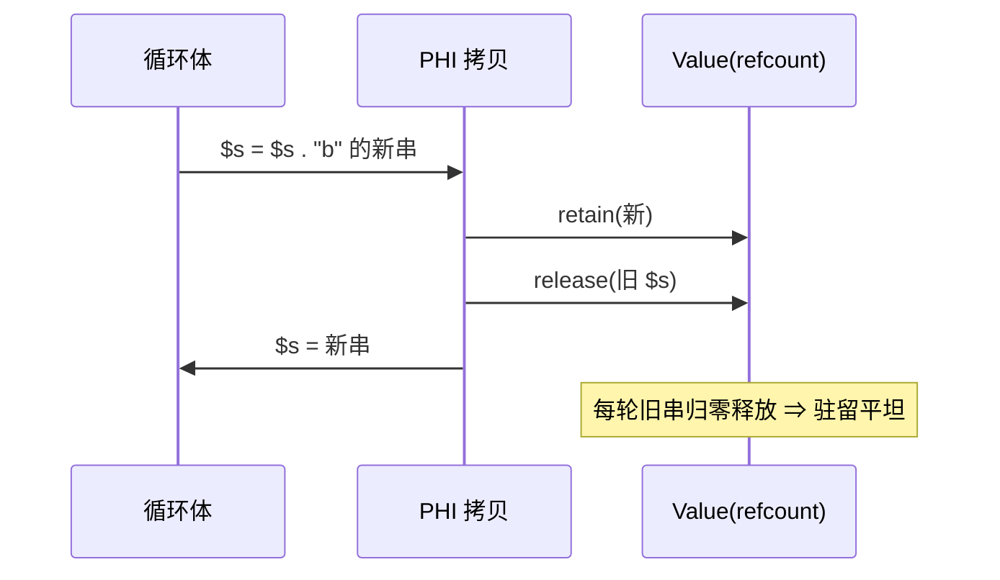

# AOT-CODEGEN-012 R-293：PHI 赋值所有权三处收口（F-204、F-205 闭；F-206/F-207 新立）

- 日期：2026-10-26
- 代次锚：**`nlk 4878e4d2d599701327b7ba72a07dbc4d`**；**`tpl 3408c5bdce84957f0fbf54c3d7574df3`**；`opti 553a2e540da638f3766911b1f0941dd1`／`irg 0b7106338d5ffe1342caee961734b8d8`／`ir fb2bb442ca27b98cf1df7e109a240e1f` 未变
- 工单：`docs/known-issues/AOT-CODEGEN-012-class-name-case-insensitive-lookup.md` §201
- 提交：未提交（HEAD `01e8c61`）

## 1. 高层摘要（TL;DR）

PHI 合并有三套互不一致的引用计数账目：并行拷贝在「retain 新 + release 旧」之后又 retain 一次结果（每拷贝净 +1）；循环体路径的普通 value 赋值只 retain 结果、**从不释放目标旧值**（每轮丢一个旧字符串/容器）；`php_string_offset_set` 的空串分支在 void 函数里丢弃 `throwThrowable` 的返回值（每次抛出漏一个异常对象图）。三处同批收口后：循环内 catch 的每抛出泄漏 8 allocs／~510 B → 0；`$s = $s . "b"` 的 O(n²) 驻留 → 平坦（18380/18380）；空串抛出循环 3000/9000 恒 110/48793。

## 2. 影响范围

| 层 | 影响 |
|---|---|
| 发射器（`native_linker.zig`） | PHI 赋值 helper：`generatePhiAssignmentsParallel` 两调用点、`writePhiAssignWithRetain`、`writePtrAwareAssign` 的普通 value 结果臂；新增 `writePtrAwareAssignBare` |
| 运行期模板 | `php_string_offset_set` 空串分支改 `throwThrowableDiscard` |
| 任意循环/分支的寄存器赋值 | 目标旧值现在会被正确释放（语义不变，内存正确） |
| alloca 槽与 ref_ptr 指针 | **不动**（所有权不明面保持原样） |

## 3. 核心变更

| # | 变更 | 说明 |
|---|---|---|
| 1 | `writePtrAwareAssignBare`（新） | 仅做八种 alloca/ref_ptr/value 形态的解引用赋值，不动引用计数 |
| 2 | 并行 PHI 拷贝 | 两处调用点改 `Bare`（调用方已 retain 新 + release 旧） |
| 3 | `writePhiAssignWithRetain` | 改成「retain 新 → release 旧 → Bare」，与并行拷贝同账目 |
| 4 | `writePtrAwareAssign`（普通 value 结果） | 同样改成「retain 新 → release 旧 → Bare」；alloca/ref_ptr 目标保持原逻辑 |
| 5 | 空串抛出 | `_ = try throwThrowable(...)` → `try throwThrowableDiscard(...)` |

**定向 A/B（同机同参，PHP 8.5.8）**

| 探针 | 修前 | 修后 |
|---|---|---|
| q1 `intdiv(1,0)` catch 循环 N=2000/6000 | live 16108→48110、bytes 1020712→3031680 | **1769→2025**、128428→140780（残余经 q1g 2000/6000/12000 恒 `106/48620` ⇒ F-191 GC 缓冲，非引用泄漏） |
| s1 `$s=$s."b"` N=2000/6000 | live 2105→6107、bytes 2130379→18435427 | **101/101、18380/18380** |
| s2 `$s="x".$i` N=1000/3000 | live 1104→3106 | **101/101、18380/18380** |
| s3 临时串转存 / s4 `str_repeat` N=1000/3000 | bytes 572615→4745603 | **102/102、18460/18460** |
| s2g 空串抛出循环（GC 前置）N=3000/9000 | 24114→72116、1652769→4787257 | **110/110、48793/48793** |
| o1 `new Node()` 循环 N=2000/6000 | live 8105→24105 | 8105→24105（**与基线逐字节相同**；强制 GC 后恒 102 ⇒ F-191） |
| e1 嵌套 rethrow N=2000/6000 | 2014/2014 | 2014/2014 |

## 4. 可视化概览（Code & Logic Map）

## 5. 详细变更分析

| 文件 | 变更点 |
|---|---|
| `src/aot/native_linker.zig` | `writePtrAwareAssign` 拆分出 `writePtrAwareAssignBare`；普通 value 结果臂改平衡账目；并行拷贝两处与 `writePhiAssignWithRetain` 改用 Bare/平衡账目 |
| `src/aot/runtime_lib_template.zig` | 空串分支 `throwThrowableDiscard` |
| `fuzzy_scripts_720/tmp/c337_phi_ownership_gate_tmp.sh` | 新门 16 臂（13 语义 + 3 泄漏） |
| `fuzzy_scripts_720/tmp/c336_string_offset_gate_tmp.sh` | s2 臂补 `gc_collect_cycles()`，判据收敛到引用计数面 |

**C337 臂**：a1 catch 循环、a2 嵌套 rethrow、a3 catch 内 continue、a5 finally+return、a6 自拼接、a7 新串赋值、a8 临时串转存、a9 双串交换、a10 while、a11 do-while、a12 foreach 按值、a13 数组 phi、a14 try/finally 字符串 phi；s1 异常泄漏（GC 前置）、s2 自拼接泄漏、s3 新串赋值泄漏。

## 6. 影响与风险评估

- **破坏式变更**：无输出语义变化；改的是寄存器旧值的释放时机（之前是泄漏）。
- **风险点**：任何依赖「旧值不释放」的站点会变成提前释放 ⇒ 用主回归 + 邻居门兜底。
- **内存**：三条泄漏面归零（见 §3 表）。
- **性能**：每 PHI 拷贝多一次 release（引用计数原子减），少一次多余 retain。
- **复测路径**：`bash fuzzy_scripts_720/tmp/c337_phi_ownership_gate_tmp.sh`、`c336_string_offset_gate_tmp.sh`；自证 `AOT_BIN=/bin/false`；邻居 C328–C335。
- **读数**：C337 **16/16**、C336 **18/18**；邻居 C328 6/6、C329 4/8（F-191 既有红，零转移）、C330 5/5、C331 7/7、C332 13/13、C333 7/7、C334 8/8、C335 14/14；`zig build test` **21/21 steps、326/326**；主回归 **PASS=68 FAIL=0**（`/tmp/r293_regression.log`，`SELF_CHECK_OK rows=68 uniq=68 total=68`）

## 7. 遗留问题/潜在问题

- **F-206（P1，新立，既存）**：嵌套 `for` + `continue`/`break` 的字符串累加 ⇒ 输出丢失，N≥500 直接挂起（HEAD 复现）。
- **F-207（P2，新立，既存）**：catch 内 `break` ⇒ 跳出后多执行一次 `intdiv(1, null)` 并打 Deprecated（HEAD 复现）。
- alloca 槽 / ref_ptr 目标的赋值账目未审计（本轮只收口普通 value 结果）；若后续出现同类驻留，从这两个面继续查。
- 对象循环滞留（o1 4 allocs/轮）属 F-191 GC 缓冲平台，未修。

## 8. 后续建议

| 优先级 | 建议 | 影响面 | 落地成本 |
|---|---|---|---|
| P0 | F-206：嵌套循环 + continue/break 的值丢失与挂起（先定最小挂起阈值与 IR 形状） | 循环发射 | 中高 |
| P1 | F-207：catch 内 break 后的空操作数（phi/状态机边） | try/catch 发射 | 中 |
| P1 | alloca/ref_ptr 目标赋值账目审计（本轮未动面） | 发射器所有权 | 中 |
| P2 | 把 C337 的两个既有红臂（a4/a15）在 F-206/F-207 闭后加回门内 | 门覆盖 | 低 |
