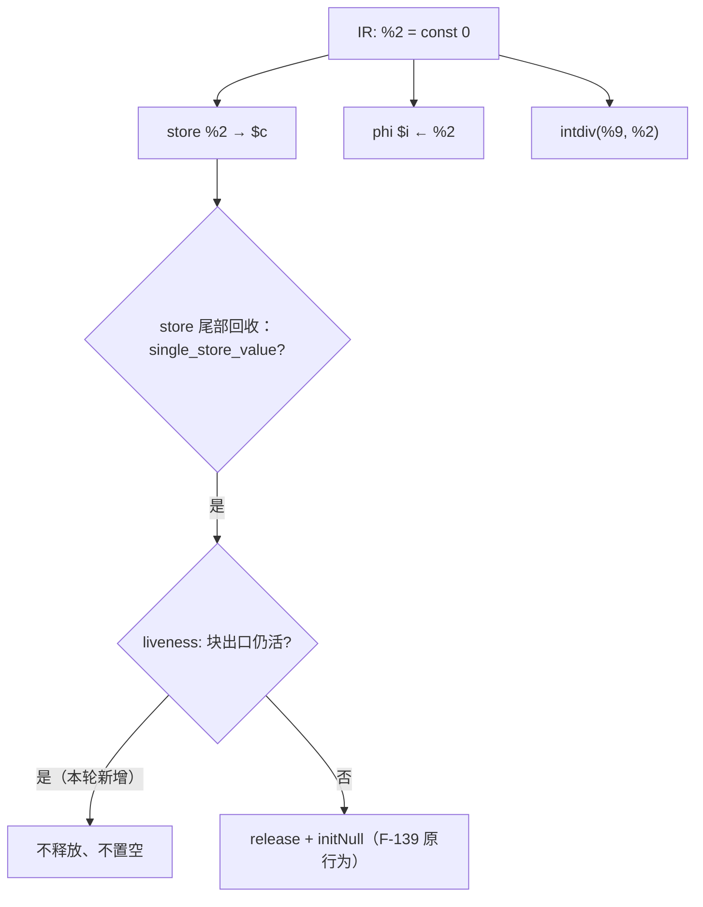
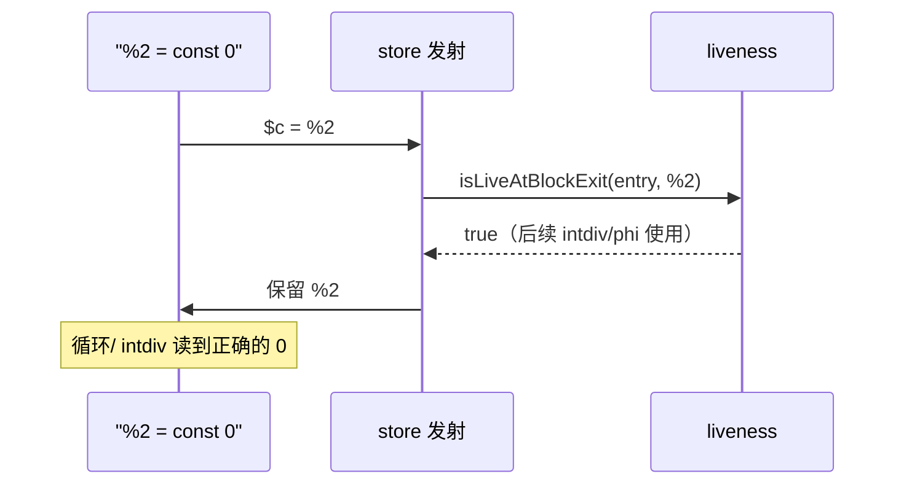

# AOT-CODEGEN-012 R-294：共享寄存器被 store 回收置空（F-207 闭环）

- 日期：2026-10-26
- 代次锚：**`nlk 2ca2ea9503f4e347761bbbcc09794acc`**（本轮唯一改动）；`tpl 3408c5bdce84957f0fbf54c3d7574df3`／`opti 553a2e540da638f3766911b1f0941dd1`／`irg 0b7106338d5ffe1342caee961734b8d8`／`ir fb2bb442ca27b98cf1df7e109a240e1f` 未变
- 工单：`docs/known-issues/AOT-CODEGEN-012-class-name-case-insensitive-lookup.md` §202
- 提交：未提交（HEAD `01e8c61`）

## 1. 高层摘要（TL;DR）

`for (...) { try { intdiv(1,0); } catch (Throwable $e) { $c++; break; } }` 在 AOT 下会多打一条 `intdiv(): Passing null to parameter #2` Deprecated。根因不在 try/catch，而在 store 发射末尾的 F-139 泄漏回收：它用「该寄存器只被 store 一次」推断「值已死」，把**共享常量寄存器** `const 0` 释放并置 null —— 而这个 0 同时还是循环初值与 `intdiv` 的除数。修法是给该回收叠加 liveness 守卫：块出口仍活的值不释放、不置空。

## 2. 影响范围

| 层 | 影响 |
|---|---|
| 发射器（`native_linker.zig`） | `.store` 末尾的「一次性 value 回收」判据新增 `!isLiveAtBlockExit` |
| 语义面 | 所有「常量/临时被多块共享且被 store 一次」的函数 |
| 通用 liveness 判据（`releaseDeadOperands`） | 未动 |
| 运行期模板 / 优化器 / IR | 未动 |

## 3. 核心变更

| # | 变更 | 说明 |
|---|---|---|
| 1 | store 回收守卫 | `single_store_value ∧ !isLiveAtBlockExit(block, value) ∧ !value_is_alloca ∧ !ref_param ∧ value≠ptr ∧ regMayHeap` |
| 2 | 无 liveness / 无块索引时 | `value_live_at_block_exit = false` ⇒ 沿用旧行为（不扩大改动面） |

**定向读数（PHP 8.5.8 对照）**

| 探针 | PHP | 修前 AOT | 修后 AOT |
|---|---|---|---|
| a4（catch+break，n=5） | `c=1`，stderr 空 | 多 2 条 Deprecated（stdout+stderr），`c=1` | **`c=1`，双流空** |
| a1/a2/a11/a12（catch 循环四形） | 逐字节 | 红 | **SAME** |
| c1/c2/c3（if/循环体/字符串跨块共享常量） | 逐字节 | SAME | **SAME（未受影响）** |
| b1/b2/b3（F-206 的对照臂） | 逐字节 | SAME | **SAME** |

## 4. 可视化概览（Code & Logic Map）

## 5. 详细变更分析

| 文件 | 变更点 |
|---|---|
| `src/aot/native_linker.zig` | `.store` 正常值路径：`single_store_value` 回收条件叠加 `!value_live_at_block_exit` |
| `fuzzy_scripts_720/tmp/c338_shared_reg_liveness_gate_tmp.sh` | 新门 15 臂（12 语义 + 3 泄漏；s1 F-139 形状带 GC barrier） |
| `src/aot/liveness_analysis.zig` | 仅临时加过 `ZIGPHP_TRACE_LIVE` 插桩并已移除（md5 未变） |

**C338 臂**：a1 catch+break、a2 catch+continue、a3 try 体内共享常量、a4 if 分支、a5 循环体、a6 字符串常量、a7 catch 体、a8 finally、a9 嵌套 try、a10 switch、a11 while、a12 do-while；s1 循环内 `$arr=[1,2,3]`（F-139 守卫，置 null＋GC 前置）、s2 新串赋值、s3 异常 catch 循环。

## 6. 影响与风险评估

- **破坏式变更**：无输出语义变化；修复的是「把活值当死值回收」。
- **内存**：`value_live_at_block_exit=true` 时跳过回收 ⇒ 该值的生命周期延长到其真正最后使用（由 `releaseDeadOperands` 或函数出口 cleanup 处理；C338 s1 证明 F-139 形状仍平坦）。
- **性能**：每个 store 多一次块级 bitset 查询（O(1)）。
- **方向性**：`current_gen_block_idx` 在分支臂内可能是陈旧值 ⇒ 最多少释放，不会误放。
- **复测路径**：`bash fuzzy_scripts_720/tmp/c338_shared_reg_liveness_gate_tmp.sh`；自证 `AOT_BIN=/bin/false`；邻居 C328–C337。
- **读数**：C338 **15/15**（自证 15 CF）；邻居 C328 6/6、C329 4/8（F-191 既有红，零转移）、C330 5/5、C331 7/7、C332 13/13、C333 7/7、C334 8/8、C335 14/14、C336 18/18、C337 16/16；`zig build test` **21/21、326/326**；主回归 **PASS=68 FAIL=0**（`/tmp/r294_regression.log`，SELF_CHECK_OK rows=68 uniq=68）

## 7. 遗留问题/潜在问题

- **F-206（P1，既存）**：外层 `continue` + 内层循环 ⇒ 死循环；根因与两段取证见 §201.5（then 臂直指 latch；继续边不经过四条已知 PHI 物化入口）。
- F-139 的回收判据仍依赖 `current_gen_block_idx` 的正确性；若未来在臂内直接发射 store，需确保该字段同步（否则只会少释放）。
- 通用 `releaseDeadOperands` 的 liveness CFG 未审计（本轮只用其结果，不改判据）。

## 8. 后续建议

| 优先级 | 建议 | 影响面 | 落地成本 |
|---|---|---|---|
| P0 | F-206：then 臂直指 latch 的完整发射（按 §201.5 的两段取证继续归因到具体发射器） | 循环发射 | 中高 |
| P1 | 把 `current_gen_block_idx/inst_idx` 在所有发射入口统一维护，供 `releaseDeadOperands` 与 store 回收共用 | 发射器 | 中 |
| P2 | C338 增补「共享常量 + 闭包/方法体」臂，覆盖其它发射入口 | 门覆盖 | 低 |
