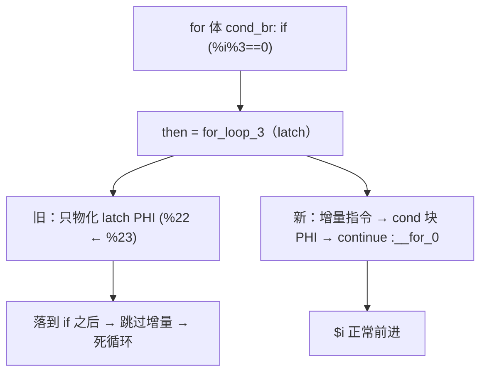
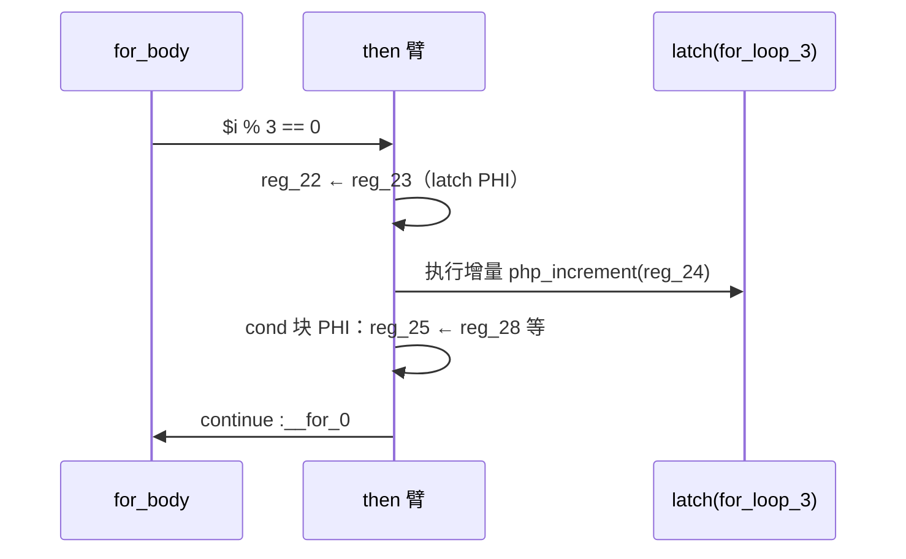

# AOT-CODEGEN-012 R-295：for 族回边（latch）在 continue 臂上的完整发射（F-206 闭环）

- 日期：2026-10-26
- 代次锚：**`nlk 3c0f50e833f6a97b2edfad4b48137e18`**（本轮唯一改动）；`tpl 3408c5bdce84957f0fbf54c3d7574df3`／`opti 553a2e540da638f3766911b1f0941dd1`／`irg 0b7106338d5ffe1342caee961734b8d8`／`ir fb2bb442ca27b98cf1df7e109a240e1f` 未变
- 工单：`docs/known-issues/AOT-CODEGEN-012-class-name-case-insensitive-lookup.md` §203
- 提交：未提交（HEAD `01e8c61`）

## 1. 高层摘要（TL;DR）

外层 `if (...) continue;` + 内层循环在 AOT 下 n=1 即死循环。根因在 `generateForFromLabels` 的 `then_is_be` 分支：then 边是循环回边（latch）时，它只物化回边块的 PHI，**不发射增量指令、cond 块 PHI 和 `continue`**；当 else 臂已经把 latch 内联（内层循环的 `br → for_loop_N` 走 `generateBrToMergeCondBr`），then 路径落到 if 之后会跳过增量，`$i` 不再前进。修法是把这个分支补全成「增量指令 → cond 块 PHI → continue」。

## 2. 影响范围

| 层 | 影响 |
|---|---|
| 发射器（`native_linker.zig` / `generateForFromLabels`） | `then_is_be` 分支补全回边发射 |
| 语义面 | 所有 `for` 循环中「continue 分支直指回边块」的形状 |
| `while` / `do-while` / `if-else` 发射器 | **未动**（F-206-c/d 见 §7） |
| 运行期模板 / 优化器 / IR | 未动 |

## 3. 核心变更

| # | 变更 | 说明 |
|---|---|---|
| 1 | then 臂发射回边块非 PHI 指令 | 即增量（`php_increment` 等） |
| 2 | then 臂物化 cond 块 PHI | 只取「来自回边块」的 incoming |
| 3 | then 臂补 `continue :label` | 与 f113「各边各自内联一份 latch」一致 |

**归因法（可复用）**：在 `generateForFromLabels` 区域内给 17 个 `writePtrAwareAssign` 调用点编号（临时 `trace_site`），编译 b1，命中 `result=22` ⇒ 站点 7 = `then_is_be` 分支。插桩随后全部移除（先确认 md5 复原，再落修复）。

**定向读数（PHP 8.5.8）**

| 探针 | 修前 | 修后 |
|---|---|---|
| b4（外层 continue + 内层 break）n=1..100 | **挂起**（rc=124） | 与 PHP 逐字节一致（n=100 ⇒ `66`） |
| b1（仅外层 continue）/ b2（纯嵌套）/ b3（仅内层 break） | 正确 | **不受影响** |
| a15/b4d（带 echo 的嵌套累加） | 输出丢失 | 控制流正常；带 echo 的值丢失另立 F-206-b |

## 4. 可视化概览（Code & Logic Map）

## 5. 详细变更分析

| 文件 | 变更点 |
|---|---|
| `src/aot/native_linker.zig` | `generateForFromLabels` 的 `then_is_be` 分支：补发回边块非 PHI 指令、cond 块 PHI、`continue` |
| `fuzzy_scripts_720/tmp/c339_latch_then_arm_gate_tmp.sh` | 新门 13 臂（10 语义 + 3 泄漏） |
| `fuzzy_scripts_720/tmp/c339_latch_then_arm_tmp.tsv` | 门读数 |

**C339 臂**：a1 b4 形状、a2 chr 累加（原 a15）、a3 嵌套累加、a4 仅外层 continue、a5 仅内层 break、a6 纯嵌套、a7 内层 continue、a9 do-while、a11 双层 break、a12 `i+=2`；s1 b4 形状泄漏、s2 continue+字符串泄漏、s3 嵌套循环计数泄漏。

## 6. 影响与风险评估

- **破坏式变更**：无输出语义变化；修复的是「continue 路径漏掉增量」。
- **风险**：then 臂与 if 后的兜底回边会各发一份 latch（f113 既有约定，语义安全）；未设置 `break_generated`，避免抑制其他形状的兜底回边。
- **性能**：仅多一层发射期判断，运行时无额外指令。
- **复测路径**：`bash fuzzy_scripts_720/tmp/c339_latch_then_arm_gate_tmp.sh`；自证 `AOT_BIN=/bin/false`；邻居 C328–C338。
- **读数**：C339 **13/13**（自证 13 CF）；邻居 C328 6/6、C329 4/8（F-191 既有红，零转移）、C330 5/5、C331 7/7、C332 13/13、C333 7/7、C334 8/8、C335 14/14、C336 18/18、C337 16/16、C338 15/15；`zig build test` **21/21 steps、326/326**；主回归 **PASS=68 FAIL=0**（`/tmp/r295_regression.log`，SELF_CHECK_OK rows=68 uniq=68）

## 7. 遗留问题/潜在问题

- **F-206-b（P1，值面）**：嵌套循环体内带 `echo` 的字符串累加（b4d）⇒ 控制流已对、`$s` 丢失（`LEN=0` vs 2）；属 F-117/F-158 的循环体 merge phi 物化缺口。
- **F-206-c（P1）**：`while` 外层 continue + 内层循环 ⇒ AOT 挂起；生成码把外层 while 体复制成内层 `__while_2`（第二份 `php_increment` + `continue :__while_2`）。属 `generateWhileFromLabels` 的同族缺口。
- **F-206-d（P1）**：`if/else` 分支内 continue + 内层循环 ⇒ AOT 输出为空（rc=0）。
- a8/a10 已从 C339 剔除并在门头注明原因；F-206-c/d 闭后应加回。

## 8. 后续建议

| 优先级 | 建议 | 影响面 | 落地成本 |
|---|---|---|---|
| P0 | F-206-c：while 发射器的同族回边缺口（先看 `generateWhileFromLabels` 的 continue 臂与 `__while_N` 复制来源） | 循环发射 | 中 |
| P1 | F-206-d：if/else 臂内 continue 的值/控制流丢失 | 循环发射 | 中 |
| P1 | F-206-b：循环体 merge phi 值面（与 F-117/F-158 合并处理） | 循环发射 | 高 |
| P2 | 把 a8/a10 加回 C339 | 门覆盖 | 低 |
