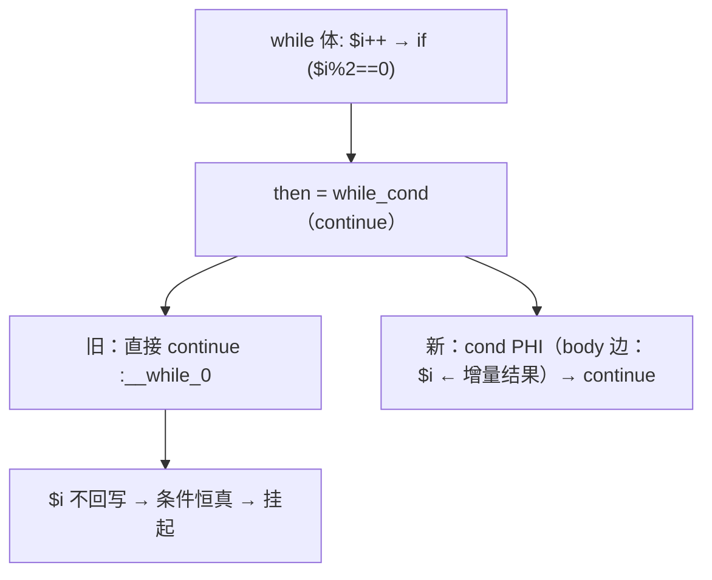
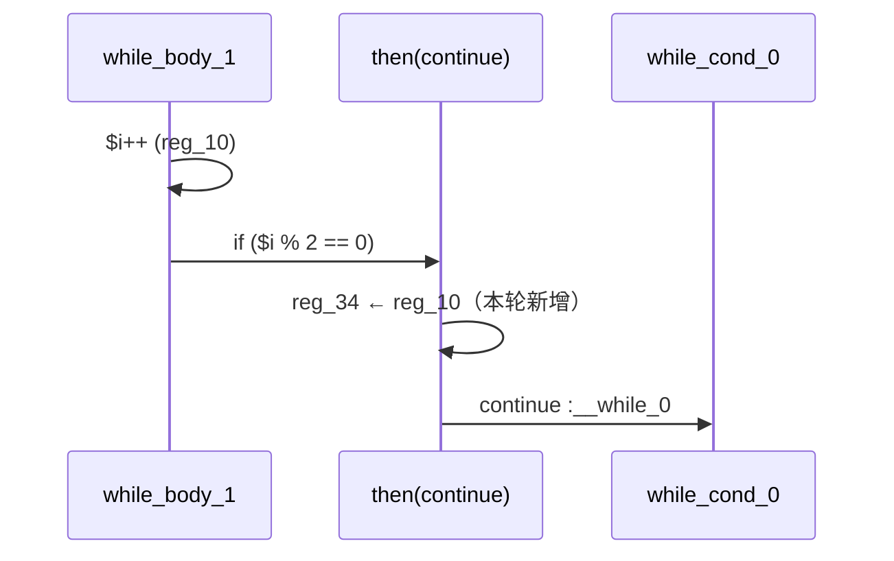

# AOT-CODEGEN-012 R-296：while 的 continue 臂物化循环携带 PHI（F-206-c 死循环面闭环）

- 日期：2026-10-26
- 代次锚：**`nlk 7849cee054f6d6af9abb628d3be6bb66`**（本轮唯一改动）；`tpl 3408c5bdce84957f0fbf54c3d7574df3`／`opti 553a2e540da638f3766911b1f0941dd1`／`irg 0b7106338d5ffe1342caee961734b8d8`／`ir fb2bb442ca27b98cf1df7e109a240e1f` 未变
- 工单：`docs/known-issues/AOT-CODEGEN-012-class-name-case-insensitive-lookup.md` §204
- 提交：未提交（HEAD `01e8c61`）

## 1. 高层摘要（TL;DR）

`while ($i < $n) { $i++; if ($i % 2 == 0) { continue; } for (...) {...} }` 在 AOT 下挂起。根因是 `generateWhileFromLabels` 的 `then_is_back_edge` 快速路（then 块直接是 `while_cond`）只发 `continue :label`，不回写 cond 块的循环携带 PHI —— `$i++` 的增量结果留在 body 寄存器里，continue 路径读到上一轮 `$i`，条件恒真。修法是在 continue 前按 body 边物化 cond 块 PHI。修后 a8 可正常终止（`i=12` 正确）；内层累加器 `$c` 仍丢失，属循环尾 PHI 选取的另一面（F-206-c-b）。

## 2. 影响范围

| 层 | 影响 |
|---|---|
| 发射器（`native_linker.zig` / `generateWhileFromLabels`） | `then_is_back_edge` 快速路补 cond 块 PHI 物化 |
| 语义面 | 所有「while 体内 `if (...) continue;`」的形状 |
| for / do-while / if-else 发射器 | 未动 |
| 运行期模板 / 优化器 / IR | 未动 |

## 3. 核心变更

| # | 变更 | 说明 |
|---|---|---|
| 1 | continue 前物化 cond PHI | 只取 `incoming.block == body_block` 的边（增量结果所在边） |

**归因法**：给 while 发射器内全部 7 个 `continue :{s}` 发点编号（`ZIGPHP_TRACE_WC`），编译 a8 命中 **WC_SITE=1**（then 快速路）与 5（循环尾）；插桩随后全部移除。另两处未证的改动（`writeBrInLoopContext` 的 self-cond 守卫、循环尾 `br → cond` 的 phi 块）经 A/B 证明非必需，已回退，保持最小 diff。

**定向读数**

| 探针 | PHP | 修前 AOT | 修后 AOT |
|---|---|---|---|
| a8（while+continue+内层循环，n=12） | `6 i=12` | 挂起（rc=124） | **`0 i=12`**（可终止；`c` 值面见 §7） |
| b1–b4 / a4（for 族与 catch 形状） | 逐字节 | 正确 | **不受影响** |

## 4. 可视化概览（Code & Logic Map）

## 5. 详细变更分析

| 文件 | 变更点 |
|---|---|
| `src/aot/native_linker.zig` | `generateWhileFromLabels`：`then_is_back_edge` 分支在 `continue` 前物化 cond 块 PHI（body 边） |
| 门 | 复用 C339（for 族反证）+ C336–C338（邻域）；a8/a10 仍不在门内（F-206-c-b / F-206-d） |

## 6. 影响与风险评估

- **破坏式变更**：无输出语义变化；修复的是「continue 路径不写回循环变量」。
- **性能**：仅多几条 emit 期的 PHI 拷贝，运行时无额外开销（与原有回边物化同形）。
- **风险**：PHI 拷贝按 body 边匹配；若某形状的 continue 边来自非 body 块，仍会走旧口径（不会更坏）。
- **复测路径**：a8 定向；C339/C338/C337/C336；邻居 C328–C335；`zig build test`；主回归。
- **读数**：a8 可终止；C339 **13/13**、C338 **15/15**、C337 **16/16**、C336 **18/18**；邻居 C328 6/6、C329 4/8（F-191）、C330 5/5、C331 7/7、C332 13/13、C333 7/7、C334 8/8、C335 14/14；`zig build test` **21/21、326/326**；主回归 **PASS=68 FAIL=0**（`/tmp/r296_regression.log`，SELF_CHECK_OK rows=68 uniq=68）

## 7. 遗留问题/潜在问题

- **F-206-c-b（P1，值面）**：while 循环尾的 cond PHI 选取用了 body incoming（生成码 `reg_35 = reg_35`、`reg_33 = reg_33` 自拷贝），真实更新在内层循环退出边（`for_cond_5`/`for_body_6` 的 `%36/%32`）⇒ `$c` 丢失（0 vs 6）。修法方向：循环尾优先采用 `last_loop_fallthrough_src_idx`／内层循环退出块作为 incoming 来源，须以 b1–b4＋a8 反证。
- **F-206-d 仍在**：`if/else` 分支内 continue + 内层循环 ⇒ 输出为空。
- F-206-b（嵌套循环内带 echo 的字符串累加）仍在。

## 8. 后续建议

| 优先级 | 建议 | 影响面 | 落地成本 |
|---|---|---|---|
| P0 | F-206-c-b：while 循环尾 PHI 的来源块选择（接入 `last_loop_fallthrough_src_idx`） | 循环发射 | 中 |
| P1 | F-206-d：if/else 臂内 continue 的值/控制流丢失 | 循环发射 | 中 |
| P1 | F-206-b：循环体 merge phi 值面（与 F-117/F-158 合并） | 循环发射 | 高 |
| P2 | F-206-c-b/d 闭后把 a8/a10 加回 C339 | 门覆盖 | 低 |
